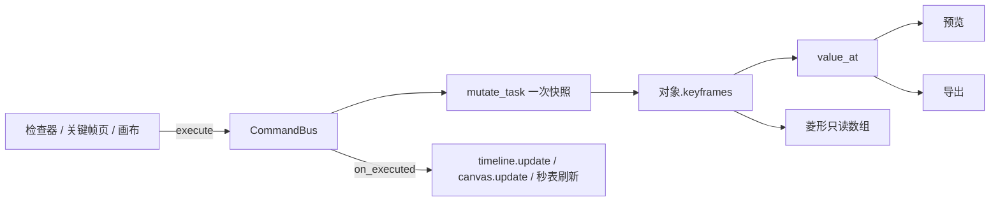
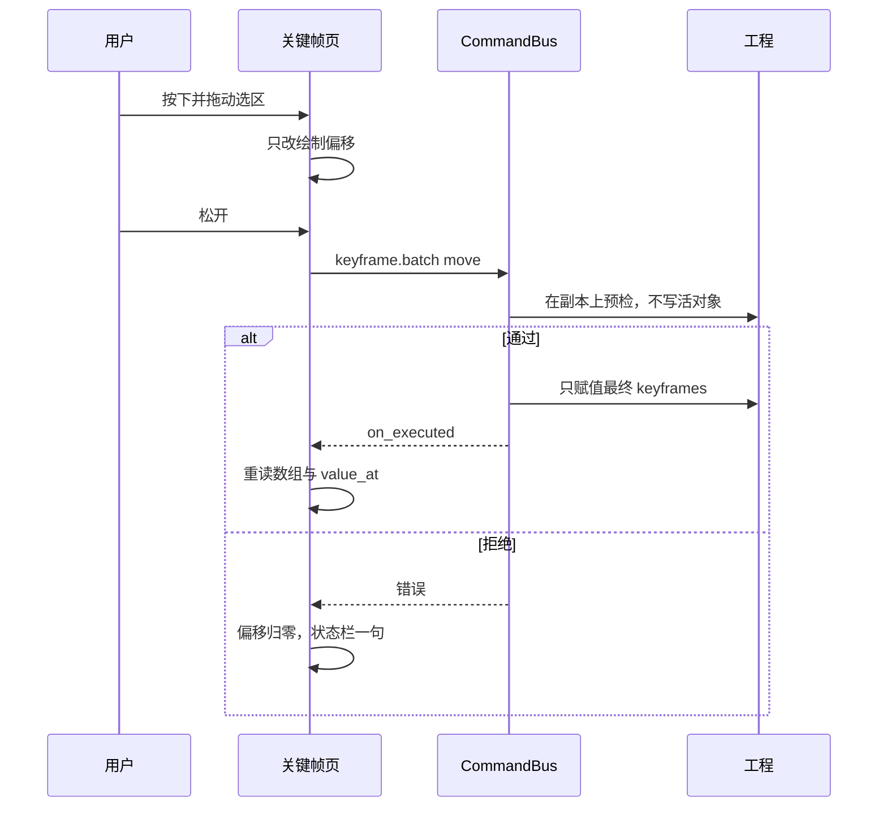

# 关键帧系统 2.0 设计

| 项 | 值 |
|---|---|
| 状态 | Draft |
| 作者 | Grok design-doc-writer |
| 日期 | 2026-09-22 |
| 受众 | Luca（产品）与 Claude（实现前复核） |
| 入库路径 `docs/plan/KEYFRAME_SYSTEM_2_DESIGN.md` | `docs/plan/KEYFRAME_SYSTEM_2_DESIGN.md` |
| 合同 | `docs/plan/KEYFRAME_SPEC.md`。预览与导出只读 `cutora.render.keyframe.value_at`。无 `keyframes` 的老工程像素与音频字节不变 |

本文只设计，不改 `cutora/`、`tests/`。

---

## Overview

Q31 / Q62 已经把关键帧写进工程：`keyframes` 挂在对象上，`t` 是相对对象起点的秒，`ease` 在左端点，六种缓动，预览和导出共用 `value_at`。检查器在视频的位置 / 缩放 / 旋转 / 不透明度（以及音频 `gain_db`）旁有秒表；时间线在片段底部画一条 10px 金色菱形带。缺的是：一块能同时看见多条片段、能框选成组挪动、能看数值曲线和一键缓动的面板，以及文本 / 图片 / 贴纸 / 字幕样式上同一套秒表。

2.0 不新做求值器，不新做撤销栈，不新做渲染器。时间线工具条增加「时间线 | 关键帧」切换。关键帧模式在**同一块时间线区域**里换成参数行（多片段同时可见，可独奏一条）。曲线是这些行的子模式，折线按像素列调用 `value_at` 采样。缓入 / 缓出 / 缓入缓出只改已有 `ease`。弹性 / 回弹在点击时展开成若干普通关键帧，播放时仍走 `value_at`。所有写操作走命令总线，一次手势一次工程快照。

## Background & Motivation

现状（已读代码，不是回忆）：

- 数据与命令名以 `docs/plan/KEYFRAME_SPEC.md` 为准。实现在 `cutora/render/keyframe.py`：`EASE_NAMES`、`HIT_EPS = 1/60`、`value_at`、`set_point`、`move_point`、`set_interp`、`enable_path` / `disable_path`。
- 命令注册在 `cutora/core/cmds/specs_edit.py`（`keyframe.set` 起约 1266 行），实现在 `cutora/core/cmds/light.py` 的 `cmd_keyframe_*`，经 `_mutate_edit` → `mutate_task`。`undoable=True` 的命令由 `CommandBus.execute` 在调用前 `push_undo`（`cutora/core/commands.py` 约 191–204 行）。`keyframe.copy` 的 `undoable=False`。
- 片段底部菱形：`TimelineWidget.KF_BAND_H = 10`、`KF_DIAMOND = 7`，颜色 `current().accent`（`cutora/ui/timeline/widget.py` `_paint_keyframe_band`）。右键菜单文案是「删除关键帧 / 缓动 / 复制 / 粘贴」，缓动六项为「线性、渐入、渐出、渐入渐出、保持、贝塞尔」。
- 秒表：`KeyframeWatch`（`cutora/ui/widgets/inspector.py`）。视频页只挂了 `x` `y` `scale` `rotation` `opacity`（`property.py` `init_video_panel`）。音频 `gain_db` 在 `on_change` 路径里走 `_auto_key`。文本覆层、图片覆层、字幕样式面板没有秒表。
- `on_change_video` 在 `_auto_key` 之后仍然写 `clip.x = …` 等静态字段（`property.py` 约 1644–1665 行）。这违反规格「已启用关键帧则必须走 `keyframe.set`，不许直接写静态字段」。
- 画布拖拽 `_commit_host_param`（`cutora/ui/canvas.py`）在路径已启用时直接 `set_point`，不经命令总线，且 `set_point` 默认 `ease="linear"`，会把已有缓动冲掉。
- `_kf_host` 只对 `target=clip` 调用 `assert_unlocked`。`overlay` 与 `style` 返回的轨道是 `None`，锁定轨挡不住（`light.py` `_kf_host`）。
- 轨道高度 `TRACK_HEIGHT_COMPACT/STANDARD/HIGH/MAX = 24/40/64/160`（`cutora/model/timeline_model.py`）。左侧 `TrackHeaderPanel` 与轨道行一一对齐，`PANEL_W = 214`。检查器行高归 Claude，不许改 `INSPECTOR_ROW_H`、QSS、dock 宽度（`docs/plan/queue/_RULES_UI_OWNERSHIP.md`）。

用户要的是专业动画，但第一次使用不能先学一套新窗口。所以面板必须长在现有时间线工具条上，默认仍是今天的时间线。

## Goals & Non-Goals

**Goals**

- 一个时间线内的关键帧模式：多片段的已启用参数同时可见，可独奏一条宿主。
- 框选、Shift 加选、成组平移、Alt 拖复制、成组时间拉伸。跨片段按参数路径粘贴。
- 数值曲线 + 贝塞尔手柄。一键：缓入 / 缓出 / 缓入缓出 / 弹性 / 回弹。
- 凡是本期会动画的行，检查器秒表规则相同。
- 预览与导出仍只调用 `value_at`。无关键帧工程字节不变。导出耗时不因「多了一套求值器」变慢。
- 一次手势一次撤销，沿用工程快照。

**Non-Goals**

- 第二套求值器、GPU 曲线、新渲染后端、磁盘预览缓存（T14 附录已否掉磁盘渲染缓存）。
- 关键帧源媒体、`in_t` / `out_t` / `start_t`、文本 `content`、速度 `speed`（变速会改时长，和局部 `t` 不是同一件事）。
- 轨道级 `track.props` 关键帧（规格「本版不做」，2.0 仍不做）。
- 把 `anim_engine` 的 `elastic` / `bounce` / `back` 注册进 `EASE_NAMES`。
- 放松 `bez` 的 0–1 钳制，让一条三次曲线做出过冲。见第 2 节。
- 转场胶带成为关键帧宿主。见 Open Questions，推荐不做。
- 调色色轮、曲线、HSL、LUT 路径、`lift` / `gamma` / `gain` 向量。只计划两个一维标量，且放在最后一期。
- 改检查器行高、`tokens.py`、`theme_dark.qss.j2`、右侧 dock 宽度。

---

## 1. 对照调研

版本与打开情况写在每条后面。菜单名只写打开页面或已读 PDF 里出现的词。没读到正文的标「未能核实」，不拿来做决定。

### DaVinci Resolve 20（Cut / Edit）

出处：Blackmagic《DaVinci Resolve 20 New Features Guide》PDF，已读第 13–21 页（页脚 “DaVinci Resolve 20 Cut and Edit”）。URL：`https://documents.blackmagicdesign.com/SupportNotes/DaVinci_Resolve_20_New_Features_Guide.pdf`。20.2 的增量已读《DaVinci Resolve 20.2 New Features Guide》第 14–15 页，URL：`https://documents.blackmagicdesign.com/SupportNotes/DaVinci_Resolve_20.2_New_Features_Guide.pdf`。

- **在哪打关键帧。** 关键帧编辑器是 Cut 和 Edit 左上角的 **Keyframes** 标签页，不再只关在时间线里。每条参数行上的菱形：播放头处没有点时菱形是白的，有点时是橙的；点击菱形在当前时间加一个点。左右箭头跳到上一个 / 下一个关键帧。Inspector 里原有的关键帧仍然会出现在这个列表里（指南写 “any existing keyframes that may have been added there”）。
- **怎么看到所有关键帧。** 默认 Keyframe Editor 列出 Video Inspector 里所有可关键帧参数，按 Transform / Cropping 等组折叠。三点菜单有 **Display Parameters with Keyframes**（只显示已有点的行）。时间线工具条上的 **Show Keyframe Tray** 在时间线里再开一屉，行为与面板相同。右上角 Expand 可把编辑器变成独立可缩放窗口。
- **怎么批量选 / 移 / 复制。** 点选一个点；Command-click 多选不连续点；在轨道上拖框选连续点；选中后左右拖。复制是系统剪贴板：Cut / Copy 后把播放头放到目标起点再 Paste，第一个点对齐播放头。Delete 删除选中点。组轨道上移动一个点会带动该组里同一时间的点。20.2：选中点可用 **Mark > Move Selected Keyframe…** 上下左右挪一帧；时间线 keyframe tray 与主编辑器共用 actions toolbar。
- **缓动怎么调。** Curve 图标进入曲线编辑器。工具条按钮的英文就是指南写的：**Linear**、**Ease In**、**Ease Out**、**Ease In and Out**，外加 **Show Handle** 开关贝塞尔手柄。可多选后一次改插值。Option-click 曲线加控制点。Shift 拖限制在一个轴上。20.2：Option-click 某条的锁或 “show curve” 会独奏这一条参数（再点一次则反过来只关掉它、打开其余）；Shift-click 则同时切换全部参数。
- **新手好懂、CUTORA 该学。** 一个显式的 Keyframes 入口，而不是把参数行撑进片段条。菱形 + 左右箭头表达「这里有没有点 / 跳到相邻点」。只显示已有关键帧的过滤，避免一打开就是整张 Inspector。缓动是四个文字按钮，不是先打开速度图。
- **不该学。** 默认列出「全部可动画参数」——指南自己写这张表会 overwhelming，然后教用户去过滤。CUTORA 行数少，默认只画已启用路径，再加当前选中宿主的空行入口。不学 Fusion 的 Spline Editor（那是另一本手册、另一页）。不学「关键帧可以留在裁掉的片段范围之外、用 `[` `]` 还能跳到看不见的点」——CUTORA 的 `t` 只保证 ≥ 0，片段裁短后的点是否保留由 `split_keyframes` 管，2.0 不新增「隐形点」模型。

### Premiere Pro（Effect Controls）

出处：Adobe Help，已打开并读到正文。

- `https://helpx.adobe.com/premiere/desktop/add-video-effects/control-effects-and-transitions-using-keyframes/keyframes-and-graphs-in-panels.html`（Last updated Aug 22, 2025）
- 同目录 `edit-keyframes-graphs.html` 的检索摘录写到 Value graph 与 Velocity graph；本次 `open_page` 该 URL 时正文被导航栏淹没，**Value/Velocity 的按钮图标名未能在渲染后的正文里复核**。下面关于「两个图都存在」采用 2025-08-22 那篇已读正文，不发明图标名。

- **在哪打关键帧。** Effect Controls。已读正文没有写出秒表的英文按钮名，**按钮标题未能核实**，不写进实现。
- **怎么看到所有关键帧。** Effect Controls 同时显示该片段全部效果属性、关键帧和插值。时间线里一次只显示一个效果属性。时间线不能改 Position 这种带 x/y 的值，但可以不离开时间线改时间。
- **怎么批量选 / 移 / 复制。** 同目录有 Copy and paste keyframes、Select keyframes 页面。本次没有打开到那些页面的正文，**批量手势的键鼠细节未能核实**。已读到的结构事实是：完整编辑在 Effect Controls，时间线是单属性的窄视图。
- **缓动怎么调。** 已读正文：图是平的表示两键之间值不变；图升降表示值增减；用插值方法和贝塞尔曲线改变速度与平滑。检索摘录把图分成 Value graph（属性值）和 Velocity graph（变化率）。**不把 Velocity 的手柄方向写成已核实的操作步骤。**
- **新手好懂、该学。** 「所有已动画属性堆在一处，时间轴与片段对齐」。这是心智模型，不是让我们克隆 Effect Controls 面板。
- **不该学。** 时间线一次只能展开一个属性，多片段对比要来回点。速度图和值图是两套纵坐标（值 vs 变化率），新手会把速度图的高度当成位置。CUTORA 只做值曲线。Position 在时间线里不能改值，说明「在 40px 片段条里改 x/y」本来就不够，更不该学。

### After Effects（Graph Editor）

出处：Adobe Help，均已用正文检索读到原文。页面 Last updated 以打开结果为准。

- Animation basics，2026-01-21：`https://helpx.adobe.com/after-effects/desktop/animate-in-after-effects/animation-basics/animation-basics.html`
- Speed：`https://helpx.adobe.com/after-effects/desktop/animate-in-after-effects/speed-between-keyframes/speed.html`
- Editing, moving, and copying keyframes：`https://helpx.adobe.com/after-effects/desktop/animate-in-after-effects/animation-keyframes/editing-moving-copying-keyframes.html`
- Keyboard shortcuts：`https://helpx.adobe.com/after-effects/desktop/get-started/keyboard-shortcuts/keyboard-shortcuts-reference.html`

- **在哪打关键帧。** Timeline 或 Effect Controls 里属性名左边的 **stopwatch**。秒表激活后，改值会在当前时间自动打点或改点。秒表关闭时属性没有关键帧；关掉秒表会删掉该属性全部关键帧，常量变成**当前时间的值**（原文：constant value becomes the value at the current time）。Auto-keyframe 是时间线面板菜单里的额外模式，CUTORA 不学。
- **怎么看到所有关键帧。** 图层条模式是默认。Graph Editor 按钮在时间线里切换，不显示图层条，而显示 value graph 或 speed graph。快捷键表：**U** = Show properties with keyframes，**UU** = Show only modified properties，**Shift+F3** 在 Graph Editor 与图层条之间切换。Show Properties 菜单里有 **Show Animated Properties**（选中图层上已动画的属性）。
- **怎么批量选 / 移 / 复制。** Graph Editor 里 Shift-click 或拖框。选中多个点且 **Show Transform Box** 打开时，出现自由变换框和中心锚点。在框内拖是平移（时间或值）；拖边上手柄是缩放。值图里缩放同时改时间和值；速度图里缩放只改时间。负向缩放会把关键帧在时间上反过来。复制后粘贴到另一图层的**同名属性**；最早的点落在当前时间，其余保持相对间隔。
- **缓动怎么调。** 值图看属性值，速度图看变化率。时间性属性（如 Opacity）默认值图；空间属性（如 Position）默认速度图。Easy Ease：快捷键 **F9**；Easy Ease In 是 **Shift+F9**；Easy Ease Out 是 **Ctrl+Shift+F9**（macOS 为 Command+Shift+F9）。正文写：施加 Easy Ease 后，该关键帧两侧速度为 0、influence 33.33%。Graph Editor 底部有 Easy Ease / Easy Ease In / Easy Ease Out 按钮。速度图的高度是速率不是值；手柄上下是快慢，左右是 influence。
- **新手好懂、该学。** 秒表的三态语义（关 = 没有帧；开 = 改值就打点；关掉 = 删光并留下当前值）。U 的思想：只展开已动画的行。一键 Easy Ease，而不是先逼用户拖手柄。变换框只在**时间**方向缩放时，用值图的水平缩放即可，不要把值一起缩放（那是另一手势）。
- **不该学。** 速度图当默认。空间/时间两套插值、roving keyframes、表达式、pick whip、分离 Position 维度。F9 与 UU 不能照搬：CUTORA 的 `F` 已是全屏预览，`U` 无占用但窗口级单字母会和以后的快捷键打架；2.0 的缓动按钮用中文，快捷键只在关键帧页里用 `[` `]`。influence 33.33% 是 AE 速度图的定义，我们的 `ease_in_out` 已是固定三次曲线，不暴露 influence 数字。

### Final Cut Pro（Video Animation）

打开 `https://support.apple.com/guide/final-cut-pro/add-video-effect-keyframes-ver8e3f20ea/mac` 与 10.6.2 / 曲线文章的版本 URL。页头能看到 Final Cut Pro for Mac 12.3 等版本链接，**正文是动态加载，本次没有读到操作步骤**。检索工具对文章 ID `ver8e3f20ea`（10.6.2）和曲线文 `ver8e3f1f04`（10.5.3）返回过摘录，提到 Video Animation、Control-V、白色菱形、Option-click / Option-K，以及曲线选项 Linear / Ease / Ease In / Ease Out。这些句子**没有在打开后的 HTML 正文里复核**。

因此：

- 在哪打、怎么看、怎么批量、缓动的菜单名：**未能核实**。不写进快捷键表，不作为 2.0 的出处。
- 该学 / 不该学：不基于未核实的 FCP 步骤做决定。唯一保留的负面约束来自 CUTORA 自己的轨道高度（见下），不是来自 FCP。

### 剪映专业版 / CapCut

打开 `https://www.capcut.cn/learning/topic_detail/7128272592783428894`（检索结果称之为剪映官网课程页）。页面正文没有匹配到「关键帧」。`jianying.com` 专业版产品页没有控件说明。博客、B 站、抖音文稿里的「显示关键帧动画」「Alt+K」「直线 / 自动曲线 / 自由曲线」**未能核实**，不采用。CapCut 桌面第三方教程同样不采用。

六个问题的答案都是：**书面官方步骤未能核实**。2.0 不引用剪映的菜单名。若以后补到官方帮助，再决定要不要加「曲线预设」的产品措辞；现在的缓动按钮出处是 Resolve 20 曲线工具条和 AE 的 Easy Ease，不是剪映。

### 对照表

| | 打点的地方 | 看全部点 | 批量 | 缓动 | 2.0 取舍 |
|---|---|---|---|---|---|
| Resolve 20 | Keyframes 页菱形；Inspector 里已有的点会进来 | 参数行列表；可只显示已有点；时间线 Tray | 框选、多选、拖移、复制后对齐播放头粘贴 | Linear / Ease In / Ease Out / Ease In and Out + 手柄 | **学入口、菱形+左右箭头、只显示已有点、四个缓动按钮、Option-click 独奏参数** |
| Premiere（2025-08-22 文） | Effect Controls | 面板看全部属性；时间线一次一个属性 | 正文未写到手势，**批量键鼠未能核实** | 值图 + 速率图（速率图图标名未能核实） | **学「属性与时间对齐的一张表」；不学速率图，不学时间线单属性** |
| AE（2026-01-21 等） | stopwatch | U = 只看有关键帧的属性；Graph Editor | 框选；Show Transform Box 缩放时间 | F9 Easy Ease；值图 vs 速度图 | **学秒表关闭=删光并留下当前值；学一键缓动；学变换框的水平缩放。不学速度图、不学 F9** |
| FCP | 未能核实 | 未能核实 | 未能核实 | 未能核实 | 不作为出处 |
| 剪映专业版 | 未能核实 | 未能核实 | 未能核实 | 未能核实 | 不作为出处 |

### CUTORA 要抄的五条（都有出处）

1. **独立的关键帧视图，而不是把参数行塞进片段条。** 出处：Resolve 20 指南第 13 页 “rather than confining them to the timeline”；加上 `TRACK_HEIGHT_MAX = 160`，六行×24px 已到 144，再加组标题就超高，且会拆开 `TrackHeaderPanel` 与轨道行的对齐。
2. **菱形 + 上一帧 / 下一帧，当前时间有点则菱形实心。** 出处：Resolve 20 指南第 15 页 Keyframe 控件（菱形橙/白，左右箭头）。CUTORA 已有实心/空心画法（`_paint_keyframe_band`：播放头命中则填充 `accent`）。
3. **默认只列出已有关键帧的参数，选中对象再给一行入口。** 出处：Resolve 20 指南第 14 页 Display Parameters with Keyframes；AE 快捷键表 U。
4. **缓入 / 缓出 / 缓入缓出是按钮，不是速度图。** 出处：Resolve 20 指南第 20–21 页工具条 Linear、Ease In、Ease Out、Ease In and Out。AE Speed 页的速度图明确不抄。
5. **关掉秒表时，常量变成当前时间的值，并删除全部点。** 出处：AE Animation basics 2026-01-21 原文。这修正今天「边打点边写静态字段」的双写，见第 2 节状态机。

---

## 2. CUTORA 的交互设计

### 2.1 主模型：时间线工具条切换，不展开片段

**决定：主模型是时间线工具条上的「时间线 | 关键帧」。** 曲线是关键帧模式里的第二下开关「菱形 | 曲线」，不是第三个顶层模式，也不是默认就弹出的独立窗口。

**理由。** 片段条高度不够（`TRACK_HEIGHT_*`，见上）。Effect Controls 式的「每条片段向下撑开参数行」会让左侧轨道头和右侧轨道错位，`TrackHeaderPanel` 今天按轨道行画按钮（静音、独奏、锁定）。Resolve 把关键帧请出片段条，同时仍和时间线共用时间刻度——CUTORA 已有 `pixels_per_second`、`scroll_x`、`position`（毫秒）和 `position_changed`。独立 AE 式窗口对第一次使用太贵：用户必须先发现窗口。工具条上已经有「选择 / 切刀 / 变速 / 磁铁」（`cutora/ui/timeline/container.py` 的 `tools` 布局），加一对按钮是同一行，不新开 dock。

**拒绝的两个模型（也见 Alternatives）。**

- 每条片段展开参数行：和轨道头锁定在一起，160px 上限装不下，多片段同时展开会把时间线撑爆。
- 默认独立曲线窗口：没有现成的可停靠面板系统给它；检查器宽度归 Claude，不能把曲线塞进右侧 dock 的第一期。Expand 到独立窗口可以以后做，不是 2.0 的主路径。

**和现有工具的关系。** 新按钮用另一组 `QButtonGroup`，不放进 `_tool_group`（选择/切刀/变速是互斥工具）。默认「时间线」。切到「切刀」或「变速」时强制回到「时间线」，避免刀和菱形抢同一次按下。磁铁 `snap_enabled` 继续有效。

```
时间线工具条（已有，container.py tools）
[ 选择 ] [ 切刀 ] [ 变速 ] [ 磁铁 ]     [ 时间线 | 关键帧 ]  ……拉伸……

「时间线」= 今天的 TimelineWidget（标尺、轨道、片段、底部 10px 菱形带）
             左侧 TrackHeaderPanel 照常显示，宽 PANEL_W=214
「关键帧」= 同一 TimelineWidget.paintEvent 里的另一种绘制
             TrackHeaderPanel.setVisible(False)，横向滚动条前的 PANEL_W 占位改为 0
             参数名只画在页内 96px 标签列，不画进轨道头
```

**坐标只有一套，和今天的时间线相同。** `paintEvent` 已经 `painter.translate(-self.scroll_x, 0)`（`widget.py` 约 2429 行）。菱形的世界坐标是 `(host_start + t_local) * pixels_per_second`，**不要再减 `scroll_x`**。命中用 `real_x = widget_x + scroll_x`（`contextMenuEvent` 约 4432 行，`_hit_keyframe` 吃的就是这个 `real_x`）。纵轴不在这次 translate 里：行顶 = `RULER_H + 内容 y - scroll_y`，与 `_track_positions` 里 `row_y = y - scroll_y` 同一约定；命中用 `event.pos().y()`，不要加 `scroll_y`。标签列要钉在视口左边：在已平移的画家里画在世界 x = `scroll_x`。

**`TrackHeaderPanel` 在关键帧模式整块隐藏，不改成参数组列表。** 它的行是轨道行（`PANEL_W = 214`），参数行是「宿主 × 已启用路径」，两边对不齐。`TimelineContainer` 里 `v_scrollbar.valueChanged` 今天同时调用 `timeline.set_scroll_y` 和 `track_header.set_scroll_y`（`container.py` 约 69–71 行）。关键帧模式只把滚动值交给 `timeline.set_scroll_y`，**不要**再调用 `track_header.set_scroll_y`。离开该模式时恢复轨道头可见、占位 214、以及原来的双连接。`Track.height` 不变。

模式存在 `TimelineWidget` 的会话字段上，**不写入工程 JSON**。理由：和 `_solo_ids`、轨道图钉一样是会话状态（`Track.pinned` 注释写明不存工程）。重开工程回到「时间线」，避免用户以为工程坏了。

### 2.2 关键帧页线框

坐标见 2.1：横轴是时间线秒，画在已经 `translate(-scroll_x)` 的世界坐标里，`x = (host_start + t_local) * pixels_per_second`。`t_local` 存在关键帧里，单位秒，相对宿主起点，与 `KEYFRAME_SPEC` 一致。纵轴是参数行（widget 坐标减 `scroll_y`），不是数值。数值只在曲线子模式里出现。左侧轨道头不出现在这张线框里。

```
┌标尺（沿用 _draw_ruler，RULER_H=24）─────────────────────────────┐
│ 播放头：1px，色 current().err（与 _draw_playhead_marker 同一 err）│
├组标题 24px bg2──────────────────────────────────────────────────┤
│ 片段名 / 覆层名                         [只看]                    │
├参数行 ROW_H=24 bg1（偶数行 bg0）────────────────────────────────┤
│ 位置 X    ◆        ◇              ◇                              │
│ 缩放      ◆───────────────◇                                      │
│ 不透明度  ◇                                                       │
├下一条片段────────────────────────────────────────────────────────┤
│ ……                                                                │
├底部（仅曲线子模式才出现，见 2.4）────────────────────────────────┤
└横向滚动条与今天共用──────────────────────────────────────────────┘
```

- 组标题高度 24 = `ROW_H`（`tokens.py`，给时间线用不给检查器）。不要用 `INSPECTOR_ROW_H` 32，那是右侧面板的。
- 左标签列宽 96px，字号 `FONT_LABEL` 12，色 `fg1`，背景不新建 token。超长名字省略，tooltip 给全名。
- 菱形边长仍是 `KF_DIAMOND = 7`，垂直居中。命中：水平方向中心 ±（7/2+2）= ±5.5px，与 `_hit_keyframe` 一致；垂直方向整行 24px 都可点。两个中心都落在容差内时，取**离指针更近的中心**。今天 `_hit_keyframe` 返回路径字典里先碰到的那个，关键帧页不要继承这个歧义。
- 无关键帧的片段不占组。当前时间线选中的那一个宿主如果还没有点，仍显示一组空参数行，用来打第一个点。打点手势在 2.3，不是「点空白就 seek」。理由：Resolve 的「只显示已有点」会让第一次打点没地方点；选中对象补一组空行，其余片段保持干净。
- 纵向滚动就是时间线已有的 `scroll_y`，由同一根 `v_scrollbar` 驱动，但只进 `TimelineWidget`。轨道头此时是隐藏的，不跟滚。锁定状态仍在命令里拒绝，组标题用 `fg_muted` 并禁止拖动，tooltip「轨道已锁定」。
- 字幕样式不是一条片段。`task.style.keyframes` 的 `t` 相对**每一条**字幕 `event.start` 重放（`frame_renderer.draw_subtitle` 用 `local_time(event, …)` 再 `bake_host`）。页上只把「含播放头的那一条字幕」画成可点菱形；其他字幕上用 40% alpha 的空心菱形，**不可点**。拖动改的是共享数组，每一句一起变。组标题写「字幕样式 · 每句从头重放」。不要画成 N 条看起来能单独编辑的线。

**独奏。** 组标题按钮文案「只看」，不要用轨道头那个 “S”。轨道独奏是静音语义（`TrackHeaderPanel` 的 solo），存在 `_solo_ids`。关键帧独奏是另一集合，建议字段名 `TimelineWidget._kf_solo_key`，会话级，不进工程。有独奏时只画那一个宿主的行；再点一次取消。没有 Resolve 20.2 那种「Option-click 曲线图标独奏单参数」——那是参数级。CUTORA 第一期独奏的是**整条宿主**。参数级显隐用行首眼睛，默认开；眼睛状态也是会话级。

**播放头在页内。** 不画第二个播放头三角。垂直线用 `err`，世界坐标 x = `playhead_seconds * pixels_per_second`。点击**标尺**或**组与组之间的空隙**才 seek：把 `position` 设到该时间，清空关键帧选区，发已有 `position_changed`。点在参数行上不是 seek，见下表。检查器已经把 `position_changed` 接到 `_refresh_kf_watches`。

### 2.3 选择、移动、复制、拉伸

选择对象是三元组 `(host_ref, path, t)`，`t` 用 `HIT_EPS` 比较，不把浮点当字典键。`host_ref` 沿用命令寻址：`target=clip` 加 `track_id`+`clip_index`，`target=overlay` 加 `list`+`overlay_index`，`target=style` 无下标。

| 手势 | 行为 |
|---|---|
| 单击菱形 | 只选中该点。不移动播放头 |
| Shift+单击 | 切换该点是否在选区里 |
| 在行间空白拖出矩形 | 中心落在矩形内的菱形被选中。Shift+拖则并入选区 |
| 单击标尺，或组与组之间的空隙 | 播放头移到该时间，清空关键帧选区。**不打点** |
| 单击参数行（没点中菱形，含空行） | **打点，不 seek，不清选区。** `t` = 播放头的局部秒（`local_time`），不是点击处的 x。路径还没有点：`keyframe.enable enabled=true`，`v` = `read_path` 的静态值。路径已有点且播放头不在点上：`keyframe.set`，`v` = 当前 `value_at`。播放头已经在点上：只选中该点，不新建。这是第一个点和第二个点的同一手势 |
| 拖选区中任意一点 | 选区全体加上同一个 `Δt`（秒）。拖的过程只改绘制偏移，**松手才发命令** |
| Alt+拖 | 不移动原点，在 `t+Δt` 复制选区（值、ease、bez 原样） |
| 选区时间范围的左或右 6px | 水平缩放时间。锚点是对面那条边。只改 `t`，不改 `v` |
| Ctrl+C / Ctrl+V | 见 2.7。选区非空时复制 / 粘贴关键帧，并拦住字幕段的 Ctrl+C |
| Delete / Backspace | 删除选区。选区为空则不拦截，交给时间线现有按键 |

`Δt` 的单位是秒，不加 `clip.speed`。规格例子：改 `start_t` 后局部 `t` 不变，动画跟着片段走。拉伸同理，缩放的是局部 `t`。

多片段同时在选区里时，拉伸的比例尺是**时间线上选区包络的宽度**：`scale = new_span / old_span`，每个宿主用自己选中点里最小的局部 `t` 当锚点（拖右缘时）。不要用一条绝对时间去乘所有宿主，否则不同 `start_t` 的片段会错相。

磁铁开着且 `snap_kinds["playhead"]` 为真时，松手前把选区包络的近边吸到播放头，吸的是整个 `Δt`，不是单独一个点。吸的阈值沿用时间线现有吸附，不新造像素值。实现时读 `widget.py` 里片段吸附用的像素阈值，关键帧用同一个数。

重叠：`move_point` 今天会丢掉目标时间上已有的点，并且 `t_to = max(0, t_to)`（`keyframe.py` `move_point`，约 267–272 行）。成组命令不允许这种静默丢失。预检看的是**钳制之后的意图时间** `max(0, t)`，不是调用 `move_point` 的结果（调用它会先把目标点丢掉，重叠就看不见了）。同一宿主同一路径上若有两个存活点 `|Δt| ≤ HIT_EPS`，包括全体被钳到 `t = 0`，**整批拒绝**，状态栏一句「关键帧叠在一起了，松开前请再拉开」。原子性见 3.3，不要靠 `_pop_undo` 回滚。

Alt+拖若目标处已有点，同样整批拒绝，不覆盖。覆盖是 `set_point` 的旧语义，留给检查器在播放头上改值，不留给批量复制。

### 2.4 曲线子模式

关键帧模式开着时，工具条右侧再加「菱形 | 曲线」（仍是 `QToolButton`，不新控件皮肤）。默认菱形。曲线视图：

- 上半仍是参数行和菱形，高度压到每行 24，让出下半。
- 下半是**一条**值曲线，对应参数行里点中的那一行。没点中行时，下半是空状态一句「点一行参数看曲线」，色 `fg2`。
- 横轴与上半锁定（同一 `scroll_x`、同一播放头）。
- 纵轴是该参数自己的单位（`x` 为画布像素，`scale` 为倍率，`rotation` 为度，`opacity` 为 0–255，`gain_db` 为 dB，`tracking_em` 为 em）。自动范围 = 可见点的 min/max，上下各留 10%。若 min=max，数值路径 ±1，`scale` ±0.1。
- 折线：每个横像素列调用一次 `value_at(host, path, t_local, fallback)`，把返回值映射到纵像素。`hold` 会自然画成台阶，因为 `ease_unit` 在 `u<1` 时返回 0。不要在 UI 里再写一套 ease 公式。
- 折线按数据缓存，不按播放头缓存。播放时只移动竖线。命令或撤销后丢掉缓存。这是界面折线，不是渲染缓存。
- 颜色（第 2.6 节）按路径固定，不按曲线随机上色。
- 颜色路径（`fill.colors[0]`）**没有值曲线**。点那一行时下半写「颜色沿 OKLab 插值，不能当一条数值曲线拖」，菱形仍可框选和移动时间。理由：`interpolate` 走 OKLCH，纵轴没有一个用户该拖的标量。

**手柄。** 只在左点 `ease=="bezier"` 时画出。手柄画在该段的单位正方形里：横轴 `u∈[0,1]` 映射到 `t0..t1`，纵轴 `eased_u∈[0,1]` 映射到 `v0..v1`。拖手柄发 `keyframe.set_interp`，`ease="bezier"`，`bez=[x1,y1,x2,y2]`。

必须对实现者写明钳制，避免做出「拖出过冲」的假象：

- `_bez_tuple` 把四个数都钳在 0–1（`keyframe.py` 约 529–539 行）。
- `_cubic_bezier_y` 把结果再钳在 0–1（约 723 行）。
- `interpolate` 把 `u` 再钳在 0–1（约 109 行）。
- 规格写 `bez` 是四个 0–1 的数。

所以手柄**不能**拖出这段值域。UI 在拖的时候就钳住，松手写入的数和画出来的曲线一致。x1/x2 必须落在 0–1，否则牛顿求解不保证单调，保持现状。

### 2.5 缓动预设：弹性 / 回弹不是一条三次曲线

按钮放在曲线视图顶边，五个：`缓入` `缓出` `缓入缓出` `弹性` `回弹`。作用对象是当前选区；没选区时作用播放头所在段的左点（若播放头在两点之间）。

| 按钮 | 写入什么 | 播放时谁算 |
|---|---|---|
| 缓入 | 每个选中的**非末尾**点 `ease=ease_in`，去掉 `bez` | `value_at` → `EASING_MAP["ease_in"]` 即 `ease_in_cubic` |
| 缓出 | `ease=ease_out` | 同上 |
| 缓入缓出 | `ease=ease_in_out` | 同上 |
| 回弹 | 一次点击只替换**该路径的一段**。采样 `anim_engine.ease_out_back`（不是 `ease_out_bounce`）。均匀 17 个 u。折线与函数的最大绝对误差 ≤ 0.02 | 只有 `value_at` 的线性插值 |
| 弹性 | 同样一次一段。采样 `anim_engine.ease_out_elastic`。均匀 49 个 u。同一误差上限 | 只有 `value_at` 的线性插值 |

**决定：弹性与回弹用方案 (b) 多关键帧预设。不新增 ease 名，不把它们塞进 `bez`。**

理由，对着代码而不是对着 CSS 的一般知识：

- 一条 CSS `cubic-bezier` 的 y 可以跑出 0–1，所以**在浏览器里**可以用一条曲线近似单次过冲（back）。CUTORA 的实现做不到：上面三处钳制把过冲削掉。规格也写了四个 0–1 的数。若为了回弹去放开钳制，已有 `bezier` 工程的像素会变，预览/导出契约要改。这不值得。
- `ease_out_elastic`（`anim_engine.py` 46–52 行）是衰减正弦，在 0–1 之间多次穿过 1。上面采样：`u=0.125` 时约 1.364，`u=0.25` 时约 0.912，`u=0.4375` 时约 1.047。一条三次曲线只有有限拐点，**不是振荡**。不许在文档或 UI 里把弹性画成一条立方贝塞尔。
- `ease_out_back` 是单次过冲（`u=0.55` 约 1.098，然后回到 1）。过冲写在 `v` 里。`value_at` 对数字是 `v0+(v1-v0)*eased_u`，`eased_u` 在 0–1，但 `v` 本身可以大于两端。五点折线不够：`u=0` 到 `u=0.40` 的弦在 `u=0.2` 约 0.515，函数约 0.706，误差约 0.19。所以不声称「五个点等于 back」。
- 按钮「回弹」对的是 `ease_out_back`，不是 `ease_out_bounce`。出处：`anim_engine.EASING_LABELS` 里已有 `("回弹", "back")` 和 `("弹跳", "bounce")`（约 128–131 行）。`bounce` 留在 0–1，没有这次要的过冲。**不要**把 `back` / `bounce` / `elastic` 写进 `EASE_NAMES`。
- `EASING_MAP` 里已有这些函数，但 `ease_unit` 与命令 enum 不认它们。加进 `value_at` 是方案 (c)。2.0 不付这个成本。采样只发生在**点击按钮的那一次**。预览和导出不调用这两个函数。

误差合同：对 `u ∈ [0,1]`，相邻采样点之间的弦与 `f(u)` 的最大绝对差 ≤ **0.02**。均匀网格已核对：`ease_out_back` 用 17 点（`u = i/16`）最大误差约 0.006；`ease_out_elastic` 用 49 点（`u = i/48`）最大误差约 0.016。实现必须调用函数本身，不要在 UI 里抄公式。测试对网格中点抽查 `|chord - f| ≤ 0.02`，不要只断言结点上 `value_at` 等于存进去的 `v`（那永远为真，看不出弦误差）。

一段的定义，防止点第二次变成 257 个点：每个路径每次点击只处理**一段**。有选区时，这段是该路径上被选中的最小 `t` 到最大 `t`。没选区时，是播放头所在的那一段（左点 `t ≤` 播放头 `<` 右点）。先删掉开区间 `(t0, t1)` 里的点，再按固定 u 网格写入。再点一次是替换同一段，不是把每个小段再拆 16 份。`span ≤ 1e-12` 则整批失败，不写。

`ease` 落在段的左点上（`KEYFRAME_SPEC`）。因此：

- 左点：`v` 改为 `v0 + (v1-v0)*f(0)`，`ease` 改为 `linear`，去掉 `bez`。
- 新的内部点：`ease=linear`，无 `bez`。
- **右点的 `ease` / `bez` 不动**（它管的是下一段）。`f(1) = 1`，所以右点的 `v` 也不必改。
- `(t0, t1)` 之外的点不动。

一次按钮 = 一条 `keyframe.batch`，一步撤销。

颜色路径上点弹性或回弹：命令失败，状态栏「颜色不能做弹性或回弹」。理由：过冲的 `v` 不是合法 `#RRGGBB`。

**第二个点的默认缓动（期 1，可计算）。** JSON 里没有「用户改过 ease」的位。`enable_path` 写下的 `linear` 和用户后来点的「线性」长得一样。规则因此只能看存储值：**某路径打出第二个点时，若左点的 `ease` 仍是 `linear`，同一次 `keyframe.batch` 把它改成 `ease_in_out`。** 不改 `set_point` 的默认参数，脚本直接 `keyframe.set` 两个 `linear` 点不受影响；只有关键帧页「单击参数行」打出第二个点时才升级。用户若要匀速，打完后用已有右键菜单里的「线性」（`_keyframe_context_menu`，期 1 的页复用这个菜单）再设回去。这是 CUTORA 自己的取舍，不是 AE：AE 的 Easy Ease 是另一次手势，不会自动改第一个点。

### 2.6 检查器：一条规则

凡是本期目录里标了秒表的行，控件相同，挂在 `InspectorRow.attach_keyframe` 已有的位置（重置按钮左边）。**不要改行高，不要新增图标文件。** 上一帧 / 下一帧是两个 20×20 的 `QToolButton`（`INSPECTOR_RESET_PX`），图标用清单里已有的 `skip-back` 和 `skip-forward`（`resources/icons/MANIFEST.json`）。没有 `arrow-left` / `arrow-right` / `chevron-left` / `chevron-right`。挤不下时这两个按钮不放进检查器行，只在关键帧页用 `[` `]`。视频页今天把秒表塞在数值框 trailing 里（`vid_x_kf` 等），新行优先走 `attach_keyframe`，视频页可以留着现有 trailing，但状态机必须一致。

秒表绘制沿用 `KeyframeWatch.paintEvent`：关 = `fg_muted` 空心；开且不在点上 = `accent` 空心；开且在点上 = `accent` 实心。不要新画一套。

CUTORA 没有「秒表关着但点还留着」的状态。`keyframe.enable enabled=false` 会 `disable_path` 删掉整条路径。所以「没有点」和「秒表关」是同一个状态。

| 状态 | 判定 | 秒表单击 | 行内改数值 | 上一帧/下一帧 |
|---|---|---|---|---|
| 关 | `not path_enabled` | `keyframe.enable enabled=true`，`t`=播放头局部秒，`v`=当前静态值。第一个点 `ease=linear` | 写静态字段，与今天非关键帧相同 | 无操作 |
| 开（无论播放头在不在点上） | `path_enabled` | **一律关掉整路**：`keyframe.enable enabled=false` 且带 `t`。命令先把静态字段写成 `value_at(播放头)`，再 `disable_path`。在点上点秒表也是这一条，不是 `keyframe.delete`。改完一个值之后播放头通常就在那个点上（实心菱形），这一下必须还能关掉 | 在点上：`keyframe.set` 覆盖 `v`，沿用该点原来的 ease/bez。在两点之间：`keyframe.set` 新点，`v`=用户刚改的值；第二个点的 ease 规则见 2.5 | 把时间线 `position` 设到相邻点的绝对毫秒，发 `position_changed` |

删**一个**点只用菱形：时间线底部带、关键帧页的菱形、以及检查器里放得下的那颗菱形。菱形在点上 = `keyframe.delete` 该点；不在点上 = `keyframe.set` 当前 `value_at`，ease 抄左点。这和 Resolve 的菱形一致，和秒表分开。一行放不下秒表 + 菱形 + 两个 `skip-*` 时，菱形只留在关键帧页。

`KeyframeWatch` 今天 `setCheckable(True)`，`set_state` 把 `setChecked` 设成 `_enabled`（`inspector.py` 约 1262–1277 行）。处理函数读模型里的 `path_enabled`，**不要**接 `toggled`，也不要信 `isChecked()`。`clicked` 的布尔参数丢掉。命令结束后用 `set_state` 按模型重画；命令失败时同样 `set_state`，避免按钮自己翻到关。

关闭整路时写静态字段的规则：

- 数字：`value_at` 的返回值，整数路径（`opacity`）用现有 `_coerce_like` 的 round。
- 颜色：`value_at` 的 `#RRGGBB`。
- `t` 用播放头局部时间。UI 必须把这个 `t` 放进 `keyframe.enable` 的 payload。命令在 `enabled=false` 时若带了 `t`，先读 `value_at` 写入静态字段再 `disable_path`。没带 `t` 的旧调用保持今天的行为（只删路径），避免无头脚本突然改像素。检查器永远带 `t`。

**禁止。** 路径已启用时，`on_change_video` 不得再写 `clip.x` / `y` / `scale` / `rotation` / `opacity`。今天 1659–1665 行在 `_auto_key` 之后仍写静态字段，2.0 删掉这五条在 `path_enabled` 为真时的赋值。其他字段（适配、翻转、速度、裁剪）照旧直写，它们不在关键帧目录里。

`_auto_key` 的 0.6 秒合并（直接 `set_point` 再 `capture_undo_after`）可以留，但合并写必须带上该点**现有** ease，禁止默认 `linear`。合并仍然落在同一次撤销记录里（`_undo_hold` / `capture_undo_after` 已是这个模式，见 `property.py` `_open_reset_undo`）。不要第二套 undo 栈。

画布 `_commit_host_param` 改为 `get_bus().execute("keyframe.set", …)`，ease 从已有点抄。直接 `set_point` 只允许留在命令实现和测试里。

### 2.7 快捷键

`cutora/ui/shortcuts.py` 的 `SHORTCUTS` 已占用：Space K L J I O Shift+I Shift+O Left Right Shift+Left Shift+Right Home End S Delete Ctrl+Z Ctrl+Y Ctrl+S Ctrl+Shift+S Ctrl+O Ctrl+N Ctrl+I Ctrl+E Ctrl+Shift+E M Alt+Left Alt+Right Shift+Up Shift+Down Ctrl+, F Shift+S Ctrl+T Ctrl+Shift+I + - Z Shift+Z。

`install_shortcuts` 把 `delete` 放进 skip，Delete 走别的 QAction，不是这张表的新快捷键。时间线 `keyPressEvent` 还用了 N（临时关吸附）、Z、逗号/句号（逐帧挪选区）、Ctrl+A、Ctrl+C、Ctrl+V（字幕段）。

2.0 **不**往 `SHORTCUTS` 加窗口级快捷键。只在关键帧模式且 `TimelineWidget` 有焦点时，于 `keyPressEvent` 里处理：

| 键 | 动作 | 为什么不冲突 |
|---|---|---|
| `[` | 选区或当前行的上一个点，并移动播放头 | 不在 `SHORTCUTS` 里。不做成 `QShortcut` |
| `]` | 下一个点 | 同上 |
| Ctrl+C | 关键帧模式且选区非空：`keyframe.copy`，payload 带 `points`。处理完 `return`，不要落到后面的字幕段复制（`keyPressEvent` 约 4727 行，`selected_indices` 非空就会 `Ctrl+C`） | 不新增窗口级快捷键。选区为空则忽略，字幕复制照旧 |
| Ctrl+V | 同上条件下 `keyframe.paste`，`all=true`，`t` = 目标宿主上的播放头局部秒。`required` 仍是 `["t"]`，无头调用方自己传 `t` | 同上，挡在字幕段 `Ctrl+V` 之前 |
| Delete / Backspace | 仅当关键帧选区非空 | 选区空则 `event.ignore()`，不抢片段删除 |
| Esc | 先清空关键帧选区；已空则走现有 `clear_selection` | 已有 Esc |
| 左/右方向键 | **不**拿来跳关键帧 | 已是逐帧 |

不使用 F9、U、UU、Alt+Left、Shift+S、K。

### 2.8 零成本上手

第一次切到「关键帧」（`_load_app_settings` 里没有 `kf_sheet_coach_seen`）时，状态栏一条，4 秒：

「把播放头放到时间上，再点那一行参数，打出第一个关键帧；再把播放头移开，点同一行打第二个点，这一段会变成缓入缓出。要匀速就在菱形上点右键选线性。」

然后 `_save_app_settings` 把 `kf_sheet_coach_seen` 设为 true。不要向导，不要高亮蒙层。设置函数已在 `cutora/core/history.py`。

撤销粒度：

| 手势 | 撤销步数 |
|---|---|
| 打一个点、删一个点、改一个 ease | 1（现有单命令） |
| 拖一组、Alt 复制、拉伸、套预设、框选后 Delete | 1（一条 `keyframe.batch`） |
| 滑条连续拖 | 1（现有 0.6 秒合并 + `capture_undo_after`） |
| 复制到剪贴板 | 0（`keyframe.copy` 已是 `undoable=False`） |

### 2.9 视觉规格（给 UI 工程师）

全部读 `current()`，不写死十六进制，除了下面「默认 roma-gold 下等于」的对照。默认主题 `roma-gold`：`accent #C8A24A`，`accent_hi #E0BE68`，`fg0 #EFE7DA`，`fg1 #B3A695`，`fg2 #92897F`，`fg_muted #7A6F63`，`bg0 #141210`，`bg1 #1C1815`，`bg2 #262019`，`err #B4544A`，`info #8FA89B`，`warn #C8913A`。轨道色已有 `TRACK_VIDEO #4A5F7A`、`TRACK_AUDIO #5A7A63`、`TRACK_TEXT #E6C04A`。

| 元素 | 规则 |
|---|---|
| 页背景 | `bg1`。偶数参数行 `bg0`。组标题 `bg2`，字 `fg0` 12px |
| 菱形 | 7×7，与 `KF_DIAMOND` 相同。未选中：描边 `accent` 1.5px，空心；播放头命中：填充 `accent`。与今天片段带一致 |
| 选中菱形 | 填充 `accent_hi`，外框 `fg0` 1px |
| 框选矩形 | 描边 `accent` 1px，填充 `accent` alpha 40。与片段带底色 alpha 40 同一习惯 |
| 播放头 | 1px `err`，贯穿关键帧页。不另做金色播放头 |
| 曲线 | 1.5px。路径色见下表。手柄 1px 同色，端点 5px 圆，填充 `bg2` 描边同曲线 |
| 行高 | 24。组标题 24。标签列 96。不使用检查器 32 |
| 锁定组 | 标题 `fg_muted`，菱形不响应拖拽 |

路径色（稳定，不随选中变化；选中只改菱形不改曲线）：

| 路径 | token |
|---|---|
| `x` `pos_x` | `TRACK_VIDEO` |
| `y` `pos_y` | `info` |
| `scale` | `accent` |
| `rotation` | `warn` |
| `opacity` | `fg1` |
| `gain_db` | `TRACK_AUDIO` |
| `tracking_em` `shadow.distance_em` | `TRACK_TEXT` |
| `shadow.angle_deg` | `fg2` |
| 其他数字 | `fg1` |

片段底部原有 10px 带在「时间线」模式保留，颜色和命中不变，避免 Q31/Q62 的绘制测试无故失效。关键帧模式不画这 10px 带，避免两套菱形。

---

## 3. 信号 / 命令清单

### 3.1 谁可以写

工程里的 `keyframes` 只由命令总线写入。UI 读两处：

- 菱形、列表、选区：`keyframes_of` / `all_times` / 路径数组。
- 播放头上的数字、曲线折线、检查器数值框：`value_at`。

禁止的错类（实现验收要有反例）：

1. 路径已有点时，检查器或画布写静态字段（今天 `on_change_video` 的双写）。
2. 挪动菱形却不调用 `keyframe.move`（或 batch 里的 move）。拖拽预览不算写。
3. 曲线改 `bez` 却不调用 `keyframe.set_interp`。
4. 任何 `keyframe.*` 忘了锁定轨。`overlay` / `style` 今天确实会忘，2.0 补上。
5. 曲线或预设在渲染路径调用 `ease_out_elastic` / `ease_out_back`。这两个函数只允许出现在预设编译（点击按钮时）。

### 3.2 现有信号，以及要补的刷新

已有，不要新造平行总线：

- `TimelineWidget.position_changed = Signal(int)`（毫秒）。`PropertyPanel._ensure_playhead_hook` 把它接到 `_refresh_kf_watches`。
- `PropertyPanel.param_changed`。`main_window` 接到 `update_preview`。
- `CommandBus.on_executed`。`MainWindow._on_command_executed` 在 `cutora/ui/command_bodies.py` 约 1669 行。今天它**不**因为 `keyframe.*` 刷新时间线或检查器；各面板在 `execute` 之后自己 `timeline.update()`。无头或脚本发的命令，界面会呆住。

**新增行为（不是新信号）：** `_on_command_executed` 若 `name` 以 `keyframe.` 开头，调用已有的时间线 `update()`、画布 `update()`，并对属性面板和字幕样式面板调用它们的 `_refresh_kf_watches`（字幕面板若尚无此方法，在第 2 期按 `PropertyPanel._refresh_kf_watches` 的形状加一个，名字就用这个，避免两套）。关键帧页是 `TimelineWidget` 的一种 paint 或它的直接子控件，`update()` 必须盖到它。

检查器在本地改完仍可立刻刷新，但以命令钩子为权威，这样撤销（也是一次命令或历史回放）不会只更新其中一个表面。撤销回放若今天不走 `on_executed`，则在现有历史应用点上显式调用同一次刷新函数。实现前先读 `history_mgr` 的 apply 路径，把刷新挂在「工程已经换成快照」之后，不要挂在快照之前。

### 3.3 命令表

寻址字段与 `keyframe.set` 相同：`target`、`track_id`、`clip_index`、`list`、`overlay_index`、`media_id` / `media` / `project`。下表不重复。

| 用户动作 | 命令 | payload 要点 | 撤销 | 刷新 |
|---|---|---|---|---|
| 秒表从关到开 | 已有 `keyframe.enable` | `enabled=true`，`path`，`t`，`v` 或 `color` | 1 | 钩子：检查器、时间线带、关键帧页、画布 |
| 秒表从开到关 | 已有 `keyframe.enable` | `enabled=false`，`path`，**带 `t`**。命令内先把 `value_at` 写入静态字段再 `disable_path` | 1 | 同上 |
| 在点上改数字 / 在空隙打点 | 已有 `keyframe.set` | `path` `t` `v`/`color`。**若该 `t` 已有点且 payload 没给 `ease`，保留原 ease/bez**。今天 `cmd_keyframe_set` 用 `params.get("ease") or "linear"`，会冲掉缓动，要改这条 | 1。滑条合并仍是一条 | 同上 |
| 删一个点 | 已有 `keyframe.delete` | `path` `t` | 1 | 同上 |
| 拖一个点（时间线带或页） | 已有 `keyframe.move` | `t_from` `t_to` | 1 | 同上 |
| 右键或按钮改一种 ease / 拖手柄 | 已有 `keyframe.set_interp` | `ease`，`bezier` 时带 `bez` | 1 | 同上。曲线折线缓存失效 |
| 复制一个点 | 已有 `keyframe.copy` | `path` `t` | 0 | 无工程变化，不刷新像素 |
| 粘贴到播放头（单点） | 已有 `keyframe.paste` | `t`，`path` 可省略 | 1 | 钩子 |
| 成组移动、删除、拉伸、Alt 复制、预设、第二个点连带改 ease | **新增 `keyframe.batch`** | 见下 | 1 | 钩子 |
| 复制选区 | **新增：给 `keyframe.copy` 增加可选 `points`** | 不新增命令名。无 `points` 时行为与今天相同 | 0 | 无 |
| 跨片段粘贴选区 | **新增：`keyframe.paste` 增加可选 `all=true`** | 见 3.5。缺省 `all` 为 false，旧 UI 不变 | 1 | 钩子 |

`keyframe.batch` 的注册抄 `specs_edit.py` 里 `keyframe.set` 的 `spec(...)` 形状，实现放在 `light.py`，与 `cmd_keyframe_set` 并列：

```python
spec(
    "keyframe.batch", "批量改关键帧",
    "在一次工程快照里按顺序执行 ops。任一目标轨道已锁定，或预检发现"
    "同一路径上两点将落在 1/60 秒内，则整批拒绝、工程不变。"
    "op 取 set / delete / move / set_interp / enable。",
    "cutora.core.cmds.light:cmd_keyframe_batch",
    params={
        "ops": arr("object", "有序操作，每项含 op 与 keyframe.set 那套寻址"),
    },
    required=["ops"],
    undoable=True,
    headless=True,
    requires_project=True,
)
```

`arr` / `spec` 用该文件已有的辅助函数，不要新 schema 方言。每项 op 的字段与对应单命令相同（`set` 要 `path` `t` `v` 或 `color`）。不要在 UI 里循环 `execute("keyframe.move")`：那会一次手势 N 步撤销。`CommandBus` 对这一条命令只 `push_undo` 一次。

**整批必须原子，而且 `_pop_undo` 不是回滚。** `CommandBus.execute` 先压入撤销前镜像，再跑命令（`commands.py` 约 191–212 行）。异常时 `_pop_undo` 只调用 `HistoryManager.pop_last`（`history.py` 约 154–161 行），把历史条目丢掉，**不**把 `tasks` 写回去。`mutate_task` 把 `fn` 用在活的 task 上（`subtitle/io.py` 约 258–261 行）。若 op 1 已经 `_assign_kfs`、op 2 再抛，工程停在半截，而那份前镜像已经被 pop 掉。

因此 `cmd_keyframe_batch` 的 `fn` 分成两截，写盘只发生在第二截：

1. **无副作用的预检。** 对每个涉及的宿主 `deepcopy` 它的 `keyframes`（没有就是 `{}`），只在副本上演练。演练时**不要**调用 `move_point` / `delete_point` / `set_point`（它们会改活对象，而且 `move_point` 会丢掉目标点，重叠检查会失灵）。用纯函数算出每条路径的最终点列。`move` 的目标时间先 `max(0.0, t)`，与 `move_point` 的钳制相同。然后检查：
   - 锁定：`clip` 走 `assert_unlocked`。`overlay` 用覆层 `_track_id` 找轨道再 `assert_unlocked`；找不到则按 text/image 拒绝任何锁定的同类型轨，与 `cmd_overlay_split` 的 `assert_type_unlocked` 同一方向。`style` 拒绝锁定的字幕轨（读 `track_guard`，不要猜新类型名）。
   - 缺席：`delete` / `move` / `set_interp` 的 `t` 在副本上对不上点 → 失败。`set` 新建点不算缺席。
   - 重叠：演练结束后，同一宿主同一路径上任意两个存活点 `|Δt| ≤ HIT_EPS` → 失败。包括负的 `Δt` 把很多人钳到 `t = 0`。
   - 任一失败：抛 `ValueError`，**还没有**调用 `_assign_kfs`。活 task 与进入 `fn` 时相同。总线随后 `_pop_undo` 只是丢掉一次没用上的历史条目，工程本来就没变。
2. **一次写入，且不再抛。** 预检得到的最终字典赋回宿主（`_assign_kfs`）。这一截只做赋值，不再 `raise`。不要「边写边查」。

单命令 `keyframe.move` 的「丢掉目标点」旧行为不动，以免改 Q62 拖单个菱形的测试。只有 batch 用上面的预检。

`cmd_keyframe_set` 的 ease 保留是行为修复：仅当 payload **含有** `ease` 键时才覆盖；省略则已有点保持原 ease，新点仍用 `linear`。检查器改值时省略 `ease`。显式按钮仍传 `ease`。

`cmd_keyframe_enable`：`enabled=false` 且 payload 含 `t` 时，`v_now = value_at(host, path, t, read_path(...))`，`write_path` 写回，再 `disable_path`。`enabled=true` 逻辑不变。

锁定修复建议做在 `_kf_host`，这样旧的单命令也对 overlay/style 生效。这是规格已写的「锁定轨拒绝」，不是新规则。要补测试：锁定文本轨后 `keyframe.set` target=overlay 必须失败且 JSON 不变。

### 3.4 参数路径目录

「已支持」= `value_at` 的调用方已经会读到这个路径（`resolve_clip_visual`、`resolve_gain_db`、`bake_host` 的 `TEXT_PATHS`+`CLIP_VISUAL_PATHS`、或 Q62 已断言的绘制）。「本期新增」= 静态字段在、渲染也读，但 `bake_host` 的白名单还没写它，要加进白名单才有像素变化。不加第二求值器。

白名单今天是：

```text
CLIP_VISUAL_PATHS = x, y, scale, rotation, opacity
CLIP_AUDIO_PATHS  = gain_db
TEXT_PATHS        = opacity, scale, tracking_em, fill.colors[0],
                    shadow.angle_deg, shadow.distance_em
```

`bake_host` 对 dict 宿主会写 `TEXT_PATHS + CLIP_VISUAL_PATHS` 里已启用的路径。所以文本/图片覆层的 `x` `y` `rotation` 虽然不在规格的「文本」表里，**引擎已经会写**。Q62 的贴纸测试就是图片覆层的 `x`。

#### 视频 clip

| 路径 | 单位 | 静态字段 | 状态 |
|---|---|---|---|
| `x` | 画布像素 | `Clip.x` | 已支持 |
| `y` | 画布像素 | `Clip.y` | 已支持 |
| `scale` | 倍率，1=原大 | `Clip.scale` | 已支持 |
| `rotation` | 度，顺时针 | `Clip.rotation` | 已支持 |
| `opacity` | 0–255 | `clip.opacity`，构造器不设，`clip_defaults` 为 255 | 已支持 |

有静态字段但 **不做**：`scale_y`（`resolve_clip_visual` 不读，`_draw_video_overlay` 用 `clip_scale_y(clip)` 读静态值）、`crop_*`、`feather`、`fade_*`、`speed`、`flip_x` / `flip_y`、`fit_mode`、`blend_mode`、`in_t` / `out_t` / `start_t`、`alpha_mode`。理由：规格第一批没有它们；`speed` 与局部时间不是同一轴；翻转是布尔。

#### 音频 clip

| 路径 | 单位 | 静态字段 | 状态 |
|---|---|---|---|
| `gain_db` | dB，0=原音量 | `Clip.gain_db` | 已支持。导出走 `ffmpeg_gain_filter`，缓动时每 50ms 采样 `value_at`，不要改这条 |

不做：`pitch_semitones`、`fade_in_dur`、`fade_out_dur`、`spatial_amount`。它们是静态混音参数，不是 2.0 的动画。

#### 文本覆层（`text_overlays[]`，`t` 相对 `ov["start"]`）

| 路径 | 单位 | 静态字段 | 状态 |
|---|---|---|---|
| `x` `y` | 像素 | `ov["x"]` `ov["y"]`，`overlay_defaults` | 已支持（bake 写 CLIP_VISUAL，`paint_text_overlay` 在 bake 之后读 x/y） |
| `scale` | 倍率 | 创建默认字典里**没有** `scale`；`paint_text_overlay` 在 `path_enabled(ov,"scale")` 时读 `ov["scale"]` | 已支持（有点才写；无点不造字段，老像素不变） |
| `rotation` | 度 | `ov["rotation"]` | 已支持 |
| `opacity` | 0–255 | `ov["opacity"]` | 已支持 |
| `tracking_em` | em | `fx.tracking_em`（`write_path` 会放进 `fx`） | 已支持 |
| `fill.colors[0]` | `#RRGGBB` | `fx.fill.colors[0]` | 已支持，OKLab 插值 |
| `shadow.angle_deg` | 度 | `fx.shadow.angle_deg` | 已支持 |
| `shadow.distance_em` | em | `fx.shadow.distance_em` | 已支持 |

不做：`content`、`w` / `h`、`fontsize`、`text_layout`、描边宽、发光、转场预设与时长。`w/h/fontsize` 每帧会重排文字，成本归 T14 的字幕光栅，不是关键帧该背的。

#### 图片覆层与贴纸

贴纸不是单独的容器。Q62 `test_q62_sticker_keyframe_renders` 把关键帧打在**覆层**的 `x` 上。另外，`FrameRenderer.draw_stickers` 对每个元素调用 `bake_host(el, local_time(el, current_time))`（`frame_renderer.py` 约 1568–1570 行）。`bake_host` 会写 `TEXT_PATHS + CLIP_VISUAL_PATHS` 里已启用的路径，所以元素上的 `x` / `y` / `scale` / `rotation` / `opacity` **已经会动**。`draw_sticker` 读取 `el["x"]` 等（约 1631 行起）。`w` / `h` 不在白名单里，不会动。**不要删掉这次 per-element `bake_host`。**

元素字典通常没有 `start` / `start_t`。`_start_of` 因此返回 0（`keyframe.py`），`t` 是时间线绝对秒，不是相对覆层 `start`。2.0 **不**给 `elements[i]` 加命令 `target`（enum 仍是 clip / overlay / style），关键帧页也不列出元素路径。这是产品裁剪：渲染已经认这些点，只是面板和命令不提供入口。已有工程里写在元素上的点继续生效。

| 路径 | 单位 | 静态字段 | 状态 |
|---|---|---|---|
| `x` `y` `scale` `rotation` `opacity` | 与视频相同。图片默认见 `_image_overlay_defaults`：`opacity` 255，`scale` 1，`rotation` 0 | 覆层顶层字段 | 已支持。面板与命令打在这里 |
| 元素 `x` `y` `scale` `rotation` `opacity` | 像素 / 倍率 / 度 / 0–255 | `elements[i]` | 渲染已支持（见上）。2.0 命令与面板不提供入口 |
| 元素 `w` `h` | 像素 | `elements[i]` | 渲染不写。不做 |

不做：`feather`、`flip_*`、`transition_preset`、`transition_duration`、`blend_mode`。

#### 字幕样式（`task.style`，角色样式同样挂 `keyframes`；`t` 相对当前 `event.start`）

| 路径 | 单位 | 静态字段 | 状态 |
|---|---|---|---|
| `opacity` | 0–255；`_style_opacity_scale` 把 ≤1 的数当成 0–1 | `style["opacity"]` | 已支持（Q62 测了预览与导出） |
| `scale` | 倍率；缺字段时管线当 1 | `style["scale"]`，缺省不当关键帧 | 已支持 |
| `tracking_em` | em | `fx.tracking_em` | 已支持 |
| `fill.colors[0]` | 颜色 | `fx.fill.colors[0]` | 已支持 |
| `shadow.angle_deg` `shadow.distance_em` | 度 / em | `fx.shadow.*` | 已支持 |
| `pos_x` `pos_y` | 像素 | `style["pos_x"]` / `pos_y`，检查器 `sub_x` / `sub_y` | **本期新增**。`textfx` 布局读取它们（`pipeline.py` 约 153 行）。`bake_host` 白名单要加上，否则 `value_at` 算了也不进绘制 |
| `rotation` | 度 | `style["rotation"]`，`style_rotation_deg` | **本期新增**。同样只扩白名单 |

不做：`fontsize`、`pos_x_pct` / `pos_y_pct`、字内容、逐词高亮、入场动画 `fx.anim`、安全区。百分比位置和像素位置同时动画会双源，规格没定义优先级。

#### 调色

静态结构是 `identity_grade()`（`cutora/render/grade.py`）：`exposure` `contrast` `pivot` `temperature` `tint` `saturation` `vibrance`，以及 `lift` `gamma` `gain` 各 4 个数、`curves`、`hsl` 六色、`cube` `cube_mix`。检查器用 `grade.set` 写三处：clip（`_on_vid_grade`）、track（`_on_trk_grade`）、project（`_on_prj_grade`）。关键帧命令的 `target` 只有 clip / overlay / style。

**期 5 只动画 clip 上的调色**，路径 `grade.exposure`、`grade.contrast`，`target=clip`，与 `_on_vid_grade` 同一宿主。不动画 `track.grade` 和 `task["grade"]`。单位与滑条一致：曝光 −2..2，对比 −1..1（`panels/grade.py`）。

播放与导出**不得改存储的 `clip.grade`**。`apply_clip_track_grade` 在 `host_needs_grade` 为假时直接返回原图（`grade.py` 约 718–723 行）。身份调色上的关键帧会走这条早退，永远到不了 `value_at`。`_grade_key` 把整个 `normalize_grade` 结果（含 exposure、contrast）JSON 化（约 590–596 行），`get_or_build` 和 `get_1d` 都用这把钥匙。把每帧变化的曝光塞进这把钥匙，既会让 `get_1d` 每帧失效，也会在同一条 grade 上还有 saturation 时让 `build_3d_lut` 每帧重算。**不要改这把钥匙。**

期 5 新增函数，签名挨着现有的 `apply_clip_track_grade(img, clip, track=None, cache=None)`：

```python
def apply_clip_grade_frame(img, clip, track, timeline_t, cache=None):
    """Keyframed exposure/contrast use a copy. Stored grade is not written."""
```

返回值必须是 `QImage`，与被替换的 `apply_clip_track_grade` 相同（`canvas.py` 约 1633 行、`render_worker.py` 约 1715 行拿它当画面）。`apply_grade_rgb`（`grade.py` 约 392–408 行）只吃**一份** grade，返回 float32 数组，不能直接交回这两处。

规则：

- `grade.exposure` 与 `grade.contrast` 都没启用：原样 `return apply_clip_track_grade(...)`。`cache` 只在这一支转给它。
- 启用了：`copy = normalize_grade(grade_of(clip))`，用 `value_at(clip, path, local_time(clip, timeline_t), copy[字段])` 覆盖这两个标量。不写回 `clip.grade`。不动画 track / project。
- 启用支按格式把像素变成 **RGB float 0–1**，再按 `apply_clip_track_grade` 的顺序做两步 `apply_grade_rgb`，最后量化成 uint8 再包回 `QImage`。不要走 LUT。`_wrap_packed`（约 820 行）和 `_rgba_to_qimage`（约 854 行）都只认 uint8 字节，**不接受** `apply_grade_rgb` 的 float32。`_apply_linear_ops` 把第 0 通道当红（约 349–364 行）。导出这条路在 `render_worker.py` 约 1572–1579 行把 3 通道帧做成 `Format_BGR888`、4 通道做成 `Format_ARGB32_Premultiplied`，然后才进 `_grade_clip_frame`。未启用关键帧时 `apply_grade_to_qimage` 把这两种格式送进 `_grade_opaque_bgr`（约 881–889 行），不会把打包字节的第 0 通道当红。启用支若把 `_packed_u8` 直接送进 `apply_grade_rgb`，一开曝光关键帧就会红蓝对调，关掉关键帧又是对的。
- 取出（与 `apply_grade_to_qimage` 的格式分支同一套，出处 `grade.py` 878–889 行）：
  - `Format_RGB888`：`_packed_u8` 已是 RGB。`/ 255` 成 float。
  - `Format_BGR888`：`_packed_u8` 是 BGR。送进 `apply_grade_rgb` **之前**把通道 0 和 2 对调；包回去之前再对调回来。
  - `Format_ARGB32` / `Format_RGB32` / `Format_ARGB32_Premultiplied`：打包字节是 BGRA。改成 RGB 再调色，**不要调 alpha**。也可以改用 `_qimage_rgba_u8`，只把 `rgba[..., :3]` 送进 `apply_grade_rgb`，alpha 原样贴回。源是预乘且 alpha 不是全不透明时，调色前先除掉预乘，调色后再乘回去。`apply_grade_to_qimage` 对这种帧走 `convertToFormat`，就是为了解预乘（约 876–877 行的注释）。
- 两步调色只作用在上面得到的 RGB float 上：
  1. `rgb = apply_grade_rgb(rgb, copy)`。
  2. 若 `grade_of(track)` 不是身份，`rgb = apply_grade_rgb(rgb, grade_of(track))`。身份则跳过。
- 量化必须发生在调用包装函数之前：`u8 = np.rint(np.clip(rgb, 0, 1) * 255).astype(np.uint8)`。三通道：BGR 格式先换回 BGR，再 `_wrap_packed(u8, img.format())`。四通道：把没调过的 alpha 贴回，再 `_rgba_to_qimage`（它按源格式 `convertToFormat`）。不要把 float32 交给这两个函数，也不要把四通道塞进 `_wrap_packed`（它的步长是 `w * channels`，`_rgba_to_qimage` 则是 `w * 4`）。
- **不要**把 `[copy, grade_of(track)]` 传给 `apply_grade_to_qimage`、`get_or_build` 或 `get_1d`。`apply_grade_to_qimage` 一定会进 `LutCache`（约 865–871 行）。工程级调色仍只走现有的 `apply_grade_to_frame`（约 901 行），这一函数不碰它。
- 理由：被替换的函数对 clip 再对 track 各上一次色（718–724 行的列表顺序）。只对 clip copy 调一次 `apply_grade_rgb` 会丢掉轨道调色。`_apply_linear_ops` 里曝光在饱和之前（约 340–359 行），所以也不能先烘焙不含曝光的 LUT 再在 sRGB 里乘曝光。
- 对照用的「像素」是格式转换之后的 RGB float，不是 `_packed_u8` 的原始缓冲。身份 clip、轨道也是身份时，量化前的 float 与单次 `apply_grade_rgb(这份 RGB, copy)` 差 ≤ 1/255。轨道不是身份时，与「先 clip 副本、再 `grade_of(track)`」这两步差 ≤ 1/255。把同一块 BGR 缓冲当成 RGB 去调色的对照**不是**合格测试，它会和错误实现一起变绿。
- `prepare_grade_plan` / `frame_needs_grade` 今天只看存储的 grade 是不是身份（约 670–675 行）。身份 grade 加了曝光关键帧时必须仍进入调色，办法是调用点先看 `path_enabled`，不要靠把存储 grade 改成非身份。无这些路径的老工程：`path_enabled` 为假，`prepare_grade_plan` 的结果与今天相同。

| 字段 | 2.0 |
|---|---|
| clip 的 `grade.exposure` `grade.contrast` | **本期新增**，期 5。见上 |
| track / project 的同名字段 | 不做。没有对应的 keyframe target |
| `temperature` `tint` `saturation` `vibrance` `pivot` `cube_mix` | 不做。留在存储 grade 里，继续走现有缓存 |
| `lift` `gamma` `gain` `curves` `hsl` `cube` | 不做。不是单标量 |

#### 转场

`TransitionItem` 的数字字段（`timeline_model.py`）：`duration`、`zoom_scale_start`、`motion_blur`、`intensity`、`angle`、`feather`。另有字符串 `preset`、`easing`、`direction`。检查器 `init_transition_panel` 已绑定这些控件。`transition_runtime.py` 把 `zoom_scale_start` 等传进 `anim_engine`。**没有任何 `value_at` 调用。** `easing` 已经是整段转场的一条缓动枚举。

2.0 **不动画转场**。再套一层关键帧会和 `easing` 叠成两套时间曲线。`duration` 是转场自身的长度，不是局部 `t` 的宿主语义。详见 Open Questions。

### 3.5 跨片段粘贴

`keyframe.copy` 今天把一个点放进模块全局 `_CLIPBOARD`（`copy_point`）。扩展而不是替换：

- 无 `points`：与今天相同，剪贴板是 `{path, v, ease, bez}`。`v` 继续 `copy.deepcopy`，与 `copy_point` 一致。
- 有 `points`：`[{path, t}, …]`，剪贴板变成 `{items: [{path, v, ease, bez, dt}, …]}`。`dt` 是该点局部 `t` 减去选区里最小的局部 `t`。每个 `v` 和整个 `items` 列表都 `deepcopy`。`clipboard()` 今天返回浅拷贝字典（`keyframe.py` 约 340–341 行），多点时必须再拷一层，否则调用方改 `items` 会改到活剪贴板。返回值仍包含第一项的扁平字段，外加 `items`，这样旧的 `paste_point` 还能贴第一项。

手势在 2.7：关键帧模式且选区非空时 Ctrl+C / Ctrl+V。右键单颗菱形仍走今天的 `keyframe.copy` / `keyframe.paste`（不带 `all`）。

`keyframe.paste` 的 `required` 保持 `["t"]`（`specs_edit.py` 约 1456–1478 行）。无头没有播放头。UI 把播放头局部秒算好放进 `t`。`all=true` 时这个 `t` 就是 `t0`，不是命令自己去读 `TimelineWidget.position`。

`all=true` 时：

- 目标是 payload 里的宿主。UI 用关键帧页当前点中的组；没点过组就贴回选区所在的宿主（等于在播放头上再放一份）。
- 对每个 item：若 `path` 不在目标的目录里（第 3.4 节该宿主类型的「已支持」或「本期新增」且该期已落地；元素路径不在目录里），放进 `dropped`，不写。
- 否则 `set_point(target, path, t0+dt, v, ease, bez)`。
- 返回 `{pasted: [paths], dropped: [paths]}`。状态栏：若有丢弃，「已粘贴 N 个，M 个参数目标没有」。
- 整次是一个 `fn(task)`，一步撤销，包括部分丢弃。
- 目标轨道锁定：整次失败，一个点都不写。
- 目标时间已有点：`set_point` 覆盖该 `t`。跨片段粘贴允许覆盖，因为用户是在播放头上「贴上去」。与 Alt+拖的拒绝不同：Alt+拖是怕手滑叠住，粘贴是明确写入。

路径对齐只看字符串相等。`x` 不会贴到 `pos_x`。没有模糊匹配。

---

## 4. 性能方案

### 4.1 今天怎么调用

| 调用 | 频率 | 无关键帧时 |
|---|---|---|
| `resolve_clip_visual` | 预览画布与 `render_worker._draw_video_overlay` 每帧每条有关键帧的视频 clip。导出里几何和透明度各查一次（约 1538 与 1594 行），有重复但次数是常数 2 | `has_keyframes` 为假立即返回静态字段 |
| `resolve_gain_db` / `ffmpeg_gain_filter` | 导出音轨滤镜**一次**生成表达式，不是每帧 Python。缓动时按 50ms 采样 | 返回 `None`，走旧的静态音量 |
| `bake_host` | 每帧每个有关键帧的文本覆层、图片覆层、贴纸、字幕样式。先 `deepcopy` 再按白名单 `value_at` | 返回原对象，不拷贝 |
| `value_at` | 上面这些的内层。`_points_for` 每次线性扫描并排序 | 空路径立刻 `fallback` |

`value_at` 不是逐像素的。贵的是字幕 `bake_host` 的 deepcopy 加上本来就贵的文字光栅，不是三次曲线。

### 4.2 预算（用已有测量，不新编帧率）

T14 任务书目标：窗口与全屏实际帧率 ≥ 28 fps，p95 单帧 ≤ 33 ms（`docs/plan/phase1_tasks/T14_预览播放流畅度.md`）。附录把「播放心跳 33 ms、重绘间隔 p95 ≤ 40 ms」写成后续口径。`docs/plan/reports/T14_report.md` 的离屏基准：窗口 total p95 **4.88 ms**，`draw_layers` p95 **3.78 ms**，全屏 total p95 **6.44 ms**，掉帧按 `>33.3 ms` 计为 0。报告同时写明该基准没走主窗口 33 ms 心跳里的时间线重绘。所以关键帧 UI 的重绘要另算，不能假装 4.9 ms 里已经含了曲线编辑器。

2.0 的数字目标（设计上限，不是本次实测）：

- 单次 `value_at`，路径上 ≤ 16 个点：不单独承诺毫秒，要求它在下面的导出差里被吸收。实现时不要为它上 Numba 或缓存框架。
- 一个典型预览帧：≤ 8 条片段 × ≤ 6 条路径 = ≤ 48 次 `value_at`，再加每条字幕/覆层一次 `bake_host`。这相对 33 ms 心跳应当仍是噪声。若某期把字幕 `pos_x` 放进白名单，文字会按帧重排，那一项单独进第 5 期的导出计时，不靠感觉。
- 曲线绘制：停着或拖手柄时，每个横像素一次 `value_at`（宽度约 1000 时是 1000 次，只在数据变化时重算）。播放时不重算折线。禁止在 `paintEvent` 里对每条可见曲线每帧重采样。
- 不引入 GPU 曲线，不引入第二渲染器，不做磁盘烘焙。

**拒绝按帧烘焙缓存作为默认方案。** 理由：T14 已经证明字幕卡顿的量级不在「再算几个浮点」，而在光栅；缓存要处理撤销、锁定失败回滚、`set_point` 合并写、`split_keyframes`，错一个就会预览≠导出。本项目在这条上翻过车（任务规矩第 4 条）。`value_at` 本身是闭式的，缓存的收益小于失效的风险。

允许的唯一微优化，且必须放在 `value_at` 内部、结果逐位一致：`_points_for` 若已按 `t` 排序则不再排序。要有测试：乱序输入与排序输入返回值相同。这不是新求值器。若第 5 期的计时没有超过阈值，连这个都不要做。

### 4.3 失效

没有渲染缓存就不存在「哪条命令丢掉缓存」。UI 折线缓存的失效集合：任意 `keyframe.*` 成功、撤销/重做应用快照、工程切换。播放头移动不失效。

调色进入第 5 期时：不改 `_grade_key`。曝光或对比已启用时，先按格式把像素变成 RGB float（`Format_BGR888` 与 ARGB32 系要先交换通道，alpha 不调色），再 `apply_grade_rgb` clip 副本，再视情况 `apply_grade_rgb` 轨道 grade，然后 `rint` 成 uint8，三通道走 `_wrap_packed`，四通道贴回 alpha 再走 `_rgba_to_qimage`（见 3.4）。这两个包装函数不接受 float32。这一支不调用 `apply_grade_to_qimage`、`get_or_build`、`get_1d`。工程级调色仍走 `apply_grade_to_frame`。

### 4.4 回归测试

1. **无关键帧字节不变。** 已有 `tests/test_q31_keyframes.py::test_q31_no_keyframes_is_legacy` 必须保持绿。再加一条：同一任务字典，不写 `keyframes`，预览帧与导出帧的 md5 与本分支基线一致。不许重录 golden。
2. **有关键帧时预览=导出。** 沿 Q62 的做法：同一任务、同一时间，预览合成与导出合成比 MAD，阈值用 Q62 已有的 0.05 那一档，不要新放宽。
3. **导出耗时。** 新增测试，150 帧、160×90、一条视频 clip、五条路径（`x y scale rotation opacity`）各 8 个 `ease_in_out` 点。对照是把每帧的 `value_at` **事先写成常量**后的同分辨率导出（对照工程没有 `keyframes` 键）。关键帧导出的墙钟 ≤ 对照的 **108%**，且绝对差 ≤ **每帧 2 ms**（150 帧合计 ≤ 300 ms）。两个条件都要满足，避免机器很慢时 8% 太大、机器很快时 2 ms 太严时只卡一边——写进测试：若对照本身 < 1 s，只卡绝对差；否则两个都卡。数字是门槛不是实测。失败就停，不许改门槛来变绿。
4. **弹性预设不调用渲染期新函数。** 左点和内部点的 `ease` 是 `linear`；右点的 `ease` 与点击前相同。弦与 `ease_out_elastic` 的最大绝对差 ≤ 0.02。`value_at` 在结点上等于存进去的 `v`。再点一次，点数不变（仍是 49，不是 257）。渲染模块不调用 `ease_out_elastic`。按项目规矩，grep 源码字符串不算测试；主断言是数据与 `value_at`。

---

## 5. 分期

每一期单独可发。后面的期不存在时，应用保持上一期的行为。不要改 `PROTECTED_INVARIANTS.md` 里的导出解码、内存计划、字幕真源。右侧检查器只加控件和信号。

### 期 1 — 关键帧页：多片段菱形、独奏、框选与成组移动

**为什么先做。** 这是用户打开就能看见的洞。不改 `value_at`，不改像素，风险最低。成组移动依赖 `keyframe.batch`，所以命令和页面一起做；没有 batch 就会一次拖动多步撤销。

**可改。** `cutora/ui/timeline/container.py`（工具条按钮；关键帧模式隐藏 `TrackHeaderPanel`，`v_scrollbar` 不再调用 `track_header.set_scroll_y`，横向占位从 214 改为 0）、`cutora/ui/timeline/widget.py`（模式、绘制、命中、按键）、新建 `cutora/ui/timeline/keyframe_sheet.py`（若 widget.py 再涨就拆出去，逻辑仍由 TimelineWidget 持有时间和选区）、`cutora/core/cmds/specs_edit.py`、`cutora/core/cmds/light.py`（batch 的副本预检 + `_kf_host` 锁定）、`cutora/ui/command_bodies.py`（`keyframe.` 刷新）、`tests/test_q31_keyframes.py` 只许加用例不许改断言、新建 `tests/test_kf_sheet.py`。

**不做。** 曲线、弹性/回弹预设、新路径、检查器秒表铺开、改 `bez` 钳制、改片段底部菱形的外观、把轨道头画成参数行。

**验收。**

- 新增 `test_kf_batch_is_one_undo`：三条 move 放在一个 batch 里，一次撤销后三点都回到原 `t`。
- 新增 `test_kf_batch_locked_track_is_noop`：锁定视频轨，batch 抛错，工程 JSON 相等。同样测锁定文本轨上的 overlay。
- 新增 `test_kf_batch_second_op_missing_is_noop`：第一项 move 合法，第二项 delete 一个不存在的 `t`。抛错后第一项的 `t` 也没变。这是对「写到一半再 `_pop_undo`」的反例。
- 新增 `test_kf_batch_overlap_rejected`：把两点移到 1/120 秒内，拒绝且数据不变。再加一条：负的 `Δt` 会把两点都钳到 `t=0`，同样拒绝且数据不变。
- 新增 `test_kf_sheet_does_not_change_track_height`：进入关键帧模式前后 `Track.height` 不变，且 `TrackHeaderPanel` 不可见。
- 新增 `test_kf_empty_row_sets_key_at_playhead`：空行点击后该路径在播放头局部时间有一个点，时间线 `position` 不变。
- 新增 `test_kf_second_point_upgrades_linear_left`：页上打出第二个点后，左点 `ease` 为 `ease_in_out`。直接调用两次 `keyframe.set` 且都带 `ease=linear` 时，左点仍是 `linear`。
- 现有 `test_q31_timeline_diamonds_and_stopwatch`、`test_q31_no_keyframes_is_legacy`、`test_q62_diamond_drag_and_paste_at_playhead` 仍绿。
- 手动：两条片段各有 `x` 的点；切到关键帧能同时看见，左侧轨道头消失，横向滚动时菱形不双倍偏移；「只看」只剩一条；点空行在播放头打出第一个点；框选后拖动，Ctrl+Z 一步还原；切刀时自动回到时间线模式，轨道头回来。
- 导出耗时测试（第 4.4 节第 3 条）在这一期就加，作为基线。本期不改求值，它应当远低于 108%。

### 期 2 — 检查器秒表铺到已求值的行，并堵住双写

**依赖期 1 的刷新钩子**，否则字幕页打点后面板不更新。不依赖曲线。

**可改。** `cutora/ui/panels/property.py`、`cutora/ui/panels/subtitle_style.py`、`cutora/ui/panels/subtitle_layout.py`（只往 `INSPECTOR_LAYOUT` 的已有行上登记秒表，不改段的尺寸）、`cutora/ui/widgets/inspector.py`（不改 `KeyframeWatch` 尺寸；上一帧/下一帧用已有 `skip-back` / `skip-forward`，不新增 svg）、`cutora/ui/canvas.py` 的 `_commit_host_param`、`light.py` 的 enable/set ease 保留、对应测试。

**不做。** `pos_x` 白名单、调色、曲线、改行高、改 QSS。

**验收。**

- 路径已启用时，改 `vid_x` 后 `clip.x` 仍是进入关键帧之前的静态值，`value_at` 在播放头等于新值。这是对今天双写的反例，测试必须会在「恢复双写」时变红。
- 播放头正压在关键帧上时点秒表：该路径的点全部消失，静态字段等于这一点的 `value_at`，不是只删一个点。播放头在两点之间时同样关掉整路。画面与关掉前一帧的预览 MAD < 0.05（160×90 纯色位移，不要用全零位移）。
- 点时间线或关键帧页上的一颗菱形只删该点，其他点还在。
- 在已有 `ease_in_out` 的点上拖滑条，ease 仍是 `ease_in_out`。
- 画布拖拽走命令总线：历史里能看到 `keyframe.set`，而不是无记录的 `set_point`。
- 文本覆层 `opacity`、图片覆层 `x`、字幕 `fill.colors[0]` 能打点，预览与导出 MAD 同 Q62。
- 锁定轨拒绝覆盖 overlay。
- `[` `]` 在关键帧页移动播放头；在时间线模式不占用左/右方向键（现有逐帧测试若有则仍绿）。
- 手动：文本层秒表三态与视频层一致；第一次进关键帧页状态栏只有一句，重启不再出现。

### 期 3 — 曲线与缓动预设

**依赖期 1 的 batch**（预设是一批 set/delete）。依赖期 2 的 ease 保留，否则滑条会把预设冲掉。

**可改。** `keyframe_sheet.py`（或 widget 的曲线 paint）、`light.py` 里预设只作为 batch 的调用方，**不**改 `EASE_NAMES`，**不**改 `_bez_tuple` / `_cubic_bezier_y` / `interpolate` 的钳制。预设采样函数放在 `cutora/render/keyframe_presets.py`（**新增**），只被命令或 UI 在点击时调用，渲染模块不许 import 它。若想少一个文件，就放在 `light.py` 的预设辅助函数里，但不要放进 `anim_engine.py` 的播放路径。

**不做。** 速度图、influence、手柄拖出 0–1、新 ease 名、弹性用单条 `bez`。

**验收。**

- 缓入缓出只改左点 `ease`，`v` 与 `t` 不变，一步撤销全回来。
- 回弹：该段含两端共 17 个均匀 u，采样 `ease_out_back`。左点与内部点 `ease=linear`。右点的 `ease` 与点击前相同。在若干段中点上 `|chord - ease_out_back(u)| ≤ 0.02`。再点一次仍是这 17 个 u，不是更多。
- 弹性：49 个均匀 u，同样的误差上限和「右点 ease 保留、再点一次不膨胀」。存在 `v` 大于右端（`u=0.125` 附近约 1.364）。
- 颜色路径点弹性，数据不变。
- 拖手柄后 `bez` 四元组都在 0–1，曲线像素列与直接 `value_at` 的采样最大差 < 1e-4（同一 `t`）。
- 播放 2 秒时折线采样次数不随帧数线性增长（测试可以打桩计数，或断言缓存对象身份在 `position_changed` 后不变）。
- 手动：选两个点，点「缓入缓出」，片段运动变顺；点「弹性」，缩放会冲过终点再回来；Ctrl+Z 一步。

### 期 4 — 跨片段粘贴与时间拉伸

**依赖期 1 的选区和 batch。** 不依赖曲线。

**可改。** `keyframe.py` 的剪贴板结构（必须保持无 `points` 时 `paste_point` 旧行为）、`cmd_keyframe_copy` / `cmd_keyframe_paste`、关键帧页的拉伸命中与粘贴、测试。

**不做。** 把 `x` 自动贴到 `pos_x`、新剪贴板栈、覆盖 Alt+拖的拒绝规则。

**验收。**

- 关键帧选区非空时 Ctrl+C 不走字幕段复制（`selected_indices` 即使非空）。Ctrl+V 调用 `keyframe.paste` 且 payload 含 `t` 与 `all=true`。
- 从视频 clip 复制 `x` 与 `opacity` 到另一条视频，两点的 `dt` 保持，落在 payload 的 `t` 上，而不是命令自己读播放头。
- 贴到音频 clip：`opacity` 进 `dropped`，`gain_db` 若源没有则不发明；`x` 被丢弃；一步撤销后目标关键帧与贴之前一致。
- 剪贴板里的 `v` 与 `items` 是深拷贝：改返回的列表不改变下次粘贴的值。
- 拉伸 2 倍后局部 `t` 间隔翻倍，`v` 不变；缩到会重叠时整批拒绝。
- 旧的 `test_q62_diamond_drag_and_paste_at_playhead` 仍绿（单点粘贴落在播放头而不是被点的菱形上）。
- 手动：Alt+拖后原菱形还在，新菱形在松手处；Ctrl+Z 只去掉新的。

### 期 5 — 字幕位置与一维调色

**依赖期 2 的秒表。** 这是第一次改「哪些字段进入渲染」。放最后，因为字幕位置会让文字按帧重排，调色要证明不碰 3D LUT。

**可改。** `bake_host` 的白名单（只加 `pos_x` `pos_y` `rotation`）、字幕检查器这三行的秒表、`cutora/render/grade.py` 的 **新增** `apply_clip_grade_frame`、`canvas.py` 与 `render_worker.py` 里今天调用 `apply_clip_track_grade` 的那两处（约 `canvas.py` 1633 行、`render_worker.py` 1715 行）改为走新函数、`tests`。不许改 `readers.py`、导出解码、`_grade_key` / `build_3d_lut` 的钥匙。不许在播放时写 `clip.grade`。

**不做。** 转场关键帧、track/project 级调色关键帧、`scale_y`、色轮、HSL、温度、饱和的动画、`fontsize`、轨道 `props`、元素路径的命令入口。

**验收。**

- 无这些新路径的老字幕工程，预览与导出 md5 与本期改动前一致（不重录 golden；用测试内自建小图）。
- `pos_x` 从 10 到 80，预览与导出在 t=0 与 t=1 的帧不相同且彼此 MAD < 0.05。
- 身份 `clip.grade`、轨道 grade 也是身份，只有 `grade.exposure` 两键：中间帧亮度介于两端，`clip.grade["exposure"]` 渲染后仍是存储值。`host_needs_grade(clip)` 为假时新函数仍然上色。返回值是 `QImage`，格式与输入相同。对照用格式转换后的 RGB float，与单次 `apply_grade_rgb` 差 ≤ 1/255。不要拿 `_packed_u8` 的原始字节当这份 RGB。
- `Format_BGR888` 的一帧，轨道 `saturation` 非零，clip 上有曝光关键帧：结果必须等于「BGR 换成 RGB → `apply_grade_rgb` clip 副本 → `apply_grade_rgb` 轨道 grade → 换回 BGR → `rint` 到 uint8」。把同一块打包缓冲当成 RGB 送进 `apply_grade_rgb` 的对照**不算**这条测试，它会把红蓝对调的实现也判绿。150 帧里 `build_3d_lut` 的调用次数不随帧数增长。工程级 `apply_grade_to_frame` 仍在这条 clip+track 之外单独跑，本测试不把它并进这两步。
- 第 4.4 节导出耗时门槛仍过。字幕位置用例单独记一笔墙钟，超过 108% 就写进报告并停止加路径，不要默默优化渲染器。
- 手动：字幕样式组标题有「每句从头重放」；拖一颗菱形，下一句字幕一起动。

---

## Proposed Design

数据流：



成组拖动：



宿主与时间零点（不要在页里再发明）：

| 宿主 | 容器 | 零点 |
|---|---|---|
| 视频/音频 clip | `clip.keyframes` | `clip.start_t` |
| 文本/图片/贴纸覆层 | 覆层字典 | `ov["start"]` |
| 字幕样式 | `task.style.keyframes` | 当前字幕 `event.start` |

## API / Interface Changes

见第 3.3 节。没有新的 Python 求值 API。`value_at(obj, path, t_local, fallback)` 签名不变。

UI 侧新增的只有会话状态，不是公共 API：`TimelineWidget` 的模式枚举（实现时可叫 `_kf_view`，取值 `"timeline"` / `"keys"`，曲线再加 `_kf_curve` 布尔）。这是**新增**字段，因为代码里没有模式开关。不要占用已有 `self.mode`（那是拖拽状态 `'none' / 'move_single' / …`，`widget.py` 约 560 行）。

## Data Model Changes

不改 JSON 形状。没有「用户改过 ease」字段。第二个点把仍为 `linear` 的左点改成 `ease_in_out` 只发生在关键帧页的打点手势里，不写新键。弹性/回弹是更多的普通点：左点和内部点 `ease=linear`，右点的 `ease` 保持原样。无 `keyframes` 键的对象继续被 `_assign_kfs` 丢掉空字典。没有迁移脚本。

`keyframe.enable enabled=false` 且带 `t` 时会改静态字段。这是行为变化，不是新字段。旧调用不带 `t` 则不改静态字段。秒表无论播放头在不在点上，都走这一条。

## Alternatives Considered

### A. 时间线切换 vs 片段内展开 vs 独立曲线窗口

| 方案 | 优点 | 否决原因 |
|---|---|---|
| **时间线 \| 关键帧（采用）** | 共用刻度与播放头；不撑轨道高度；第一次使用只是工具条上的一个词 | — |
| 每条片段展开参数行 | 和 Premiere 一样「点哪条看哪条」 | `TRACK_HEIGHT_MAX=160` 与轨道头对齐。多片段同时展开是用户明确要的，展开模型做不到还不炸布局 |
| 默认独立窗口 | 面积大，像 AE | 没有停靠框架；零成本上手失败。曲线作为页内下半部分已经够画手柄 |

### B. 缓动预设：只写 bez vs 新 ease 名 vs 拆成多点

| 方案 | 优点 | 否决原因 |
|---|---|---|
| (a) 单条 `bez` 近似过冲 | 点少 | 实现把 y 和插值 u 钳在 0–1，过冲被削掉。放开钳制会改旧工程。而且立方曲线不是弹性振荡 |
| (c) 新 ease 名，直接调用 `ease_out_elastic` | 点少、和函数精确一致 | 改 `EASE_NAMES`、命令 enum、规格。曲线手柄无法表示振荡。渲染路径出现第二套「名字到函数」的心智，尽管函数仍是 `value_at` |
| **(b) 点击时采样成多点（采用）** | 播放只走 `value_at`；过冲在 `v` 里，钳制无关；一步撤销 | 弹性 49 点、回弹 17 点，弦误差 ≤ 0.02。一次只替换一段，再点不膨胀 |

### C. 按帧烘焙 vs 每次调用 `value_at`

| 方案 | 优点 | 否决原因 |
|---|---|---|
| 每帧把曲线烘焙成常量再渲染 | 导出内层更快 | 必须证明与 `value_at` 逐位一致，失效列表长，本项目预览≠导出已经翻过车 |
| **直播 `value_at`（采用）** | 一个函数；无关键帧路径已经是早退 | 字幕位置若按帧重排，慢在光栅不在插值。用第 4.4 节的 108% / 2ms 门槛看住 |

## Security & Privacy Considerations

关键帧是工程 JSON 里的数字和 `#RRGGBB`，不新增网络、不新增文件类型、不记录画面内容。剪贴板是进程内 `_CLIPBOARD`，不是系统剪贴板，不会把工程路径拷出去。命令仍走现有 `requires_project` 与锁定轨。无头 `keyframe.batch` 与现有 `keyframe.set` 同一信任边界。不要把预设采样做成下载曲线包。

状态栏教练标记写在已有 `app_settings.json`，键名 `kf_sheet_coach_seen`，布尔。不要写入工程文件。

## Observability

沿用 `CommandBus` 已有的 `append_audit`（命令名、耗时、ok）。不新打点系统。

失败：`ValueError` 变成 `CommandError` 后，UI 用现有 `statusBar().showMessage(..., 4000)`，文案使用命令抛出的那句（锁定、重叠、颜色不能弹性）。不要吞掉异常再画一个「看起来移过了」的菱形。

日志：`ease_unit` 对未知 ease 已有 warning。预设不得写出未知 ease。若 batch 预检失败，打一条 `cutora.render.keyframe` 或命令 logger 的 info 即可，不要 warning 刷屏。

曲线采样超过 2 ms 的单次重算可以在 `CUTORA_PERF=1` 时记一行，与 T14 的开关一致。默认零开销，不要常驻计时。

## Rollout Plan

没有功能旗标框架就不要发明一个远程开关。分期本身是旗标：每一期合入后默认开，因为旧工程无 `keyframes` 时新 UI 是空的，像素路径不变。

回滚：每一期单独提交。回滚期 3 不影响期 1 的页面。回滚期 5 时白名单回到今天的元组，已写入的 `pos_x` 关键帧会留在 JSON 里但不再影响像素——这是可接受的降级，比删用户数据安全。不要写「回滚时清洗 JSON」的迁移。

导出耗时测试从期 1 就在。任何一期让它变红就停，不重录、不放宽。

## Open Questions

交互模型、预设形态、缓存策略都已决定，不放在这里。

**转场要不要成为新的关键帧宿主？** 推荐：**不要。** `TransitionItem` 已有整段的 `easing` 字符串，时长是 `duration` 而不是一条可拖的局部动画；渲染不调用 `value_at`。若 Luca 坚持，那才会改架构：命令 `target` 增加 `"transition"`（今天 enum 只有 `clip` / `overlay` / `style`），`t` 相对 `TransitionItem.start_t`，并且每个转场渲染函数在读 `intensity` / `feather` 之前走 `value_at`。在那之前不要加这个 enum。

## 关键决定

1. **主界面是时间线工具条的「时间线 | 关键帧」，曲线是该页下半。** 关键帧模式隐藏 `TrackHeaderPanel`，标签只在 96px 列。绘制用已经 `translate(-scroll_x)` 的世界坐标，不再减一次 `scroll_x`。纵向只用 `timeline.set_scroll_y`。
2. **仍只有 `value_at` 一个读路径。** 曲线按像素列调用它。弹性/回弹在点击时写成普通点，弦与源函数的误差 ≤ 0.02。
3. **不放开 `bez` 的 0–1 钳制，不加 ease 名。** 「回弹」采样已有的 `ease_out_back`（`EASING_LABELS` 里的「回弹」），不是 `bounce`。
4. **成组编辑是一条 `keyframe.batch`。** 先在副本上预检（含钳到 `t=0` 的重叠、缺席的点），再一次性赋值。`_pop_undo` 不恢复工程。单条 `keyframe.move` 仍会丢掉目标点。
5. **秒表单击在路径已开时一律烤 `value_at` 再 `enabled=false`，播放头在点上也不例外。** 删一个点只用菱形。不读 `QToolButton.isChecked()`。路径已开时禁止写静态字段。
6. **空参数行的单击在播放头打第一个点，不 seek。** 第二个点若左点仍是 `linear`，同一次 batch 改成 `ease_in_out`。没有「用户没改过」的存储位；要匀速就再用右键「线性」。
7. **默认只显示已有关键帧；当前选中宿主补空组。** 字幕样式在每句开头重放，只有含播放头的那句可点。元素关键帧渲染已经生效，面板不提供入口。
8. **独奏是会话级「只看」，不复用轨道静音独奏。**
9. **调色只做 clip 的 exposure 与 contrast。** 不改存储的 grade，不靠 `host_needs_grade` 放行，不改 `_grade_key`。启用时先按格式换成 RGB float（BGR / BGRA 先交换通道，alpha 不调色，预乘且非不透明要先解开再乘回），再 `apply_grade_rgb` clip 副本，再非身份的轨道 grade，`rint` 成 uint8 后三通道 `_wrap_packed`、四通道 `_rgba_to_qimage`。这两个函数不吃 float32。不进 `apply_grade_to_qimage` / `get_or_build` / `get_1d`。工程调色仍走 `apply_grade_to_frame`。转场不动画。
10. **无关键帧导出字节不变；有关键帧导出墙钟不超过「常量对照」的 108% 且每帧不超过 2 ms。** 不做按帧烘焙缓存。Ctrl+C / Ctrl+V 在关键帧选区非空时处理关键帧并返回，`paste` 仍要求 payload 里的 `t`。

## PR Plan

与第 5 节一期一个 PR。

| PR | 标题 | 依赖 | 文件 | 说明 |
|---|---|---|---|---|
| 1 | 关键帧页：多片段菱形、独奏与成组移动 | 无 | `container.py`，`timeline/widget.py`，`timeline/keyframe_sheet.py`（新），`specs_edit.py`，`cmds/light.py`，`command_bodies.py`，`tests/test_kf_sheet.py` | 隐藏轨道头；世界坐标不双减 `scroll_x`；空行在播放头打点；`keyframe.batch` 副本预检后一次赋值；第二个 `linear` 左点升为 `ease_in_out`。不改 `value_at` |
| 2 | 检查器秒表统一，并停止双写静态字段 | PR 1 | `panels/property.py`，`panels/subtitle_style.py`，`panels/subtitle_layout.py`，`widgets/inspector.py`，`canvas.py`，`cmds/light.py`，测试 | 秒表在点上也是烤回再关闭；菱形才删一点；图标 `skip-back` / `skip-forward`；不新增 svg |
| 3 | 数值曲线与缓动预设 | PR 1、PR 2 | `keyframe_sheet.py`，`keyframe_presets.py`（新）或 `light.py` 内的点击期采样，测试 | 回弹 17 点 `ease_out_back`，弹性 49 点，弦误差 ≤ 0.02；右点 ease 保留；一次一段。不改 `EASE_NAMES` |
| 4 | 跨片段按路径粘贴与时间拉伸 | PR 1 | `render/keyframe.py` 剪贴板、`cmds/light.py`，`keyframe_sheet.py`，`timeline/widget.py`，测试 | Ctrl+C / Ctrl+V 在选区非空时接受并返回；`paste` 仍要 `t`；`v` 与 `items` 深拷贝 |
| 5 | 字幕位置与 clip 曝光/对比关键帧 | PR 2 | `render/keyframe.py` 白名单，字幕检查器三行，`grade.py` 的 `apply_clip_grade_frame`，`canvas.py`，`render_worker.py`，测试 | 返回 `QImage`。BGR/BGRA 先换成 RGB 再 `apply_grade_rgb`，`rint` 成 uint8 后包装。不进 LUT。`Format_BGR888` + 轨道饱和度 + 曝光关键帧必须对上换通道后的两步链，不能把打包字节当 RGB。不重录 golden |

## Risks

| 风险 | 严重度 | 缓解 |
|---|---|---|
| 为了过冲改 `interpolate` 的钳制，旧 bezier 工程像素变化 | 高 | 不改。过冲只存在于预设的 `v` |
| 关秒表后画面跳回旧静态值，或相反双写把静态值弄脏 | 高 | 期 2 的烤回规则 + 禁止双写测试 |
| batch 写到一半失败，撤销对不齐 | 高 | 副本上预检，通过后只赋值。`_pop_undo` 不恢复 task，不能当回滚 |
| 字幕 `pos_x` 让每帧重排文字，导出超门槛 | 中 | 单独放期 5；超了就停，不优化无关渲染 |
| 调色关键帧红蓝对调，或把 float 交给只认 uint8 的包装函数 | 中 | 导出的 `Format_BGR888` / `ARGB32_Premultiplied` 先换成 RGB 再 `apply_grade_rgb`，alpha 不调。`rint` 成 uint8 之后才 `_wrap_packed` 或 `_rgba_to_qimage`。对照禁止把同一块 BGR 缓冲当成 RGB |
| 删掉元素上的 `bake_host`，以为它没生效 | 中 | 文档写明 `draw_stickers` 已经 bake 元素；2.0 只是不提供命令入口 |
| 关键帧页 Delete 删掉片段 | 中 | 仅选区非空时处理，否则 ignore；不加窗口级快捷键 |
| 曲线 paint 在播放时每帧采样上千次 `value_at` | 中 | 折线缓存，播放头不失效 |
| overlay 锁定漏检被批量命令放大 | 中 | 期 1 就把 `_kf_host` 补上，并有锁定测试 |
| 教练文案或模式写进工程，换机器打开就进关键帧页 | 低 | 只进 `app_settings.json` |

## References

- `docs/plan/KEYFRAME_SPEC.md`
- `docs/plan/PROTECTED_INVARIANTS.md`
- `docs/plan/queue/_RULES_FOR_EVERY_TASK.md`
- `docs/plan/queue/_RULES_UI_OWNERSHIP.md`
- `docs/plan/UI_INSPECTOR_SPEC.md`
- `docs/plan/phase1_tasks/T14_预览播放流畅度.md` 与 `docs/plan/reports/T14_report.md`
- `cutora/render/keyframe.py`、`cutora/render/anim_engine.py` `EASING_MAP`
- `cutora/core/cmds/specs_edit.py`、`cutora/core/cmds/light.py`
- `cutora/ui/timeline/widget.py`、`cutora/ui/timeline/container.py`、`cutora/ui/widgets/inspector.py` `KeyframeWatch`
- `cutora/ui/shortcuts.py`
- DaVinci Resolve 20 New Features Guide，第 13–21 页：`https://documents.blackmagicdesign.com/SupportNotes/DaVinci_Resolve_20_New_Features_Guide.pdf`
- DaVinci Resolve 20.2 New Features Guide，Improved Keyframing：`https://documents.blackmagicdesign.com/SupportNotes/DaVinci_Resolve_20.2_New_Features_Guide.pdf`
- Premiere Pro，Keyframes and graphs in panels，2025-08-22：`https://helpx.adobe.com/premiere/desktop/add-video-effects/control-effects-and-transitions-using-keyframes/keyframes-and-graphs-in-panels.html`
- After Effects，Animation basics，2026-01-21：`https://helpx.adobe.com/after-effects/desktop/animate-in-after-effects/animation-basics/animation-basics.html`
- After Effects，Speed：`https://helpx.adobe.com/after-effects/desktop/animate-in-after-effects/speed-between-keyframes/speed.html`
- After Effects，Editing, moving, and copying keyframes：`https://helpx.adobe.com/after-effects/desktop/animate-in-after-effects/animation-keyframes/editing-moving-copying-keyframes.html`
- After Effects，Keyboard shortcuts（U / UU / F9）：`https://helpx.adobe.com/after-effects/desktop/get-started/keyboard-shortcuts/keyboard-shortcuts-reference.html`
- Final Cut Pro 文章壳（正文未能核实）：`https://support.apple.com/guide/final-cut-pro/add-video-effect-keyframes-ver8e3f20ea/mac`
- 剪映课程页（未读到关键帧步骤）：`https://www.capcut.cn/learning/topic_detail/7128272592783428894`
