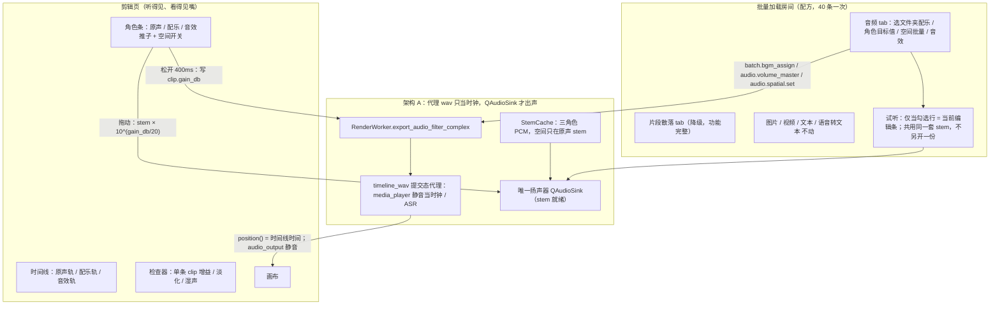
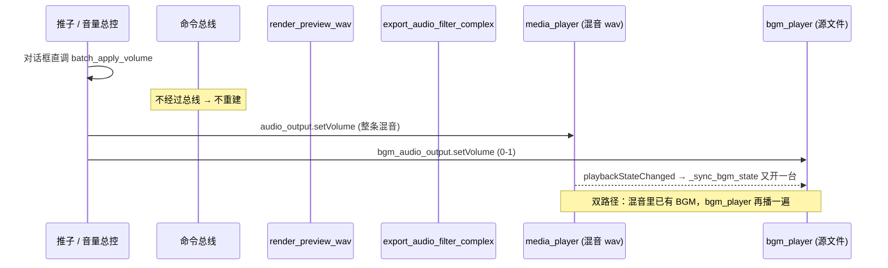
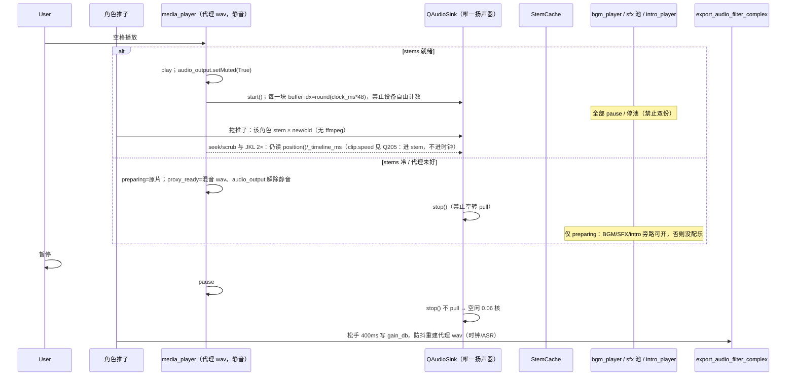
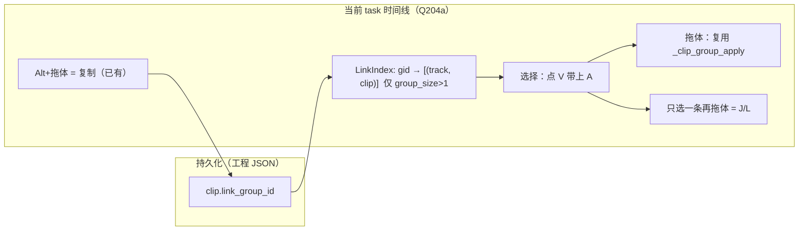

# CUTORA 音频设计 v2：轨道纪律、实时试听、一线时间线能力

| 字段 | 值 |
|---|---|
| 文档标题 | CUTORA 音频 v2：角色轨 + 实时混音 + A/V 链接 + 淡化/关键帧/变速 + 清理/AI 效率 |
| 作者 | Grok |
| 日期 | 2026-10-09 |
| 状态 | Approved（Luca 2026-10-09，v2） |
| 仓库 / HEAD | `D:\0_Dev\CUTORA` · `main` · `827cadcc`（Q196） |
| 建议任务编号 | Q197–Q203（v1）· Q204a/b–Q209（v2）；全部 Approved |
| 读者 | 实现工程师（按本文落地）；Luca（拍板产品选择，不需要读代码） |
| 前身 | `docs/plan/Q197_AUDIO_DESIGN.md` v1 Approved（Luca 2026-10-09）。**v1 合同一字不改**：Q197→Q203 顺序、架构 A、角色条在运输行、新 BGM 0.22、无音频房间、空间只上原声、只持久化 `clip.gain_db`、StemCache 96 MB、一台 sink、feature-off 字节相同、禁止自录 golden。 |

本文是 **v1 + v2 合一**。§A–I 是已批准的 v1（Q197–Q203）。§J–T 是 v2：把时间线音频补到「对这个产品够用的一线 NLE」——Resolve / Premiere / FCP / 剪映里 Luca **每周会用**的那一截，不是 Fairlight。

---

## Overview

CUTORA 的音频能力已经有一批真正的专业件：卷积空间立体声（`cutora/audio/spatial.py`）、导出响度 -14 LUFS（`cutora/audio/loudness.py`）、角色化 clip（`audio_role = main|bgm|sfx`）、音效库、波形缓存、clip 淡化字段、音频接缝 `TransitionItem`、`gain_db` 关键帧、导入时写下的 `link_group_id`。但用户能摸到的入口是坏的，而且**若干一线能力已经写进模型、没有接到时间线手上**。

v1 修两件 Luca 已经看见的事，都不是「缺功能」，是**模型错了、听不见**：

1. 顶栏「音频 → 添加背景音乐」和「批量 → 批量配乐」并不保证新建一条配乐轨。BGM clip 可以落到原声（口播）那条 `Track("audio")` 上。没有一线 NLE 会把配乐画在人声轨上。
2. 「音量总控」三个数字（原声 1.00 / 配乐 0.50 / 音效 0.18）改了听不见。对话框自己绕开命令总线，不触发预览混音重建；与此同时预览还在同时跑「混好的 timeline_wav」和一台独立的 `bgm_player`，两套信号互不相认。

v1 方案（Q197–Q203，不动）：先把轨道模型改成一线 NLE 的样子（每种声音资产一条自己的 clip、待在自己的角色轨上），再用**角色推子 + 分轨 PCM 缓存**让推子在 50–80 ms 内入耳，最后把「批量配乐 / 音量总控 / 空间立体声 / 音效 / 片段散落」收进批量加载，并拆掉已经覆盖完的旧菜单。空间立体声作为产品差异点保留，只作用在片库主视频的原声，外置 BGM 永远不上。

v2 在「听得见」之后补时间线纪律。Luca 点名的 12 件事里，**一半已经存在但没接到拖拽/右键/手柄上**，另一半是真缺口。原则：**能接线就不重做；改字节的（降噪、分轨）必须关路径逐字节相同；链接不许第二张映射表；速度曲线拖动不许重做空间卷积。** CUTORA 是**批量竖屏短视频工厂**（40 条口播），Luca 不是混音师。效率碾过剪映的批量配乐 + Descript 式「按说话剪」；不做 DAW。

---

## v2 盘点：已有 / 断线 / 缺口 / Later / Never

以代码为准。v1 §A 写「原声与视频 clip `link_group_id` 绑定」——字段在导入时写了，**拖视频并不会带走原声**。这是 v1 里需要修正的事实，不是产品决策翻案。

| Luca 点名 | 判定 | 证据 | v2 动作 |
|---|---|---|---|
| 1. 轨/clip 之间音频转场（接缝交叉淡化） | **已有，接缝右键可用** | `AUDIO_TRANSITION_LIBRARY`（`anim_engine.py:216-224`）；`apply_audio_transition_fades`（`seams.py:145`）；时间线接缝右键「添加转场…」（`widget.py:5104-5122`）。**不是**两段重叠 + `acrossfade`，是两侧 `afade` 包络（`max(clip.fade_*, trans.dur)`） | **接线 + 默认可发现**。不重做。轨与轨之间不做转场（那是闪避） |
| 2. clip 头尾淡入淡出手柄 | **字段+检查器有，时间线手柄没有** | `Clip.fade_in_dur` / `fade_out_dur`（`timeline_model.py:80-81`）；检查器滑条（`property.py:979-982`）导出生效。`HANDLE_PX` 只做修剪（`widget.py:4014-4015`）。T07 §6 写过「拖片段角上的把手」，没落地 | **画手柄，写已有字段**。禁止第二套淡化 |
| 3. 音频参数上现有关键帧系统 | **只有 `gain_db`** | `CLIP_AUDIO_PATHS = ("gain_db",)`（`cutora/render/keyframe.py:26`）；`ffmpeg_gain_filter`（`:296`）；检查器钻石（`property.py:973`）；Alt+K 编辑器在 `cutora/ui/keyframe_editor.py`（`resolve_target` `:77-120`，音频靠 `panel.current_type == "audio"` `:118`）。条上菱形是通用 `_paint_keyframe_band`（`widget.py:557-560`），音频在 `:1780` 调用 | **继续只用这一套编辑器**。可关键帧：`gain_db`（已有）。`spatial_amount` Later。速度走 `speed_curve` 对象，不进关键帧 |
| 4. 降噪 | **真缺口** | T07 写了人声预设 / 闪避 / 静音 / `graph.py`；仓库没有这些模块，`*.py` 无 `afftdn`。响度（T07 §3）**已经落地**。T07 §6 手柄未落地（v2 做）；**声像 / L/R 表未落地，本设计标 Never** | **Now Q206：T07 启发的缩小预设集**（关=字节相同）。DeepFilterNet Later |
| 5. 去人声留伴奏 | **真缺口** | 总体计划 §2.4 标 ✗。本次 Luca 点名并确认要做 | **Q209**（其余音频 PR 之后）：Demucs MIT，worker，禁止 GUI import torch |
| 6. 去伴奏留人声 | **真缺口** | 同上 | 同一条 Q209。`htdemucs` 是 **4-stem** 权重，`--two-stems=vocals` 把其余相加成伴奏 |
| 7. 音效是否在角色条 | **v1 已定：是第三条角色** | `audio_role="sfx"` + `place_sfx_on_task`（`sfx_library.py:377`） | **确认保留**。铺音效 → sfx 轨 + sfx 推子。不第四条、不进 Fairlight |
| 8. 音频变速 | **字段有，音频 UI/导出没接** | `Clip.speed` 0.1–10（`timeline_model.py:50`）。视频检查器有速度（`property.py:1138`），T22 `TOOL_SPEED`（`tools.py:11`）。音频检查器无速度。`_build_audio_tracks` 时长 = `out_t-in_t`（`render_worker.py:2504`），**不除 speed、不加 atempo**。音频条绘制同样用 `out_t-in_t`（`widget.py:1767-1769`）。指纹却记了 speed（`timeline_wav.py:101,194`） | **Q205 接上 atempo**。口播默认变调保持 |
| 9. 区域速度曲线（不切开） | **真缺口** | 没有 `speed_curve` / time remap。`retime_left/right` 是**字幕**段工具（`widget.py:4720`），不是音频 | **Q208**。数据在 clip 上，不另建表 |
| 10. 音视频链接（极重要） | **字段+导入+波纹有，拖/修剪/选择/右键没有** | 导入占位写 gid（`main_window.py:5795-5818`），probe 给原声同一 gid（`:5934-5954`）。`ripple._linked_clips`（`ripple.py:100-107`）和 `track_guard.assert_ripple_unlocked`（T05e）认 gid。时间线 `cutora/ui/timeline/` **零处**读 `link_group_id`。选择走 Q154 `clip.group`（`ops.py:301-314`）。音频 clip **没有自己的右键菜单**（点到音频落到轨菜单，`widget.py:5124-5204` 只扫 video）。**Alt+拖已经是复制**（`_alt_copy_pending` / `_maybe_alt_copy_live` / `timeline.duplicate_clips`，`widget.py:307,4046-4051,3603-3659`），`clone()` 会把 gid 一并拷走 | **Q204a 复用 gid，不加映射表**。J/L-cut 不解绑、**不占用 Alt+拖**（见 §J 手势表） |
| 11. AI 效率（翻倍剪辑速度） | **Q190 有；静音/闪避/自动淡化没有** | `title_align.py` 按词对齐；Silero VAD MIT 已打包（`vad_silero.py`）；无 `audio.detect_silence` | 见 §P。Now：静音检测+波纹删停顿、人声闪避、句级跳转。Later：节拍撒音效。Never：玩具 |
| 12. 入口摆放 | 无矩阵 | 检查器有增益/淡化/音高/湿声；轨头有 mute/solo；无音频 clip 右键 | 见 §Q |

**不要重做淡化。** 导出已经走 `afade`（`render_worker.py:1422-1426`）和 `apply_audio_transition_fades`。v2 只补手柄、默认真值、让接缝菜单被看见。

---

## Background & Motivation

### 产品位置

片语 Studio 一次工程常有 40 条口播。Luca 的判断标准是：开得顺不顺、画面对不对、导出多快、RAM/CPU 占多少。音频是总体计划 §2.4 里标成 ★ 的差异点（空间立体声 + 音效库 + 响度），但从来没有按一线 NLE 的轨道纪律升级过。

硬件预算（`AGENTS.md`）：i9-13900KF、32 GB（16 GB 最低）、RTX 5060 Ti。空闲 CPU 必须维持约 **0.06 核**，工作集约 **1.2–1.4 GB**。GUI 进程不许 import torch。

### 今天实际有什么（以代码为准，不靠记忆）

| 能力 | 在哪 | 状态 |
|---|---|---|
| Clip 增益 / 淡入淡出 / 变调 | `Clip.gain_db` 等，`cutora/model/timeline_model.py:77-85` | 有，导出生效 |
| 角色标记 | `clip.audio_role` + `is_main`；`sfx_library.clip_audio_role` | 有，但轨类型几乎全是 `"audio"` |
| 建 BGM 轨 | `sfx_library.get_or_create_bgm_track` | **会复用已经含 BGM clip 的轨**，包括原声轨 |
| 音量总控 | `audio.volume_master` → `batch_apply_volume` | 写 `gain_db`；**UI 对话框不走命令总线** |
| 预览混音 | `asr/timeline_wav.render_preview_wav` → `RenderWorker.export_audio_filter_complex` | Q70 已对齐导出滤镜 |
| 独立 BGM 播放器 | `MainWindow.bgm_player` + `_sync_bgm_state` | **T28 混音之后还在播，双路径** |
| 空间立体声 | 卷积 IR + `afir`；`resolve_spatial_for_track` | 产品差异点，BGM/SFX 默认关 |
| 响度 | 双 pass `loudnorm`，默认 -14 LUFS；golden 钉 `off` | 仅导出 |
| 波形 | `audio/waveform.py`，8 kHz peaks，磁盘 512 MB 上限 | 时间线用，不是试听 PCM |
| 音效库 | `sfx_library.place_sfx_on_task` | 有；走第三条轨的意图，实现不硬 |
| 音乐闪避（对人声压 BGM） | 总体计划 ★ | **没有**（只有空间湿声的侧链） |
| 轨道 mute/solo | `track_guard.track_outputs` | 有；导出无视 solo |

### 痛点 1：配乐画在人声轨上

`_add_bgm_to_track`（`cutora/ui/main_window.py:5647`）和无头 `batch.add_bgm`（`cutora/batch/cli.py:2803`）都调用 `get_or_create_bgm_track`：

```274:285:cutora/audio/sfx_library.py
def get_or_create_bgm_track(timeline):
    """优先：已有 BGM clip 的轨 → 第 2 条 audio 轨 → 新建。"""
    audio_tracks = [tr for tr in timeline.tracks if getattr(tr, "type", None) == "audio"]
    for tr in audio_tracks:
        for c in getattr(tr, "clips", []) or []:
            if is_bgm_clip(c):
                return tr
    if len(audio_tracks) >= 2:
        return audio_tracks[1]
    tr = Track("audio")
    timeline.add_track(tr)
    return tr
```

干净导入（一条原声、`audio_role="main"`）时，这段会**新建**第二轨，看起来是对的。失败模式是：

- 老工程 / 曾经把 BGM 丢在原声轨上 → 第一条规则命中，永远往那条轨上继续画。
- `clip_audio_role`：空 `audio_role` 且 `is_main=False` 一律当成 `"bgm"`（`sfx_library.py:236-242`）。缺字段的 clip 会把所在轨「污染」成 BGM 轨。
- `_add_bgm_to_track` 清轨时只保留 `is_main` 或 sfx（`main_window.py:5663-5667`）。`audio_role="main"` 但 `is_main=False` 的原声会被删掉。
- 时间线轨头对所有 `type=="audio"` 都标 **Audio / Audio 2**（`timeline/header.py:118-136`，`widget.py:323`），没有「原声 / 配乐 / 音效」。即使得了第二轨，看起来也不像一线 NLE。
- 加新配乐是**替换**该轨上旧 BGM，不是「每条配乐自己一条轨」。

Luca 的规则（本文采纳）：**每条音频资产必须是自己的 clip，待在自己的角色轨上。** 原声、配乐、音效三类角色各至少一条轨，绝不混装。

### 痛点 2：音量总控是断的（截图 2026-10-09 10:18）

对话框 `open_volume_master_dialog`（`main_window.py:6717`）三个 `QDoubleSpinBox`，按钮「应用到选中 / 应用到全部」。它**直接**调 `batch_apply_volume`，不走 `bus.execute("audio.volume_master")`。

预览重建只挂在命令总线：

```1939:1942:cutora/ui/command_bodies.py
        if str(name or "").startswith(("timeline.", "audio.", "overlay.", "subtitle.")):
            rebuild = getattr(self, "_rebuild_preview_wav", None)
            if callable(rebuild):
                rebuild(immediate=False)
```

所以 Luca 点「应用到全部」：`gain_db` 写进 clip 了，导出是对的，预览混音**不重建**。数字变了，耳机里还是旧的。

即便走了命令，推子也不是实时的：混音把 `gain_db` 烘进 `timeline_wav`（48 kHz 立体声 wav），改音量 = 整条重渲。500 ms 防抖（`_proxy_timer` 间隔 500）。拖的时候听不见。

更糟的是双播放器：

- T28 之后，运输时钟播的是混好的 `preview_audio/<fingerprint>.wav`（`preview/engine.py:28-34`，`_apply_proxy_wav`）。
- `media_player.playbackStateChanged` 仍然连着 `_sync_bgm_state`（`main_window.py:1938`），它会再开一台 `bgm_player` 播同一条配乐文件。
- `_on_src_vol_changed` 改的是 `audio_output`（整条混音的扬声器音量），不是「只抬原声」。
- `_on_bgm_vol_changed` 改的是 `bgm_audio_output`（0–1 钳位）。混音路径上的 BGM 听不见这个数；如果 `bgm_player` 还在跑，配乐会响两份。
- `QAudioOutput` 有效范围 0–1。原声要抬到 1.00 以上（spin 上限 5.0，检查器也写了「>1.0 时预览与导出均生效」），预览被钳死，只有导出的 `gain_db` 是真的。

这就是 Luca 说的「信号是断的」。不是三个数字没写进工程，是**写了听不见、听见的不是那个数、抬人声还会连带抬配乐**。

### 痛点 3：入口散、房间还暂停预览

今天音频相关、用户能点到的入口：

| 入口 | 命令 / 函数 | 问题 |
|---|---|---|
| 菜单 音频 → 添加背景音乐 | `add_audio_bgm` → `batch.bgm_assign` `ids=[curr]` | 轨模型错 |
| 菜单 音频 → 空间立体声 / 音效库 | `open_audio_fx_dialog` → `AudioFxDialog` | 右侧滑出；改湿声不保证刷新指纹（全局 preset/width 不在 fingerprint 里） |
| 菜单 音频 → 铺音效 当前/全部 | `audio.sfx.apply_current/all` | 要保留 |
| 菜单 音频 → 预览时播放音效 | `_on_toggle_sfx_preview` | 要保留为试听开关 |
| 菜单 音频 → 预览时套用空间立体声 | `_on_toggle_preview_fx` | `_preview_fx_build` 已空实现，开关基本是死的 |
| 菜单 批量 → 批量配乐 | `batch.bgm_assign` | 与「添加背景音乐」同一条命令 |
| 菜单 批量 → 音量总控 | 对话框直调 `batch_apply_volume` | 断信号 |
| 工具栏 `btnAddAudio` | 同添加背景音乐 | 重复入口 |
| 检查器音频页 | clip 级增益 / 湿声 | 有，单条，听不见（同样要重建 wav） |
| 底部页面栏「片段散落」 | 房间 key `scatter` | 少用，占一线位置 |

批量加载房间（`cutora/ui/rooms.py`）进房会 `_pause_editor()`：停播放、藏时间线/画布。把「实时听混音」只放在批量加载页，等于听的时候看不见嘴在不在动。这是反对「全部塞进批量加载一个 tab、剪辑页什么都没有」的硬原因。

### 痛点 4：Q30 预览 ≠ 导出的旧伤

`docs/plan/AUDIT_2026-09-19.md`：代理 wav 没就绪时走过只渲第一段的旧 fx 代理（「第二段没有立体声」）。Q70 之后 `render_timeline_wav` 必须调用 `export_audio_filter_complex`（`tests/test_q70_preview_export.py`）。`_sync_preview_fx` 在 `_proxy_ready=False` 时放原声、不再走 first-clip 代理。这条锁不能回退。

`preview_audio_fingerprint` 含 clip 的 `spatial_enabled` / `spatial_amount`，**不含**全局 `fx.spatial_preset` / `spatial_width`。改预设或宽度，缓存路径不变，听的还是旧卷积。

---

## Goals & Non-Goals

### Goals

1. **轨道纪律**：原声 / 配乐 / 音效分轨；加 BGM 永不写到原声轨；老工程混装轨在加载时显式拆开，clip 参数不动。
2. **听得见**：角色推子拖动 < 80 ms 入耳；空间开关/预设在当前条上可试听；预览提交态与导出走同一条 `export_audio_filter_complex`。
3. **批量工厂效率**：一次给 40 条口播配乐、统一压配乐、统一开/关原声空间立体声，比剪映少一步。
4. **信息架构**：批量配方进「批量加载」；实时听进剪辑页一条窄的角色条；片段散落降级为批量加载里的安静 tab；旧菜单只在新表面覆盖全部命令之后再拆。
5. **性能**：音频 tab 没聚焦且不在拖推子时，不额外占 CPU；PCM 缓存有上限；空闲仍约 0.06 核、工作集不涨 1 GB。
6. **兼容**：老工程打开即播；新功能关 = golden 逐字节相同；不授权重录 golden。
7. **v2 时间线纪律（Q204+）**：导入的主视频原声默认链接；拖主视频带走原声；J/L-cut = 只选一条再拖（**不**占用 Alt+拖，那是已有的复制）。右键解绑。淡化手柄写已有字段。音频常数变速：atrim 用源时长、atempo 后再用输出时长。降噪 / 分轨关路径字节相同。
8. **v2 工厂效率**：40 条口播上「检测静音 → 波纹删停顿 → 配乐铺满」比剪映少两步；文本 tab 已有的 Q190 句级定位扩到时间线跳转。

### Non-Goals

- Fairlight / Premiere 式调音台、总线矩阵、64 路、自动化曲线编辑器、频谱编辑器。
- 在线素材库（总体计划已 ✗；安全红线禁止中国端点）。
- 改 CRF / preset、导出硬解、动 `render/textfx/`。
- 把 GUI 进程拉进 torch（Q187）。Demucs / DeepFilterNet 只许 worker。
- 重做时间线波形绘制（已经有 `WaveformCache`）。
- **Q197–Q203 不做**音乐闪避、人声清理、分轨、速度曲线（v1 KD-13，听得见之前不加）。这些进 Q206–Q209。
- 视频光流变速 / 视频 time remap（口播工厂不需要；视频继续常数 `clip.speed` + T22）。
- 轨与轨交叉淡化（原声×配乐不是转场，是闪避）。
- 第二张 A/V 映射表、`task.audio_bus`、第三台 QMediaPlayer。
- 删除任何既有功能。散落、音效库、空间立体声、响度、mute/solo、检查器 clip 增益、Q154 预合成全部留。Q154 `clip.group` **不是**音视频链接，禁止混用。
- **声像 (pan) 与 L/R 音量表**（T07 §6 写过、从未落地）：**Never**。Luca 不是混音师；立体声宽度已在空间 IR 里。不做第三条音量真相。

---

## Proposed Design

§A–I = v1 合同（Q197–Q203），Luca 已批准，实现时不许用 v2 的链接/降噪/曲线去改这些 PR 的范围。§J–T = v2，排在文后、Q204 起。

### 总结构



### 决策：不要独立「音频房间」，也不要把实时推子只放进批量加载

| 方案 | 优点 | 缺点 | 结论 |
|---|---|---|---|
| A. 只在批量加载加音频 tab（Luca 草图） | 配方集中；少一个页面 | `RoomHost._pause_editor` 停播放、藏画布；听的时候看不见人；要在房间里再做一套预览 | **配方放这里，实时听不放这里** |
| B. 独立音频房间（Fairlight 式） | 表面大 | 底部栏已经 5 项；Luca 不是混音师；空间就两个旋钮；再占一线位置正是散落要降级的原因 | **不做** |
| C. 混合（推荐） | 听在剪辑页（画面还在）；配方在批量加载（40 条一次）；散落降为安静 tab | 两处都有音量，需要「同一组数字」 | **采用** |

给 Luca 的一句话：推子放在片子旁边才能边看边听；给 40 条一起配乐的动作放在批量加载。两处读同一份 `clip.gain_db`，不是两套音量。

批量加载音频 tab 仍有一颗「试听」：**仅当 picker 勾选行就是当前剪辑条（`curr_idx`）时可用**，按钮写清「试听当前这条」。共用剪辑页那一套 3 stem，不给另一行另建一份、不开第二台 sink。房间已经 `_pause_editor`，试听只动音频 sink，不跑 `PreviewEngine`。切到别的 picker 行 → 按钮禁用（或灰掉并提示「先在媒体库选中这条」）。离开音频 tab / 离开房间 → `sink.stop()`，ffmpeg 工人停。不保留两套 3-stem。

---

## A. Track model

### 目标模型

三种角色，三种轨，clip 不跨轨：

| 角色 | `clip.audio_role` | `track.audio_role`（新字段） | 默认轨名 | 空间立体声默认 | 谁在上面 |
|---|---|---|---|---|---|
| 原声 | `main`（`is_main=True`） | `main` | 原声 | 跟全局「新导入默认开启」 | 片库主视频的口播。导入已写同一 `link_group_id`（`main_window.py:5795-5954`）；**拖拽跟随是 Q204a，今天时间线不读这个字段** |
| 配乐 | `bgm` | `bgm` | 配乐 | **强制 False** | 外置 mp3/wav/…，一条视频通常一首床 |
| 音效 | `sfx` | `sfx` | 音效 | **强制 False** | 音效库 clip，一条轨上可多段 |

`Track.type` **继续是 `"audio"`**。`AUDIO_TYPES` 虽含 `"bgm"`/`"sfx"`，全仓实际建轨都是 `Track("audio")`（`test_t07a_audio_mute.py:21` 写明 `No type=='bgm'`）。改 type 会动 mute/solo、清理、共享轨道。角色用新字段 `Track.audio_role`，轨头显示中文名。

`TRACK_KEYS`（`cutora/model/project_schema.py:79-83`）增加 `"audio_role"`。缺省 `""`，加载时从**音频域** clip 推断。必须同时改 `Track.__init__`、`_rj_serialize_track`、反序列化 `_known` + `track_obj.audio_role`（见下节 serdes）。老工程 overlay 的 x/y/w/h 原样读；音频同样：**缺字段只补不改语义**。视频 clip 禁止写 `audio_role`。

### 为什么现在会画到原声轨

根因不是「没调用 `add_track`」，是 **「找到已有 BGM clip 就复用那条轨」** 这条规则，加上空角色默认 `bgm`。修复必须改选择函数，不能只改 UI。

### 新的建轨函数（替换 `get_or_create_bgm_track` / `get_or_create_sfx_track`）

放在 `cutora/audio/sfx_library.py`（已有 `get_or_create_*`，UI 与 CLI 都走这里），`main_window.get_or_create_bgm_track` 继续转调。

```python
ROLE_TRACK_NAME = {"main": "原声", "bgm": "配乐", "sfx": "音效"}

def ensure_role_track(timeline, role: str) -> Track:
    """返回只承载该角色的轨。绝不返回混装轨。没有则新建。"""
    role = str(role or "bgm")
    audio_tracks = [tr for tr in timeline.tracks
                    if getattr(tr, "domain", None) == "audio"
                    or getattr(tr, "type", None) in ("audio", "bgm", "sfx")]
    for tr in audio_tracks:
        if getattr(tr, "audio_role", "") == role:
            return tr
    for tr in audio_tracks:
        clips = getattr(tr, "clips", None) or []
        if not clips:
            continue
        roles = {clip_audio_role(c) for c in clips}
        if roles == {role}:
            tr.audio_role = role
            if not getattr(tr, "name", ""):
                tr.name = ROLE_TRACK_NAME[role]
            return tr
    tr = Track("audio")
    tr.audio_role = role
    tr.name = ROLE_TRACK_NAME[role]
    timeline.add_track(tr)
    return tr
```

所有**写入**音频 clip 的路径都必须走 `ensure_role_track`，否则加载迁移会和 UI 对着打。Q197 关闭这些洞：

| 入口 | 今天 | Q197 |
|---|---|---|
| `_add_bgm_to_track` / `batch.add_bgm` | `get_or_create_bgm_track` | `ensure_role_track(tl, "bgm")`。清旧配乐**只扫配乐轨**上的 bgm clip。keep-list 改为保留 `clip_audio_role=="main"` **或** `is_main` **或** sfx，禁止因 `is_main=False` 删掉 `audio_role=="main"` 的原声 |
| `place_sfx_on_task` | `get_or_create_sfx_track` | `ensure_role_track(tl, "sfx")` |
| `_fill_task_from_probe` / 占位导入 | `get_or_create_track(..., "audio")` | 同一条轨打 `audio_role="main"`、`name="原声"` |
| `_drop_audio_file`（`main_window.py:5540-5578`） | 无 `target_track` 时 `get_or_create_track(tl, "audio")` = **第一条音频轨 = 原声**；clip `is_main=False` 且**不写** `audio_role` → `clip_audio_role` ⇒ `"bgm"`，配乐画在人声轨上 | 无目标轨 → `ensure_role_track(tl, "bgm")`，clip `audio_role="bgm"`、`spatial_enabled=False`。拖到已有角色轨上 → 继承该轨 `audio_role`（拖到原声轨的 wav 变成原声角色，罕见但可预期） |
| `add_timeline_track("audio")` / `shortcut_add_track` Alt+A（`:13501-13524`） | `Track("audio")`，空 `name`、空 `audio_role` | 新建轨必须带角色：默认 `bgm`（「添加音频轨道」= 加一条配乐轨，口播已经有了）。`name="配乐"` 或若已有配乐轨则 `"配乐 2"`。禁止留下未标记的 `Track("audio")` |
| `timeline_stitch.py` 拼接线 | 已 `audio_role="main"` | 给那条 `atrack` 打 `audio_role="main"`、`name="原声"` |
| 开场 intro（`main_window.py:1246-1260`） | 插进「第一条含 is_main 的音频轨」 | 必须 `ensure_role_track(tl, "main")`；clip 已是 `is_main=True`、`audio_role="main"`，保持 |

测试：一条只有原声轨的时间线，drop 一个 wav → 原声轨 clip 集合不变，出现「配乐」轨。Alt+A → 新轨 `audio_role=="bgm"`。

多首配乐（少见）：默认仍「一首床替换」，写在配乐轨上。本轮不自动铺多轨 BGM。新写入默认线性音量 **0.22**（只影响新 BGM，不改已有工程）。所有权在 **Q197**（`_add_bgm_to_track` / `batch.add_bgm` 不再读 `spin_bgm_vol` 的 0.10）。角色条第一次打开显示工程里已有的 `gain_db`。

### 导入主视频

`_fill_task_from_probe`（`main_window.py:5918`）已经给原声 clip 写 `is_main=True`、`audio_role="main"`、`apply_default_spatial_to_clip`。补两行：`audio_track.audio_role = "main"`，`audio_track.name = "原声"`。占位任务里 `get_or_create_track(timeline, "audio")` 同样打上。

### `Track.audio_role` 必须走完 bg_role 那三条（否则保存崩溃）

只改 `TRACK_KEYS` 不够。`_rj_serialize_track`（`project_io.py:436-464`）手写 dict，然后 `missing = [k for k in _RJ_TRACK_KEYS if k not in d]` 会 `RuntimeError("track field table not written")`。反序列化 `_known`（`:563-566`）是封闭集合，未列入的键进 `track_obj._extra`，**不会**回到 `Track.audio_role`。对照已有的 `bg_role`：`Track.__init__`、`TRACK_KEYS`、`_rj_serialize_track`、`_hydrate_track_props` / `_rj_deserialize_timeline` 的 `_known` + 赋值，五处一起改。不升 `PROJECT_VERSION`。Q197 加 `test_q82` 风格的保存→打开 roundtrip。

### 老工程迁移（显式、默开、只碰音频域）

挂在 `project_io._normalize_project_data`（加载必经之路，已有 `_migrate_clip_spatial`）。新函数 `_migrate_mixed_audio_tracks(tl, task)`。

**硬规则（违反 = Q197 失败）：**

- 只扫描 `domain=="audio"` 或 `type in ("audio","bgm","sfx")` 的轨。
- **禁止**给 video / subs / text / image / adjust 轨上的 clip 写 `audio_role`，禁止移动它们。golden 里视频 clip 普遍是 `is_main: false`、`audio_role: ""`（例如 `tests/golden/g08_stylepack_amber/project.asproj.json`、`g05_scatter_insert`）。`clip_audio_role` 对这种 clip 会返回 `"bgm"`——所以迁移若扫全轨，会把画面 clip 当成配乐搬走，golden 必坏。
- `_normalize_project_data` 现有的 `cl.setdefault("audio_role", ...)`（`project_io.py:105-115`）已经给**所有** clip 补字段。Q197 **不得**把那条 setdefault 改成「空则 bgm」的语义升级；迁移函数自己只处理音频域。
- `amix` 输入顺序保持「按 `tracks` 列表、轨内 `clips` 列表」的现序。**禁止**重排成 main 全 → bgm 全 → sfx 全。被移走的 clip 追加到目标轨末尾，源轨相对顺序不变。
- 迁移**禁止**调用 `apply_default_spatial_to_clip`。不改 `gain_db` / `spatial_*` / `in_t` / `out_t` / `start_t`。只补空的 `clip.audio_role` 字符串（音频域），导出 PCM 应逐字节相同；工程 JSON 会多几个 `"audio_role":"main"` 字——这不是像素/音频变化，golden 比的是导出 mp4。

步骤：

1. 只对音频域 clip：空 `audio_role` 时，`is_main` → `"main"`；否则若 `source.path` 与 `task["video"]` 规范化后相同 → `"main"`；否则 → `"bgm"`。写回 `clip.audio_role`。
2. 轨的「留下角色」平局规则（1 main + 1 bgm 就是 Luca 那个 bug，必须写死）：
   - 轨已有非空 `track.audio_role` → 留下这个角色；
   - 否则若存在 `is_main` 或主视频源 clip → 留下 `main`；
   - 否则留下 `bgm`。
   - 少数角色的 clip **移动**（同一对象）到 `ensure_role_track(tl, 该角色)`。日志写明规则：`[Audio] migrate task=<stem> split track=<id> keep=main moved_bgm=1 moved_sfx=0`。
3. 给纯角色轨补 `track.audio_role` 与中文名。
4. **不**把「同一轨上两段都是 bgm」拆成两轨。
5. 拆完后，原先因含 `is_main` 而不能 `enable_batch` 的轨，若 main 被留下、bgm 被搬走，配乐轨会变为可共享——这是对的，不回写 `enable_batch`。
6. 不做静默「检测但不拆」。Q197 夹具必须包含一条 **golden 形** 任务：视频 clip `audio_role=""`、`is_main=False`、带 `fit_mode/x/y/scale`；断言视频轨 clip 集合与字段一字不改，导出 PCM md5 不变。

不做的：扫描磁盘猜「这段波形是不是音乐」。

### 轨头

`timeline/header.py`：`track.name` 已优先于 `Audio 2`。迁移和新建写好中文名后，Luca 看见的就是「原声 / 配乐 / 音效」，不用改绘制算法。颜色仍走 `track_audio` token。mute / solo / 锁保持现有按钮。

### 共享轨道 / 批量

`track_supports_batch` 已拒绝含 `is_main` 的音频轨。配乐轨、音效轨可继续共享。`enable_batch` 语义不变。

---

## B. Information architecture

### 剪辑页：角色条（新，窄，常驻时间线上方或运输条右侧）

不是对话框，不是房间，不是独立窗口。**放进现有 `preview_tools` 行**（`main_window.py:2388-2453`，高 40 px）：左 AI/导出，中 跳转+播放+时间码，右 分屏参考/文本/图片/`btnAddAudio`。不新开横带——Q193 的 1366×768 已经把高度锁死。

**宽度预算（1366 px 客户区）：** 三个推子各 **72–90 px**（含静音钮）；空间预设收进菜单按钮（不放 QComboBox）；**角色条替换 `btnAddAudio`**（Q199 临时滑条起就占这个槽，不必等 Q202）。播放键和 `lbl_timecode`（已 `setMinimumWidth` 到 `00:00:00.00 / 00:00:00.00`）必须始终完整可见。客户区高度 < 800 px 或宽度不够时：无标签旋钮。Q200 断言：1366×768 下 `btn_start` 与 `lbl_timecode` 的 `geometry` 仍在窗口内且宽度不被裁。

控件：

- 三个推子：**原声**、**配乐**、**音效**。显示线性 0.00–2.00（与今天 spin 一致；>1 抬人声）。内部写 `gain_db`。
- 每个推子旁一个静音钮，绑定该角色轨的 `track.mute`（已有命令 `command_set_track_mute`）。
- **空间（一线）**：开关「原声空间立体声」+ **菜单**选预设（舞台/讲道/…）。湿声/宽度/话筒质感/「新导入默认开启」放在批量加载音频 tab 与「更多…」全量 `AudioFxDialog`。
- 推子拖动立即听（stem 乘法）。松手 400 ms 写工程并防抖重建 `timeline_wav`。
- 没有配乐 clip 时配乐推子灰掉；添加走角色条菜单「添加配乐…」（`batch.bgm_assign` `ids=[curr]`），不再并排放 `btnAddAudio`。

数字与检查器、批量加载音频 tab 是同一份 `clip.gain_db`。改一处，另外两处 `blockSignals` 同步。

### 批量加载：音频 tab（新）

`cutora/batch/batch_dialog.py` 现有 tab：图片 / 视频 / 文本 / 语音转文本（约 256–321 行）。在「语音转文本」之前插入 **音频**（配方，常用），**片段散落**放最后（少用、安静）。

音频 tab 内容（左：与现有相同的 `TaskPicker` 勾选；右：配方）：

1. **配乐文件夹**：路径 + 浏览。按钮「给勾选的视频配乐」。走现有 `batch.bgm_assign`（命令体不弹框；UI 把 `dir` 和勾选下标传进去）。短于视频的循环，逻辑已有，保留。
2. **角色音量目标**：三个推子，默认显示当前勾选条的值（多条不一致显示「混合」）。按钮「应用到勾选」/「应用到全部」。走 `audio.volume_master`（**必须经总线**）。
3. **空间立体声（覆盖 AudioFxDialog 空间页，禁止 Q202 删功能）**：开关「勾选视频的原声使用空间立体声」；预设；湿声；**立体声宽度**；**话筒质感**开关+强度；**「新导入的原声默认开启」**。外置配乐旁注死：「配乐不加空间，避免发糊。」走 `audio.spatial.set`（preset/width 写全局 fx，Q198 先修命令）。批量开关只扫 `audio_role=="main"`。
4. **音效**：缩略现有音效页（启用类目、间隔、音量）+「铺到勾选 / 铺到全部」。走 `audio.sfx.apply_*`。
5. **「更多…」**：打开**完整** `AudioFxDialog`（空间+音效+AI 三页都在，`RIGHT_CLASSES` 已登记）。Q202 拆掉顶栏音频菜单之后，这是话筒质感/AI/导入默认的保底入口，**不是 AI-only**。
6. **试听**：仅当 picker 当前行 == `curr_idx`。共用 StemCache 那一套 3 stem + **进程里同一台** QAudioSink。时钟 = 墙钟（编辑页已暂停，没有 `position()`）。不调用 `PreviewEngine`，不 `media_player.play()`。

设置里的 **目标响度**（`settings_dialog.py:124-134`）留在设置，不进音频 tab，不进拆除清单。检查器「这条音频使用空间立体声」（`property.py:983`）保留。编辑 → 添加轨道 → 音频轨道走 Q197 的默认配乐轨。拖放音频走 Q197 `_drop_audio_file`。

进批量房间仍暂停剪辑预览（Q191 `_pause_editor`，`media_player` 停着）。全进程**一台** sink，不是房间内第二台。试听：墙钟从 0（或上次 `_timeline_ms`）往前走，**禁止**在房间里 `media_player.play()`（两套时钟）。离开 tab/房间 → `sink.stop()`。Q200 测试：进 batch、picker 行 == `curr_idx`、点试听 → 一台 sink 在跑、`media_player` 仍 pause、不调 `PreviewEngine`；其它 picker 行按钮禁用。

### 片段散落：降级，不删除

- **从底部页面栏拿掉** key `"scatter"`。栏变为：`edit` / `batch` / `monitor` / `stitch`（剪辑 / 批量加载 / 中央监视器 / 片段拼接）。
- **功能完整保留**：`batch.scatter_broll` 命令、`script_broll_scatter.build_dialog`、g05 / g15 golden 一条都不动。
- UI 刷新：把 `build_dialog` 嵌进批量加载最后一个 tab。签名改为 `build_dialog(parent, picker=None)`：`picker` 传入批量加载已有的 `TaskPicker`，tab 内**禁止**再造一份勾选列表。「关闭」改成「完成」，**不**调用 `close_room("scatter")`（房间已经不叫这个 key）。参数控件保留，用批量加载同一套 token 间距，去掉 `apply_plugin_style` 另起炉灶。
- 菜单 **批量 → 片段散落…** 留下（`test_t03c` 的 `BATCH_MENU_ORDER` 仍含这个标题），行为改成：`room_host.enter("batch")` 然后 `tabs.setCurrentWidget(scatter_tab)`。
- `open_script_broll_scatter` 同样跳到该 tab，不再 `host.enter("scatter")`。
- 测试：`test_q192_inwindow.py::test_stitch_and_scatter_are_rooms` 不再断言 `scatter` 在 `bar.buttons`；`test_q193_lowspec.py` 进 batch 再切散落 tab；`test_q201` **显式** `assert "scatter" not in rh.bar.buttons`（`test_q191` 只锁 `[:3]==[edit,batch,monitor]`，抓不到这次删除）。`test_q96_scatter_dialog.py` 继续测 `build_dialog`。g05/g15 **禁止重录**。当前 `tools/ui_golden.py` CASES 是画布/检查器/时间线，不含页面栏；若哈希变了仍停下给 Luca 看，不自录。

### 菜单拆除清单（Q202，最后做）

**只有当音频 tab + 角色条已经覆盖下列每一条命令之后**才拆。拆之前每一条都要能从新表面点到。

| 现入口 | 命令 / 控件 | 新表面 | 拆除时机 |
|---|---|---|---|
| 音频 → 添加背景音乐 | `batch.bgm_assign` ids=[curr] | 角色条「添加…」+ 音频 tab | Q202 |
| 音频 → 空间立体声 / 音效库 | `AudioFxDialog` 全对话框 | 音频 tab 覆盖空间页+音效页；「更多…」仍打开**完整对话框** | Q202 拆菜单，对话框不删 |
|  其中 话筒质感 `chk_mic`/`sp_mic` | `mic_texture` / `mic_amount` | 音频 tab 空间区 | 必须在 Q202 前进 tab |
|  其中 「新导入的原声默认开启」 | `fx.spatial_enabled` | 音频 tab 空间区 | 同上 |
|  其中 立体声宽度 | `fx.spatial_width` | 音频 tab 空间区 | 同上 |
|  其中 湿声（全局默认） | `fx.spatial_wet` | 音频 tab；clip `spatial_amount` 仍在检查器 | 同上 |
|  其中 AI 识别 tab | `sfx_ai` | 「更多…」全对话框 | 不删 |
| 音频 → 铺音效当前/全部 | `audio.sfx.apply_*` | 音频 tab | Q202 |
| 音频 → 预览时播放音效 | `_sfx_preview_on` | **Q198 改语义**：代理/stem 就绪时 = 「预览混音是否含 SFX」（零 sfx stem / 预览 `mix_rows` 省略 sfx；导出始终含）。preparing 仍可用 4 路池 | Q202 把开关迁到角色条或设置 → 预览，不删 |
| 音频 → 预览时套用空间立体声 | `_preview_fx_on` | 删除死开关（`_preview_fx_build` 空实现）；提交态永远走 export filter | Q202 |
| 批量 → 批量配乐 | `batch.bgm_assign` | 音频 tab | Q202；`tests/test_t03c_polish.py` `BATCH_MENU_ORDER` 去掉这两项 |
| 批量 → 音量总控 | `audio.volume_master` / `open_volume_master_dialog` | 角色条 + 音频 tab | Q202；`test_t03c` 断言 `open_volume_master_dialog` 的源码检查改掉；`test_s1` 不再调用它 |
| 工具栏 `btnAddAudio` | 同上 | 角色条「添加」 | Q202；`test_ui_actions_smoke.py:230`、`test_t03c_polish.py:352` 改名 |
| 批量 → 片段散落 | `batch.scatter_broll` | 跳到散落 tab | **改跳转，菜单项保留**（`BATCH_MENU_ORDER` 仍有「片段散落…」） |
| 设置 → 目标响度 | `audio.loudness.set` | 留在设置 | 永不拆 |
| 检查器「这条音频使用空间立体声」/ 湿声 / 音量 | clip 级 | 保留 | 永不拆 |
| 编辑 → 添加轨道 → 音频 / Alt+A | `add_timeline_track("audio")` | Q197 起默认配乐轨 | 不拆入口 |
| 拖放 mp3/wav | `_drop_audio_file` | Q197 起落到配乐轨 | 不拆入口 |

顶层 **音频** 菜单整菜单移除的前提：上表每一行「新表面」已可点到（含话筒质感、导入默认、宽度）。`_build_shell_menus` 里 `audio_fx_menu = menu.addMenu(tr("音频"))` 整段删除。命令仍在 API/MCP。`AudioFxDialog` 文件保留，「更多…」打开完整三页。`inwindow.RIGHT_CLASSES` 暂留。

---

## C. Industry capability matrix

CUTORA 是批量口播工厂。表里 **Never** 的理由都是「Luca 不会每周用，做了占内存/学习成本」。

**v2 读法：** 本表是 v1 当时的「本设计之后 / 何时」。当时标 Later 的「音乐闪避」「人声清理」，以 **§R / Q206–Q207** 为准（Q197–Q203 仍然不做；Q206–Q207 才做）。

| 能力 | Resolve Fairlight | Premiere Essential Sound | FCP Roles | 剪映/CapCut 批量 | CUTORA 今天 | 本设计之后 | 何时 |
|---|---|---|---|---|---|---|---|
| 独立音频轨，资产不混装 | 有 | 有 | 有 | 原声/音乐分轨 | 模型允许，加 BGM 会混装 | 角色轨 + 迁移 | **现在 Q197** |
| 角色（对话/音乐/音效）批量 | Bus + 类别 | Dialogue/Music/SFX 标签 | Roles 强 | 「原声/音乐」两个推子 | `audio_role` 有；总控听不见 | 角色条 + 音频 tab | **现在** |
| Clip 增益 | 有 | 有 | 有 | 有 | `gain_db` | 保留，检查器 | 已有 |
| Track fader | 有 | 有 | 有 | 弱 | 无（只有 mute） | 角色推子 = 写该轨所有 clip 的 gain_db，不另做总线字段 | **现在** |
| Master / 64 bus | 有 | 有 | 有 | 无 | 无 | 无 | **Never**（工厂不需要） |
| Mute / Solo | 有 | 有 | 有 | 有 | 有，导出无视 solo | 保留 | 已有 |
| 实时听混音 | 有，低延迟 | 有 | 有 | 有，批量页也能听 | 烘进 wav，改了听不见 | stem × 增益 < 80 ms | **现在 Q199** |
| 波形 | 有 | 有 | 有 | 有 | 有（peaks LOD） | 保留 | 已有 |
| 淡入淡出 / 音频转场 | 有 | 有 | 有 | 有 | clip fade + `TransitionItem` | 保留；进 stem 重建 | 已有 |
| 响度 -14 LUFS | 有 | 有 | 有 | 部分 | 导出双 pass，默认开；golden 钉关 | 不动 | 已有 |
| 空间 / 厅堂 | 卷积/算法混响 | 房间混响 | 空间感弱 | 几乎无 | **卷积 IR + 侧链，产品差异点** | 保留；只上原声；批量开关 | **现在（修好试听）** |
| 话筒质感 | EQ/饱和 | 有 | 弱 | 无 | `mic_texture` | 保留，跟空间走 | 已有 |
| 音乐闪避（对人声压 BGM） | 侧链 | Auto-duck | 有 | 「人声突出」 | 无（只有湿声侧链） | 不做本轮 | **Later** |
| 人声清理（降噪/去齿音） | 有 | 有 | 有 | 有 | 无 | 纯 ffmpeg 滤镜链，总体计划 ★ | **Later** |
| 配乐库 / BPM 检测 | 无（Fairlight 不管） | 无 | 无 | 有库存 | 用户文件夹随机分配 | 保留文件夹配方；不内置非 CC0 | 已有配方 |
| 音效库 | SFX 轨 | 有 | 有 | 有 | 自合成 wav | 迁到音频 tab | 已有 |
| 自动化曲线 | 有 | 有 | 有 | 弱 | `keyframes` + `ffmpeg_gain_filter` | 保留，检查器 | 已有 |
| 频谱分析仪 | 有 | 有 | 有 | 无 | `spectrum.py` 给字幕音谱动画 | 不进调音台 | Never 当 DAW |

「效率碾过剪映」具体指：勾 40 条 → 选一个配乐文件夹 → 三个推子定原声/配乐/音效 → 原声空间开或关 → 当场试听当前条 → 应用到全部。剪映要进每条时间线或走不透明的「批量」二级页，且没有卷积厅堂。

---

## D. Real-time mix preview

### 今天预览实际在播什么



提交态路径（T28/Q70，要保留）：

1. `preview_audio_fingerprint(task)` → `user_cache/preview_audio/<key>.wav`
2. 后台 `render_preview_wav` → `RenderWorker.export_audio_filter_complex`（与导出同一字符串）
3. `_apply_proxy_wav` 把 `media_player` 源换成这条 wav，时钟用 `position()`
4. 未就绪：`preview_audio_mode` = `"preparing"`，放原片音轨，**禁止** first-clip fx 代理（`test_t30_spatial.py` 有锁）

失败点：对话框绕开总线；指纹不含全局空间预设；`gain_db` 烘进 wav，拖推子必须整段重渲；`bgm_player` 还活着；`_sfx_players` 最多 4 路（`main_window.py:15003-15110`，默认 `_sfx_preview_on=True`）在代理 wav **已经含 sfx** 之后仍再播一遍；`intro_player`（`:1906-1908`、`:10808-10835`）在开场段同样是第四条活路。Q70 之后这三条旁路全部过时。

### 选定架构 A（唯一合同，禁止第三台 QMediaPlayer）

**代理 wav 继续当时钟；stem 就绪时它的 `audio_output` 必须静音；唯一扬声器是一台 `QAudioSink`。** 禁止再用「QMediaPlayer 播实时环形缓冲」作为第三条出声路径。



运输合同：

| 动作 | 时钟 | 扬声器 | 旁路播放器 |
|---|---|---|---|
| 播放，stem 就绪 | `media_player.position()`（静音代理 wav，含 Q157 `pad_to`） | `QAudioSink` pull，48 kHz stereo float32 | **全部停**（bgm / sfx 池 / intro） |
| 播放，stem 冷，`_proxy_ready` | 同上，但 **解除** `audio_output` 静音，听提交态混音（推子可能 400 ms 旧） | 代理 wav | 停 |
| 播放，preparing（wav 还没有） | 墙钟 / 原片 | 原片 `audio_output` | BGM+SFX 池+intro **可以开**，否则配乐/音效要等 wav |
| 暂停 | `pause` | `sink.stop()`，禁止继续 `start()`/`pull` | 停 |
| 擦洗 / 点时间线 | `setPosition`；stem 样本下标跟时钟走 | sink 若在跑则跳样本，不重渲 | 停（若 proxy_ready） |
| JKL 倒放 | 现有 `_jkl_rate < 0`（`jkl.py` 定时 seek） | **整条静音**（`audio_output.setMuted(True)` + sink 输出 0）。不实现倒放 PCM | 停 |
| JKL 2×/4×/8× 正放 | `_jkl_set_rate` → `media_player.setPlaybackRate(2/4/8)`（`main_window.py:3801-3808`） | sink **不得**按 1× 自由跑，见下方 pull 合同 | 停 |
| 切 task | 停 sink，丢非当前 stem | 重建当前 task stem 前走「stem 冷」行 | — |
| 批量 tab 试听 | **墙钟**，从 0 或上次 `_timeline_ms`；编辑页 `media_player` **保持 pause**，禁止在房间里 `play()` | 同一台进程级 sink | 停 |

**Pull 合同（播放中每一块 buffer，不是只在 start/seek）：** sink 禁止用设备单调计数当播放头。每一块读：

```
ms = media_player.position()  if _using_media_clock
   else _timeline_ms          # Q157 EndOfMedia 掉回墙钟（:10733-10739）
idx = int(round(ms * 48.0))   # 48 kHz
```

然后从 `stem[idx : idx+n]` 取 n 帧（buffer 约 20–40 ms，满足推子 80 ms）。JKL 2× 时 `position()` 走得快一倍，`idx` 自动跟上。自由跑的设备计数在 2× 会和画面脱节——禁止。Q199 测试：`playbackRate=2` 是 **JKL**，断言连续两块 `idx` 差 ≈ 2× 墙钟样本，而不是 1×。**不要**拿这条测试当 Q205 `clip.speed` 合同。

**v2 修订（Q205，不改 Q199）：** 今天 `sync_ui` 用 `media_player.setPlaybackRate(clip_speed)`（`main_window.py:10867-10876`）让**整条混音**（含 BGM）跟着口播速度走，这是 stem 出现之前的预览近似。stem 就绪后：

- 时钟 **只** 1×，JKL 除外。`setPlaybackRate` 不再跟 `clip.speed`（画面变速走 PreviewEngine / 源时间映射，本来就有）。
- `clip.speed` **烤进** 该 clip 的 stem/export 链（atempo），不叠在时钟上。否则松手重建后时钟 2× × stem 已 2× = **4×**。
- 拖速度：见 §M「预览拖速度」——手势期间用 **clip 级 `drag_src`（源时长、未 atempo）**，禁止对已经烤过 atempo 的角色 stem 再乘一次 speed。

进程里 **只许一台** `QAudioSink`。批量试听复用它，不 new 第二台。

Q198 **还没有** sink。那一档的出声仍是代理 wav。Q198 必须先关掉双份，否则 Q199 会叠成三份。

### 目标延迟

| 动作 | 预算 | 做法 |
|---|---|---|
| 角色推子 / clip 音量 | **< 80 ms 入耳**（目标 20–40 ms） | 已缓存 stem × 线性增益，不跑 ffmpeg |
| 静音 / solo | < 20 ms | 该 stem 乘 0；已有 `track.mute` |
| 换配乐文件 / 修剪 / 淡化 / 变调 | 500–1500 ms 可接受，状态栏「音频更新中」 | 重建该角色 stem |
| 空间开关 / 改预设 / 湿声松手 | 500–2000 ms（卷积） | 只重建原声 stem；拖湿声时用 cached-wet × 近似，松手再卷积 |
| 提交态代理 wav（时钟） | 松手后 400 ms 防抖 | 现有 `_proxy_timer`，改 400 ms |

### StemCache（新模块 `cutora/audio/stem_cache.py`）

三角色 stem，48 kHz 立体声 float32，**同一时刻只服务一个 task**（`curr_idx`，或批量 tab 试听启用时也必须是这条）：

- `main.pcm`：`audio_role=="main"` 的行（含 `is_intro_video_leadin` 的原声 intro clip），空间卷积已烤进
- `bgm.pcm`：配乐，无空间
- `sfx.pcm`：音效，无空间

**构建合同（禁止第三套 trim/fade/pitch）：**

```
rows = mix_rows_for_task(task, solo_ids=preview_solo)
by_role = group(rows, clip_audio_role)
for role in (main, bgm, sfx):
    stem[role] = ffmpeg_or_pcm(same trim/loop/fade_curve/pitch/keyframe gain
                               as export_audio_filter_complex 单条链,
                               不加最终 amix)
    if role == main: 接 build_hall_reverb_filter（与导出同一 IR）
stem 长度 pad 到 playback_end_sec（与 Q157 代理 wav 一致），避免 seek 过尾崩溃
```

`mix_rows_for_task` 已经跑过 `apply_audio_transition_fades`（`timeline_wav.py:119-152`）。Q199 测试 mock ffmpeg，断言 builder **调用了** `mix_rows_for_task`（或按角色调用 `export_audio_filter_complex` 再拆开），禁止 `stem_cache.py` 私写 `atrim=`/`afade=`。

Intro：音频域上的 intro clip 进 main stem。stem 就绪或 `_proxy_ready` 时 `intro_player` **必须 pause**（与 bgm/sfx 同一条规则）。preparing 才允许 `intro_player` 出声。

播放回调（**只** `QAudioSink` pull）：

```
out[i] = main[i] * g_main * mute_main
       + bgm[i]  * g_bgm  * mute_bgm
       + sfx[i]  * g_sfx  * mute_sfx   # 「预览含 SFX」关 → g_sfx=0
```

角色推子显示绝对值。拖动 = 该角色所有 clip 同一 `gain_db`。实时输出乘 `new_linear/old_linear`。松手写 clip，400 ms 重建代理 wav。拖动近似不得成为提交态。

### 缓存与失效

| 缓存 | 内容 | 失效 | 上限 |
|---|---|---|---|
| StemCache 内存 | 当前 task 最多 3 条 stem | 换 task / 修剪 / 淡化 / 空间参数 / 换 BGM 文件 | **96 MB**（约 262 s 立体声 float32；一条 60 s 片 × 3 角色 ≈ 66 MB） |
| 解码 PCM LRU | 源文件 48 k 立体声（BGM 常被 40 条共用） | 文件 mtime/size 变 | 含在 96 MB 内，LRU 踢最久未用 |
| 空间湿声缓冲 | 原声卷积后的湿声（可选，给拖湿声用） | 预设/IR 变 | 算在原声 stem 里，不另开一份常驻 |
| `preview_audio/*.wav` | 提交态，给时钟/ASR | `preview_audio_fingerprint` | 现有 prune；指纹必须加上 `spatial_preset`、`spatial_width`、全局 `spatial_wet`（当 clip.spatial_amount≤0 而 enabled）、以及 **preview-only `_sfx_preview_on`**（不含进导出） |
| 波形 peaks | 已有，8 kHz，磁盘 512 MB | 不动 | 不动 |

**96 MB 踢除顺序（写死，180 s BGM 源 ≈ 66 MB 加三份 60 s stem ≈ 66 MB = 132 MB，装不下）：**

1. 非当前 task 的源 PCM
2. 原声 dry 备份
3. sfx stem（听的时候现解 sfx 行，或听提交态 wav 里的 sfx）
4. **拒绝缓存**超过剩余预算的 BGM 源 PCM（stem 构建时解码，用完丢）
5. 当前三份 stem 最后才动；不够则缩短缓存、打 `[Audio] stem budget role=bgm src_sec=180 kept=0`

Q205 手势期 `drag_src`（一条 clip 的源时长 PCM）**不是** StemCache 常驻档，不插入上表。按下才分配、松手必丢。分配失败 → 放弃 live 变速近似。

禁止声称 180 s 源 + 3 stem 能进 96 MB。日志 `audio_stem_mb`。16 GB 最低档不在本轮自动降到 48 MB。

只保证当前 `curr_idx`。切视频先 `sink.stop()` 再换 stem。40 条禁止预解 40 份。批量 tab 不另建一套。

解码：ffmpeg pcm_f32le stereo 48 k，信号量沿用波形那把（最多 4 路）。

### 禁止的事

- 推子每个 tick 调 `render_preview_wav` / `export_audio_filter_complex`。
- 为试听降 CRF、降采样到「听不清的质量」作为默认（拖空间湿声时的近似除外，松手必须全采样卷积）。
- 在 GUI 进程 import torch 做卷积。继续 ffmpeg `afir`。
- 缓存「整条工程 40 条 × 3 stem」。
- 第三台 QMediaPlayer 环形缓冲当扬声器（架构 A 合同：sink 是唯一 speaker）。

### 空间试听（贵）

卷积是 ffmpeg `afir`。**预算**（不是实测）：60 s 原声 stem rebuild **< 2 s**，日志 `[Audio] stem build role=main … ms=`。达不到就状态栏「空间更新中」，禁止假称「立刻干」——除非 dry stem 已按踢除顺序留在 96 MB 里。

1. **音量推子绝不重做卷积。**
2. **开关空间**：dry 缓存命中才能瞬时切干；否则走 rebuild 预算，听上一份直到新 stem 到。
3. **拖湿声**：dry/wet 线性近似**不等于**滤镜内 wet+侧链（`sidechaincompress` 会在人声处压湿声）。拖的时候大厅可能「鼓」一下；**松手必须重卷积**。只打日志，不闪状态栏。
4. **改预设**：松手才渲。

BGM/SFX 支路不接 `build_hall_reverb_filter`。

### 与 Q189 idle hold

`idle_wake.py`：鼠标按下/拖动/滚轮/键盘会清 `_sync_idle_task`，下一拍心跳出帧。角色条推子是 `QSlider` 鼠标事件，**天然叫醒**，不必特接。

额外：

- 拖音频推子不要强制 `_present_preview_frame` 走满分辨率视频合成。叫醒之后，若只是音量变了、播放头没动，心跳仍可因「ms/idx/task 没变」而 hold。**音频回调在 Qt 音频线程，不走 200 ms 视频心跳。** 这是 CPU 预算成立的关键：听音量不是看画面。
- 停拖且暂停播放：音频 sink 停，stem 留在内存，不后台重渲。
- 切走批量加载音频 tab：停 tab 内试听。StemCache 可留着当前 `curr_idx`（回来立刻能听），但 **ffmpeg 工人必须停**。
- 空闲 30 s 不碰音频：默认可留当前 stem；丢的是踢除顺序里靠前的项。
- Q199 测试（`test_q189g` 模式）：暂停且无鼠标 → sink **没有** `start()`；播放且 stem 就绪 → sink 在跑；`playbackRate=2` 时连续 buffer 的 `idx` 跟 `media_player.position()` 而不是 1× 墙钟；视频心跳仍 hold。`stem mix tick_ms` 按规范打日志。

### 单一混音函数 + Q198 旁路/静音合同（preview ≠ export 的锁）

- **导出**、**提交态预览 wav**、**ASR `render_timeline_wav`**：只许走 `RenderWorker.export_audio_filter_complex`（`test_q70_preview_audio_uses_export_filter`）。
- **拖推子**：StemCache 预览近似。松手后 export filter 更新代理 wav。相关 > 0.99。拖动近似不得提交。
- 拆掉 first-clip `_preview_fx_chain` 调用。`_preview_fx_build` 已空，Q202 删死开关。

**Q198（尚无 stem）旁路 — 删掉「无条件不再 play」那个叉子：**

1. `_proxy_ready==True`：`_sync_bgm_state` / `_sync_bgm_to_video` **no-op**（不 `play` `bgm_player`）。`_sync_sfx_preview` **no-op** 并 `_sfx_stop_all()`。`intro_player.pause()`。配乐/音效/开场只存在于代理 wav。
2. `_proxy_ready==False`（preparing）：旁路**保持**，否则 wav 出来之前配乐和音效是哑巴。这是今天双播放器唯一仍合法的窗口。
2b. **开场心跳不得再把整条混音扬声器掐到 0。** `sync_ui` 在 intro 区间做 `audio_output.setVolume(0.0)`（`:10842-10844`，「只播放开场视频音频」），过渡期再 `setVolume(fade_prog)`（`:10839-10841`）。T28 之后 `audio_output` 上是**全混**，intro 淡出已经在 clip `fade_out_dur`（`:1251-1252`）里。Q198 若只 `pause()` intro_player、心跳仍 `setVolume(0)` → 开场一段全静音，然后整条混音（含 BGM/SFX）淡入。合同：`_proxy_ready` **或** stem 就绪时，**跳过**这段 intro/main `setVolume` ducking。preparing 才允许（那时主扬声器还是原片，intro_player 才是开场声）。测试：有 intro+BGM 的 task、`_proxy_ready`、t=0 → `audio_output.volume()` 不被强制成 0；`intro_player` 非 Playing。
3. **静音改写（同一 PR，否则 mute 原声会把整条混音掐死）：** 代理 wav 已经是全混（T28）。`_apply_preview_track_mute`（`command_bodies.py:1214-1253`）今天 `audio_output.setMuted(jkl_rev or audio_mute)`——主角色不在 live set 就静音**整台**扬声器，BGM/SFX 只靠 `bgm_audio_output` / `_sfx_players` 还活着（`test_t07a:131-156` 锁的就是这个）。Q198 关掉旁路之后，若仍 `setMuted(audio_mute)`，Luca mute 原声 → 配乐也没了。
   - `_proxy_ready` 时：**禁止**因角色 mute 去 `audio_output.setMuted(True)`；只保留 JKL 倒放静音。角色 mute 靠 `timeline.set_track_mute` 命令触发的 wav 重建（`compute_audio_tracks` 已丢掉被 mute 的 clip）。
   - preparing 时：维持现有分播放器 mute（主 / bgm / sfx 池各管各的）。
3b. **Solo 不是命令，必须补重建。** 轨头 mute 走 `timeline.set_track_mute`（`timeline/container.py:160-167`）所以 `_on_command_executed` 的 `timeline.*` 会 `_rebuild_preview_wav`。Solo 只写 `timeline._solo_ids` 再调 `_apply_preview_track_mute()`（`:169-181`），**不经总线、不重建 wav**。今天 solo 能听见是因为分播放器被静音；Q198 禁止 `audio_output.setMuted(audio_mute)` 之后，solo-BGM 仍会播出**全混**，直到 Q199 stem 乘 0。指纹已经含 `solo_ids`（`timeline_wav.py:202-203`），缺的是触发。Q198 合同：solo 变更必须 `_rebuild_preview_wav(immediate=False)`。推荐同时加 `timeline.track.solo` 命令（走现有 `timeline.*` 前缀），header 改为 `bus.execute`；最低限度是 header 里直接调 rebuild。preparing 仍用 `_apply_preview_track_mute` 管分播放器。`test_t07a` solo 用例加 `_proxy_ready` 路径：solo 配乐轨 → 新 wav 不含其它角色 / 指纹变。
4. 「预览时播放音效」在 `_proxy_ready` 或 stem 就绪时语义变成 **预览混音是否含 SFX**：关 = 预览 `mix_rows_for_task` 丢掉 sfx 行（或 stem `g_sfx=0`），**导出始终含 sfx**。preparing 仍走 4 路池。`preview_audio_fingerprint` **必须**把 `_sfx_preview_on`（或等价 preview-only 标志）写进 payload；否则拨开关仍命中带 sfx 的旧 wav。导出滤镜字符串不变。Q198 测试：拨开关 → key 变 → 重建省略 sfx；`export_audio_filter_complex` 仍含 sfx 行。
5. `test_t07a` **同一 PR** 改写：`_proxy_ready` 路径断言 mute 原声后代理重建且 `audio_output` 未因 `audio_mute` 被 muted；BGM 仍在混音里。禁止再把 `bgm_player` 当混音真源。`test_sfx_pool_feed_honors_mute_and_solo` 在 proxy_ready 下断言池空闲。

Q199 再把角色 mute 做成 stem 乘 0（不必等 wav）。Q198 单独可合、可听、 mute 原声不会误杀配乐。

---

## E. Volume model

### 三层，只持久化一层

| 层 | 一线 NLE | CUTORA | 本设计 |
|---|---|---|---|
| Clip gain | 有 | `clip.gain_db` | **唯一写入工程的增益** |
| Track fader | 有 | 无 | UI 角色推子，**写到该角色全部 clip 的 `gain_db`** |
| Role/bus | Premiere 类别、FCP Roles | 隐藏的 `spin_*_vol` + `task["src_volume"]` | 去掉第三份真相。`src_volume` 仅作老字段：导出里「main 且 gain_db≈0 时用 src_volume」这段（`render_worker.py:1356-1362`）**保留**以免老工程变声，新写入路径不再只改 `src_volume` 不改 `gain_db` |
| Master | 有 | 导出 `alimiter` + loudnorm | 不动 |

不新增 `task.audio_bus` JSON。多一份总线会让 golden 和老工程出现「clip 已经 -6 dB、总线再 0.5」的双乘。角色推子的语义与今天 `set_role_gain_on_task` / `batch_apply_volume` 相同：**把该类 clip 设成同一个线性值**。

### 分类

只信 `clip_audio_role`（`audio_role` → 否则 `is_main` → 否则在迁移里按是否主视频源）。**不**按路径扩展名猜。外置 wav 配到配乐轨时强制 `audio_role="bgm"`、`is_main=False`、`spatial_enabled=False`。

### 为什么总控今天是死的（命令追踪）

```
菜单 批量 → 音量总控
  open_volume_master_dialog          # 不经总线
    spin 复制自 hidden spin_src_vol/bgm/sfx
    应用到* → 写回 hidden spin → batch_apply_volume(scope)
      写 task.src_volume
      写 clip.gain_db（main/bgm/sfx 分开，6790-6802 行是对的）
      写 fx.sfx_volume
      audio_output.setVolume(clamp 0..1)     # 整条混音
      bgm_audio_output.setVolume(...)        # 第二台播放器
      _ui_information("完成") 模态
      不调用 _rebuild_preview_wav
```

API 路径 `audio.volume_master` → `command_volume_master`（仍先抄 hidden spin，`:1546-1553`）→ `batch_apply_volume`，总线会重建。所以 **MCP 能听见（500 ms 后），Luca 点对话框听不见。**

Q198：对话框只 `bus.execute("audio.volume_master", …)`。`_proxy_ready` 时 **停止**把 `src_v` 当角色增益喂给 `audio_output.setVolume`（那是整条混音的扬声器，1.20 还会被 Qt 钳到 1）。`gain_db` 已经进滤镜，500 ms 后的 wav **可以**听见 1.20 的原声——只要不再用 1.20 去乘扬声器。`batch_apply_volume` 的「完成」模态在角色条/实时路径上禁止弹（对话框按钮可以留一句）。>1.0 真正跟手要等 Q199 stem；Q198 的 wav 重建对 1.20 已经够用。

`_on_src_vol_changed`（`:6620`）今天**没有**上限钳，`_on_bgm_vol_changed` / `batch_apply_volume` 有 `[0,1]`。检查器「>1.0 时预览与导出均生效」在烘 wav + 扬声器 0–1 路径上是假的。Q199 stem 用 `10**(db/20)` 才让预览 >1 成真。

### 批量抬人声 + 压配乐

角色条和音频 tab 的三个推子独立。原声 1.20、配乐 0.22、音效 0.18 是合法组合。线性 1.20 → `gain_db = 20*log10(1.20) ≈ +1.58 dB`，导出滤镜 `volume=1.58dB` 已支持；预览不再走 0–1 的 `QAudioOutput` 当角色增益。

检查器 clip 音量仍可把某一段配乐再压低；角色推子之后再拖，会把该角色**全部** clip 拉齐（与今天总控相同）。在推子上显示「混合」当该角色 clip 的 `gain_db` 差 > 0.1 dB。

隐藏的 `spin_src_vol` 三件套今天已经 `hide()`，仅作状态源。Q202 删除控件，状态改读 clip。

---

## F. Spatial policy

确认现有政策，写成硬规则：

```255:272:cutora/audio/sfx_library.py
def apply_default_spatial_to_clip(clip, settings=None):
    ...
    if role == "sfx":
        _clip_set(clip, "spatial_enabled", False)
        return
    if role == "bgm" or not is_main_clip(clip):
        _clip_set(clip, "spatial_enabled", False)
        return
    _clip_set(clip, "audio_role", "main")
    _clip_set(clip, "spatial_enabled", bool(fx.get("spatial_enabled", True)))
```

```439:470:cutora/audio/spatial.py
def resolve_spatial_for_track(track, fx_settings=None):
    ...
    if role == "sfx":
        return False, DEFAULT_PRESET, 0.0, 0.0
    enabled = bool(track.get("spatial_enabled", False))
    preset = str(fx.get("spatial_preset") or DEFAULT_PRESET)
    ...
```

**本设计不改这条产品规则。** 片库主视频原声可以开；外置 BGM 默认关、批量空间开关也**不许**把 BGM 打开。检查器仍允许用户强制给某条 BGM 勾上（不删既有能力），但音频 tab 的批量开关只扫 `audio_role=="main"`。

`command_spatial_set` 今天的实现是残的（`command_bodies.py:1505-1520`）：只在 `wet is not None` 时写 `spatial_amount` / `spatial_enabled`，**preset / width 丢在地上**。`docs/api/commands.md:338-352` 声称三者都写到 main clip；`resolve_spatial_for_track` 实际读 **全局** fx 的 preset/width、clip 然后全局的 wet。修复落在 **Q198**（与指纹一起，不埋进 Q200 UI）：

- `wet` → main clip `spatial_amount`；`enabled = wet>0`（若只传开关则不碰 wet）
- `preset` / `width` → `save_fx_settings` 全局。**禁止**往 clip 上存预设名（`test_t30_fingerprint_includes_spatial:215-231` 断言 leftover `clip.spatial_preset` 不得改变指纹）
- API 参数名继续是 `all`（`cmds/gui.py:474-480` 已映射 `apply_all`）
- `preview_audio_fingerprint` 加入全局 `spatial_preset` / `spatial_width` / 全局 `spatial_wet`（当 clip.spatial_amount≤0 且 enabled）。改预设终于会换缓存路径。一次失效预览缓存，不碰 golden
- Q203 才改 `docs/api/commands.md`：写明 preset/width 是全局 fx，不是 clip 字段

批量「原声空间立体声」开关：对勾选 task 的 main clip 设 `spatial_enabled`，不改 BGM。

IR 文件：仓库 `assets/ir` + 用户数据现生成（`spatial._find_ir`）。预览与导出共用同一 IR，禁止「预览用短 IR」。拖湿声的 dry/wet 近似除外。

---

## G. Scatter demotion

| 项 | 决定 |
|---|---|
| 命令 | `batch.scatter_broll` 不动 |
| Golden | g05_scatter_insert、g15_scatter_insert_fx **禁止重录**；新功能关 = 现哈希 |
| UI 位置 | 批量加载最后一个 tab「片段散落」 |
| 页面栏 | 删除 key `scatter`。最终 keys：`edit`, `batch`, `monitor`, `stitch` |
| 菜单 批量 → 片段散落… | 保留，跳到该 tab |
| `rooms.install` | 不再 `host.register("scatter", ...)` |
| `_make_scatter_room` / `_enter_scatter_room` | 删除或改成 tab factory，供 `batch_dialog` 调用 `build_dialog` |
| 测试 | `test_q192`、`test_q193` 改断言；`test_q96_*` 保留 |
| UI 刷新 | 同一套批量加载间距/按钮；主键仍是「切开并撒播到所选视频」 |
| `build_dialog` | 签名 `def build_dialog(parent, picker=None)`。`picker is None`（`test_q96`）内部自建；批量 tab 传入房间已有 `TaskPicker`，右侧不再造第二份勾选。「关闭」→「完成」，**不** `close_room("scatter")` |

---

## H. Performance budget

| 指标 | 预算 | 怎么守 |
|---|---|---|
| 空闲 CPU（音频 tab 未聚焦、未播放） | ~0.06 核 | 不新增心跳；stem 工人停；ffmpeg 信号量 0 占用；idle hold 不动 |
| 工作集增量 | 当前 task stem ≤ 96 MB；禁止 +1 GB | 踢除顺序见 D；切工程 `StemCache.clear`；关工程跟 `WaveformCache.cancel_all` 一起清 |
| 推子 | < 80 ms | 无 ffmpeg |
| 提交态混音 | 与导出同一 filter | Q70 锁 |
| 解码器池 | 预览视频池仍 6、闲置 30 s | 音频 stem **不用** `CapturePool` |
| 并发 ffmpeg | ≤ 4（沿用波形信号量） | stem 重建排队 |

48 kHz × 2 ch × float32 = 384 kB/s。60 s × 3 角色 ≈ 66 MB。180 s BGM 源 PCM 也约 66 MB，**加三份 stem = 132 MB，进不了 96 MB**——按 D 节踢除顺序丢掉源 PCM，stem 构建时再解。

日志（自己读，不让 Luca 粘贴）：

```
[Audio] stem build role=main sec=61.2 ms=740 spatial=1
[Audio] stem mix tick_ms=18
[Audio] preview rebuild key=ab12.. src=timeline_wav
[Audio] migrate task=CLIP01 split track=3f2a moved_bgm=1 moved_sfx=0
[Audio] bgm assign track=配乐 clips=1 vol=0.22 spatial=0
[Audio] volume role=bgm linear=0.22 n=40
```

用 `cutora.core.log.get_logger("cutora.audio")`。禁止 `print`（现有 `print("[AudioFx]...")`、`print("[PreviewFx]...")`、`print("[AudioMix]...")` 顺手清掉的仅限本任务碰到的文件，不借机扫全仓）。

v2 追加（同样不让 Luca 粘贴）：

```
[Audio] link drag gid=ab12 n=2 delta=0.40
[Audio] unlink clips=2
[Audio] split-rebind old=ab12 left=ab12 right=cd34
[Audio] fade clip=.. in=0.30 out=0.30
[Audio] speed-curve drag no-reconvolve
[Audio] denoise op=afftdn nf=-25 ms=180
[Audio] isolate op=vocals job=.. vram_free_gb=11.2
[Audio] silence n=4 min=0.80
```

---

## I. Golden / tests / rollout

### Golden 规则

触碰 `audio/`、`batch/`、`render/`（只许动 `export_audio_filter_complex` 的指纹/注释级对接，**滤镜字符串在默认参数下不变**）：

- 新功能关 = `tools/golden_check.py --all` 与现 `expected.sha256` 逐字节相同。
- 不得重录 g03（空间+sfx）、g05/g15（散落）、g08（空间开着的基线）等。
- 打开空间的新试听路径是预览专用，不进导出。
- 拆混装轨：clip 参数不变 → 导出 PCM 不变。用单元测试锁，不靠重录 golden。
- 响度：golden harness 已 `pin_settings_loudness_off`。不要改默认 mode。

### 新测试（文件名按 PR）

- `tests/test_q197_audio_tracks.py`：`ensure_role_track` 永不返回混装轨；drop wav → 原声 clip 集合不变；Alt+A 新轨 `audio_role=="bgm"`；混装加载拆开；**golden 形视频 clip 空 audio_role 不被改、不被移**；拆前后导出 PCM md5 同；`Track.audio_role` 保存打开 roundtrip。
- `tests/test_q198_volume_preview.py`：对话框走 `bus.execute`；fingerprint 变；`_proxy_ready` 时 bgm_player 不 Playing、sfx 池空、intro pause；intro+BGM 在 t=0 时 `audio_output.volume()` 不被强制 0；mute 原声不 `audio_output.setMuted`（JKL 除外）；solo 变更触发 rebuild / 指纹含 solo；拨 preview-SFX 开关 → fingerprint 变且重建省略 sfx、导出滤镜仍含 sfx；`audio.spatial.set` 写全局 preset/width。
- 同 PR 改 `test_t07a_audio_mute.py`（含 `_proxy_ready` solo）、`test_sfx_pool_feed_honors_mute_and_solo`。
- `tests/test_q199_stem_cache.py`：builder 调用 `mix_rows_for_task`；临时推子改变 RMS 且 mock 下无 ffmpeg；暂停无 `sink.start()`；播放 sink 跑；`playbackRate=2` 时 idx 跟 `position()` 不是墙钟 1×；踢除顺序；空间只脏 main。
- `tests/test_q200_batch_audio_tab.py`：tabs 含「音频」；运输行有角色条替换 `btnAddAudio`；1366×768 下播放键和时间码仍完全可见；进 batch 试听 = 一台 sink、`media_player` pause、其它 picker 行禁用；音频 tab 含宽度/话筒/导入默认。
- `tests/test_q201_scatter_tab.py`：`assert "scatter" not in bar.buttons`；`build_dialog(parent, picker=...)`；跳转进 batch 散落 tab。
- 改 `test_q192_inwindow.py`、`test_q193_lowspec.py`。
- Q202：`test_t03c_polish.py` `BATCH_MENU_ORDER`、`open_volume_master_dialog` 源码断言、`test_ui_actions_smoke.py:230`。

每个新测试文件加到 `RETEST_ONE.bat` 第 16 行列表最前面。

### 给 Luca 的验证（你读日志，他只操作）

1. 开一条口播，音频 →（或新角色条）添加配乐。时间线必须出现「配乐」轨，原声轨还是原声。日志 `[Audio] bgm assign track=配乐`。
2. 拖原声推子到 1.20、配乐到 0.22，**拖的过程中就要听见**人声变响、音乐变轻，画面还在。不要导出。
3. 开空间，听 3 秒厅堂；关，立刻干。配乐不应变糊。
4. 批量加载音频 tab：勾 3 条，配乐，应用到勾选。回剪辑切那 3 条都能听见配乐。
5. 空放 10 分钟（不碰音频）。你读 `[Memory]` 工作集，对比 1.2–1.4 GB，CPU 约 0.06 核。
6. 片段散落：底部栏没有「片段散落」；批量加载最后一页还能撒。导出一条以前会撒的工程，golden 不用 Luca 看，你跑 g05。

### 分期（绝不「菜单拆了 tab 还没有」）

1. **先修轨**（Q197）：Luca 第二天就能看见配乐在自己那一行。菜单全留。
2. **再修听**（Q198–Q199）：总控走总线；干掉双播放器；stem 推子。菜单全留，但总控已经听得见。
3. **再搬入口**（Q200–Q201）：音频 tab、散落 tab、页面栏减一项。菜单仍在，作为跳转。
4. **最后拆菜单**（Q202）：清单对完再删。Q203 收测试/文档。

---

## Security & Privacy Considerations

- 不新增网络端点。配乐来自用户本地文件夹。音效仍是仓库内 `sfx_synth.py`。
- 不引入中国/CCP 域名、在线素材库。
- 不把用户配乐路径打进会上传的地方；日志只写 basename。
- 密钥：本设计不碰。
- Stem PCM 落在 `%LOCALAPPDATA%\CUTORA\cache\`，工程关闭清理内存；磁盘上现有 `preview_audio/` 与波形 npz 的 prune 保留。
- 不把 Grok 生成的音乐打进安装包。
- Demucs / DeepFilterNet 只许 Apache/MIT/BSD，离线放 `runtime/models`，不入库、不打中国端点。哈希钉死。GUI 进程不加载这些权重。
- `audio_proc` sidecar 在用户缓存目录，工程关闭不删（下次打开免重算），prune 按磁盘上限；路径不进会上传的日志（只写 basename + op）。

---

## Observability

| 信号 | 前缀 | 何时 |
|---|---|---|
| 建 stem 耗时 | `[Audio] stem build` | 每次重建 |
| 推子混音回调过慢 | `[Audio] stem mix tick_ms` | tick > 50 ms 打一条 warning |
| 代理重建 | `[Audio] preview rebuild` | 已有 `cutora.ui.preview` 行，补 key |
| 迁移 | `[Audio] migrate` | 每个被拆的 task 一条 |
| 配乐分配 | `[Audio] bgm assign` | 每条视频 |
| 角色音量 | `[Audio] volume` | apply 时 |
| 内存 | `[Memory]` 现有行 | 可在活动计数加 `audio_stem_mb` |

不弹「请把日志发给我」。需要 Luca 操作一次后自己去读 `logs\cutora.log`。

告警：stem tick 持续 > 80 ms 打 warning；ffmpeg mix 失败已有 `preview wav failed`。

---

## Rollout Plan

见下方 PR Plan。功能开关：轨迁移是 bugfix，**默认开、无开关**（关着继续混装 = 继续错）。Stem 试听默认开；失败则静音该角色并打日志，提交态 wav 仍走 ffmpeg（最坏 = 今天的 500 ms 延迟，不会没声音）。

回滚：每个 Q 独立可 `git revert`。Q202 拆菜单若发现漏入口，revert Q202 即可，tab 还在。

---

## Risks

| 风险 | 严重度 | 缓解 |
|---|---|---|
| 拆轨改变 `amix` 输入顺序导致 PCM 非逐字节相同 | 高（golden） | **只许**「按 tracks 列表、轨内 clips 列表」现序。移走的 clip 追加目标轨末尾。禁止 main→bgm→sfx 重排。夹具含 golden 形视频 clip。哈希变了停下不重录 |
| 双播放器一关，靠 bgm_player 才能听见配乐的人突然没配乐 | 中 | 前提是代理 wav 已含 BGM（Q70）。测试：有 BGM 的 task 在 `_proxy_ready` 时 `bgm_player` 禁止 Playing；听感来自混音 |
| Stem 与导出滤镜不完全相同（循环、pitch、fade_curve） | 高（preview≠export） | Stem 构建必须调同一套 trim/loop/fade 参数；松手后代理 wav 覆盖。拖动期间允许近似 |
| 96 MB 在 16 GB 机器上叠加预览解码器 | 中 | 16 GB 是最低档；StemCache 看到工作集压力可降到 48 MB（丢 sfx stem，sfx 走提交态）。不在本轮做自动探测，写死 96 MB，日志打实际 MB |
| 页面栏少「片段散落」，Luca 以为功能没了 | 中 | 菜单跳转；批量加载最后一页标题就叫「片段散落」；第一次进批量加载若上次用过散落，可 badge |
| `command_spatial_set` 补写全局设置，影响后续导入默认 | 低 | 与今天 AudioFxDialog 保存行为一致 |
| UI golden（房间栏少一个按钮） | 中 | 若有页面栏静帧，哈希会变。先查 `tests/ui_golden`；变了就停下给 Luca 看对照，**不自行重录** |
| 打开老工程后拖视频，已经手拖过的原声被「带回去」 | 中 | 这是链接的正确语义（保持相对偏移）。右键解绑是出口。Q204a 测试含「预先错开 start_t 再拖视频，delta 相同」 |
| `split_at` 仍深拷贝 gid，若忘了在 command 里重配 | 高 | Q204a 测试锁切开后两套 gid；razor 同样调 rebind；`split_at` 本身不改 |
| 音频 `clip.speed≠1` 已进指纹但导出忽略，Q205 之前有人 MCP 写入 | 低 | 今天 UI 写不了。Q205 让 PCM 跟指纹。不要在 Q205 前用 MCP 写 speed |
| Demucs 与 NVENC / gpu-fx-server 抢 16 GB | 高 | Q209 导出期间拒绝调度；空闲 VRAM&lt;6 GB 排队。不进 gpu-fx-server |
| `audio_proc` 误改 `MediaSource.path` | 高（画面没了） | 合同：只写 clip.audio_proc.path。测试：isolate 后视频源 path 不变 |
| 速度曲线拖动重卷积打穿 80 ms | 高（预览卡） | Q208 测试 mock 无 `afir`；下标映射 1× stem |
| 闪避 / 降噪默认开把 golden 打红 | 高 | 全部缺省关；测试锁默认滤镜字符串 = `G08_SPATIAL_OFF_FILTER` 那条合同 |
| Q205 后 clip.speed 仍走 setPlaybackRate → 与 stem atempo 叠成 4× | 高 | stem 就绪且非 JKL 时 playbackRate=1；speed 只在图里。Q205 测试锁这一点 |
| 第二次拖速度对已烤 atempo 的 stem 再乘 | 高 | 手势期 `drag_src` 按 `speed_baked` 反解；Q205 测 2 再拖到 4 ≠ 8× |
| Alt+拖被改成滑移，复制坏掉 | 高 | 手势表写死；Q204a 测试 Alt-copy 仍 duplicate 且新 gid |

---

## Alternatives Considered

### 1. 独立「音频房间」（底部栏第六项）

把 Fairlight 缩成一页：大波形、推子、空间、配乐库。

- 优点：一个地方放下所有音频；不挤批量加载的图片/文本。
- 缺点：底部栏刚因为「少用的占一线」要降级散落；Luca 的工作流是批量口播不是混音；进房间暂停预览的问题一样要特案（音频房开着还得播画面，等于剪辑页套了个混音台）。
- **不用。** 角色条 40 px 已经覆盖 95% 操作。

### 2. 全部只放批量加载音频 tab（Luca 草图原样）

- 优点：配方一口价；菜单可以拆得最干净。
- 缺点：听不见画面；`_pause_editor`；推子变成「填数字再应用」，又回到今天音量总控。要在房间里重建预览时钟和画布缩略，等于第三套预览。
- **部分采用：** 配方（配乐文件夹、应用到 40 条、散落）放这里；实时推子不放这里。tab 内「试听当前」是音频-only，补房间里不能播片子的缺口。

### 3. 角色总线新字段 `task.audio_bus`，clip.gain_db 永远 0 dB

Premiere 式 clip+track+bus。

- 优点：检查器微调与总推子不打架。
- 缺点：导出滤镜、fingerprint、老工程、golden 全要吃新乘数；feature-off 字节相同很难；`src_volume` 已经是失败的第四份真相。
- **不用。** 总推子写 clip.gain_db。检查器再改单 clip 可以，总推子下次拉齐。

### 4. 继续烘 wav，只把对话框接上总线

半周就能做。Luca 仍要等 0.5–2 s 才听见，拖的时候没有反馈，空间卷积更劝退。

- **作为 Q198 的中间态可以落地**（先听得见，再 stem），但不是终态。Q199 必须跟上，否则「实时试听」验收失败。

### 5. Track.type 改成 `"bgm"` / `"sfx"`

`AUDIO_TYPES` 已包含。改 type 要动清理、共享、header 标签表、所有 `type=="audio"` 扫描。

- **不用。** `Track.audio_role` + `name` 足够，扫描继续 `domain=="audio"`。

### 6. 只改 `get_or_create_bgm_track`、不做 `Track.audio_role`、不做加载迁移

把「已有 BGM clip 的轨」改成「跳过任何含 `is_main` / `audio_role==main` 的轨」。新加配乐不会画到人声轨。Q197 会小很多。

- 优点：当天能修 Luca 看见的「画在人声轨上」；不碰 serdes、不改 golden JSON。
- 缺点：老工程混装轨永远混着，轨头仍是 Audio / Audio 2；`_drop_audio_file` 仍打第一条音频轨；空 `audio_role` 继续把轨污染成 bgm；下次 reopen 迁移还是要做。
- **不用当终态。** Q197 仍做完整角色轨 + 音频域迁移 + 堵住全部写入洞。这条外科手术不够。

---

## API / Interface Changes

现有命令保留，行为收紧：

| 命令 | 变更 |
|---|---|
| `batch.bgm_assign` | 内部改 `ensure_role_track(..., "bgm")`；不再复用混装轨 |
| `batch.add_bgm` | 同上（无头） |
| `audio.volume_master` | UI 必须走它；写 `gain_db` 后总线重建预览；不再依赖 hidden spin |
| `audio.spatial.set` | 真正写 preset/width 到全局 fx，写 wet/enabled 到 main clip |
| `audio.sfx.apply_*` | 仍 `get_or_create_sfx_track` → `ensure_role_track(..., "sfx")` |
| `batch.scatter_broll` | 无变更 |
| `timeline.track.mute`（现有 `command_set_track_mute`） | 角色条静音钮调用它。Q198：`_proxy_ready` 时 mute 只靠 wav 重建，不静音整台扬声器 |

新命令（Q198，给角色条和音频 tab，避免 UI 直写模型）：

```
audio.role_gain
  标题：按角色设音量
  参数：role=main|bgm|sfx，linear:number，scope=current|selected|all
  可撤销：是
  实现：sfx_library.set_role_gain_on_task（已存在）扫 scope 内 task
```

`audio.volume_master` 可变成三次 `audio.role_gain` 的包装，保持 MCP 兼容。

UI **禁止**再从对话框直接调 `batch_apply_volume`。`open_volume_master_dialog` 在 **Q202** 删除（Q198 先改成 `bus.execute`）。

v2 新命令（全部走总线，可撤销，可批量的带 `scope`）：

| 命令 | PR | 作用 |
|---|---|---|
| `timeline.unlink_clips` | Q204a | 清 `link_group_id` |
| `timeline.link_clips` | Q204a | 选中 1 视频 + 1 音频写新 gid |
| `timeline.trim_clips` | Q204a | 批量同侧修剪，一次撤销 |
| `timeline.set_clip_fades` | Q204b | 写 `fade_in_dur` / `fade_out_dur` |
| `audio.denoise` | Q206 | 预设+强度 → sidecar；mix_rows 认 path |
| `audio.detect_silence` | Q207a | 写 `analysis.silences` |
| `audio.remove_silences` | Q207a | 波纹删 ≥min_dur 的静音 |
| `audio.auto_fades` | Q207b | 说话边缘 30 ms，默认不自动跑 |
| `audio.duck_set` | Q207b | 写 `task["audio_duck"]`；`enabled=false` 或不传 = 关路径字符串不变 |
| `audio.isolate` | Q209 | `mode=vocals\|novocals`；`--two-stems=vocals` |

---

## Data Model Changes

```python
# cutora/model/timeline_model.py  Track.__init__
self.audio_role = ""     # "", "main", "bgm", "sfx"；一经 clips 写入就跟角色走

# cutora/model/project_schema.py  TRACK_KEYS 增加
"audio_role",
```

加载：`_normalize_project_data` 里对**音频域轨** `tr.setdefault("audio_role", "")` 然后跑 `_migrate_mixed_audio_tracks`。

Q197 还必须改（缺一处保存会 `RuntimeError("track field table not written")` 或字段进 `_extra`）：

- `Track.__init__`：`self.audio_role = ""`
- `TRACK_KEYS`
- `_rj_serialize_track` 写入 `"audio_role"`
- `_hydrate_track_props` 或 `_rj_deserialize_timeline`：`track_obj.audio_role = str(tr.get("audio_role") or "")`，`_known` 加入 `"audio_role"`

不改视频 clip 的 `audio_role`。不升 `PROJECT_VERSION`。

`task["src_volume"]`、`task["audio_tracks"]`、`task["audio_clips"]` 兼容列表保留。新写入仍更新 `_audio_clips_from_track` 以免旧 UI 崩。Q202 后再考虑停写，本轮不停。

v2 往 `CLIP_KEYS` 加的字段全部缺省 = 关 = 老工程 / golden 关路径不变：

```python
# project_schema.CLIP_KEYS 增加（Q204 不加；各自 PR 加）
"audio_proc",    # Q206：{} = 无处理。禁止改 MediaSource.path
"speed_curve",   # Q208：[] = 只用 clip.speed
```

`link_group_id` 已在 `CLIP_KEYS`（`:19`）。Q204 **不**加字段。`task["analysis"]["silences"]` 是分析缓存，可进工程也可进 sidecar；推荐进工程以便重开看见浅色块，缺省 []。

Q207b 闪避持久化在 **task 根键**，不是 clip/track：

```python
# 缺键 = 关。加载禁止 setdefault 写出（golden JSON）。
task["audio_duck"]  # {enabled: false, depth_db: -12, release_ms: 250}
```

禁止 `task.audio_bus`（v1 Alt 3）。禁止把闪避挂到 `Track`（五处 serdes 陷阱）。

`Clip.split_at` 的 deepcopy 仍复制 gid；重配在 `rebind_link_groups_after_split`，由 `command_split_at` **和** `command_timeline_razor` 调用。不改 `split_at` 本身。`join_clips` 后保留左半 gid。

---

## J. A/V link model

### 事实（不要再加一张表）

`Clip.link_group_id` 已经是音视频编组（`timeline_model.py:33`，`CLIP_KEYS` 含 `"link_group_id"`）。写入点：

| 入口 | 行为 |
|---|---|
| `_append_placeholder_task` `main_window.py:5795-5818` | 视频 clip 立刻拿到 `shared_link_id`；**空** `Track("audio")` 先建出来；task `'_link_group_id'` 暂存 |
| `_fill_task_from_probe` `:5934-5954` | 有音轨才新建原声 clip，`audio_clip.link_group_id = link_id`，`is_main=True`，`audio_role="main"` |
| intro `:1189-1247` | 开场视频/音频同一 gid |
| `batch/cli.py:1508-1520`、`timeline_stitch.py:224-226` | 无头导入 / 拼接同样写 |

消费点：**只有波纹**。`ripple._linked_clips`（`ripple.py:100-107`）按 gid 扫当前时间线；`assert_ripple_unlocked`（`track_guard.py:72-100`）先 gid 后 `source_id` 兜底。`command_move_clips` / `command_trim_clip` / `_select_video_clip` / 音频右键 **都不读 gid**。

Q154 `clip.group`（`clip_groups.py`）是预合成：颜色、loop_fill、`GROUP_SYNC_KEYS` 会把 `fit_mode` 同步到组员。拿它当 A/V 链接会把视频外观抄到音频上。**禁止混用。**

40 条口播是 40 个 task。鼠标只动 `curr_idx` 这一条时间线（几十个 clip），不是 40 条视频。禁止在 mousemove 上对 40 个 task 做 N² 扫描。连当前时间线也禁止每次 drag tick 全表扫 gid：拖开始建一次索引。

### 选定模型

```
clip.link_group_id : str | None     # 唯一持久化关系
# 没有 ClipLink 表、没有 task.av_map、没有 source_id 当主键
```

语义（Premiere 的「链接」+「链接选择」，不是「必须 start_t 相等」）：

1. **默认开。** 片库主视频的原声导入即与视频同 gid。BGM / SFX **永不**自动进这个组。
2. **链接 = 一起平移同一 delta。** 允许 `start_t` 不同 → 这就是 J-cut / L-cut。不解绑也能错开。
3. **链接选择（UI）。** 点视频默认把同 gid 的原声也放进 `_clip_sel`；点原声同样带上视频。手势见表，**Alt+拖体是已有复制，禁止改成滑移**。
4. **解绑 / 重新绑定。** 右键，持久化清/写 gid。
5. **组大小 == 1 当未链接。** 索引里不出现，拖拽零额外工作。

### 手势表（保留 Alt-copy）

今天 Alt 在按下时置 `_alt_copy_pending`（`widget.py:4046-4051`）；`move_video` / `move_audio` 的 `mouseMove` 走 `_maybe_alt_copy_live`（`:3603`），过 `ALT_COPY_PX=5` 就 `clone()` 再松手 `timeline.duplicate_clips`（`:3633-3659`）。这是正在出货的行为。v2 **不得**把 Alt+拖体改成 J/L-cut。

| 手势 | 已有 / 新 | 结果 | gid |
|---|---|---|---|
| 点视频/原声（链接选择开） | 新 | 双方进 `_clip_sel` | 不动 |
| **Alt+点**（按下即抬起，位移 &lt; `ALT_COPY_PX`） | 新 | **只选这一条**（临时，做 J/L 的前置） | 不动 |
| **Alt+拖体**（位移 ≥ 5 px） | **已有，保留** | 复制 clip，`timeline.duplicate_clips` | 副本必须拿**新** gid（今天 `clone()` 会让第三条进同一组，三角链接） |
| 只选一条之后 **不按 Alt 拖体** | 新（J/L 滑移） | 只动这一条的 `start_t` | **保留**（这才是 J/L-cut） |
| 链接选择开、点了视频再拖体（无 Alt） | 新 | 双方同 delta（现有 `_clip_group_apply`） | 保留 |
| **Alt+拖边缘** | 新 | 只修剪这一条（不解绑） | 保留 |
| 拖边缘（无 Alt，链接选择开） | 新 | 同侧边缘、同一时间线 delta，见下节 `timeline.trim_clips` | 保留 |
| 右键解绑 / 重新绑定 | 新 | 清/写 gid | 变 |



### 索引（性能合同）

新模块 `cutora/model/av_link.py`（无 Qt）：

```python
def index_link_groups(tl) -> dict[str, list[tuple]]:
    """O(n) 一次。n = 当前时间线 clip 数（一条口播，不是 40 条）。
    只收录 len(group) > 1 的 gid。"""
    bags = {}
    for tr in getattr(tl, "tracks", []) or []:
        for c in getattr(tr, "clips", []) or []:
            gid = getattr(c, "link_group_id", None)
            if gid:
                bags.setdefault(str(gid), []).append((tr, c))
    return {g: rows for g, rows in bags.items() if len(rows) > 1}

def partners(index, clip) -> list[tuple]:
    gid = getattr(clip, "link_group_id", None)
    rows = index.get(str(gid) if gid else "", ())
    return [(tr, c) for tr, c in rows if c is not clip]
```

`TimelineWidget.set_data` 和每次 `timeline.*` / `audio.*` 命令成功后重建。mousemove **只读这份 dict**。禁止每次 tick 调 `_linked_clips`（那是全表扫，给波纹这种低频操作用的，保留）。

### 拖移（已有多选路径，Q204a 可实现）

把 A/V 链接接到**已经存在的多选拖拽**上，不要第二套拖拽：

- `_select_video_clip` / `_select_audio_index`（`widget.py:3065-3114`）在 `_expand_group_keys`（Q154）之后再 `_expand_av_link_keys`。`_sel_clips` 已经返回混合的 video+audio（`ops.py:142-179`）。
- `_clip_group_begin`（`ops.py:887`）已经把多选里的非主 clip 放进 `_clip_group_orig`；松手走一条 `timeline.move_clips`（`:908-929`）。链接双方进同一条命令、一次撤销。
- `command_move_clip_to_track`：视频不能拖到音频轨（已有「不能跨类型换轨」`command_bodies.py:1045-1046`）。链接不随换轨断开。
- 波纹删除已经按 gid 拆双方（`ripple.py:405-408`）。Q / W 波纹修剪（`ops.py:735`）走 `apply_delete_range`，内部已经跟 `_linked_clips`。保持。
- BGM / SFX：没有与主视频相同的 gid，拖视频不动它们。这是对的。
- T22 `TOOL_SPEED` **不**在 trim 命令里抄 speed。抄写见 §M `sync_linked_constant_speed`。

### 联动修剪（必须新命令，`_clip_group_apply` 不够）

`_clip_group_apply` **只写 `start_t`**（`ops.py:897-906`）。视频拉伸走 `trim_clip_edge` / `effective_duration`（`widget.py:4470-4545`）；音频拉伸写 `out_t`/`in_t`，用 `out-in`，**忽略 speed**（`:4573-4601`）。没有组修剪。`command_trim_clip` 是单 clip（`command_bodies.py:945-958`）。

新命令：

```
timeline.trim_clips
  clips: [{track_id, clip_index, in_t, out_t, start_t, speed?}, ...]
  可撤销：是（一条命令 = 一次撤销）
```

合同：

1. **同侧、同一时间线 delta。** 拖视频右缘 +0.4 s → 伴侣音频右缘时间线终点也 +0.4 s。相对偏移 `audio.start_t - video.start_t` 不变（J-cut 保持）。
2. 视频行：现有 `trim_clip_edge`（speed_mode 仅当 `tool==TOOL_SPEED` 且**只作用于被点中的那条**；伴侣走普通 trim，不改 speed）。
3. 音频行：Q204a 仍按今天 `out-in` 写 `in_t`/`out_t`（speed=1 的工厂默认）。Q205 再把音频拉伸切到 `trim_clip_edge` / `effective_duration`。
4. **Alt+拖边缘** = 不组包，走现有单 clip `timeline.trim_clip`。
5. 只选一条再拖边缘（无 Alt）= 同样单 clip（J/L 的入点错开）。
6. snap 仍用被点中那条的邻居；伴侣只跟 delta，不各自再 snap（避免两条各吸各的把 J 切齐）。
7. 实现：`resize_video_*` / `resize_audio_*` 的 mouseMove 对伴侣做同一 timeline delta 的 live 预览；mouseUp 收成一条 `timeline.trim_clips`。禁止循环调 `command_trim_clip`（撤销会碎成 N 步）。

### J-cut / L-cut（不解绑）

一线 NLE 的错开**不是**「先解绑再移」，也**不是** Alt+拖体。

| 动作 | gid | 结果 |
|---|---|---|
| 拖视频（链接选择开，无 Alt） | 保留 | 原声 `start_t += delta`，相对偏移不变 |
| Alt+点音频，再拖体（无 Alt） | 保留 | 只动音频 `start_t` → J/L-cut |
| Alt+拖音频**边缘** | 保留 | 只修剪音频 |
| Alt+拖体 | 保留（原件） | **复制**（已有）；副本新 gid |
| 右键「解绑音视频」 | 双方 gid = None | 以后拖视频不带音频 |
| 右键「重新绑定」 | 新 uuid 写到选中的 1 视频 + 1 音频 | 以当前错开为新的相对关系 |

不新增 `link_offset` 字段。偏移 = `audio.start_t - video.start_t`，已经在两条 clip 上。

### 切开后必须重配 gid（今天是坑）

`Clip.split_at`（`timeline_model.py:109-133`）`clone()` 深拷贝，**右半继承同一 `link_group_id`**。两条切开入口：

| 入口 | 命令 | 谁被切 |
|---|---|---|
| 播放头快捷键 `shortcut_split`（`main_window.py:3914-3920`） | `timeline.split_at` → `command_split_at`（`command_bodies.py:698-721`） | **所有**盖住 t 的 clip |
| C 剃刀（`widget.py:3281-3286`） | `timeline.razor` → `command_timeline_razor`（`command_bodies.py:902-931`） | **当前选中**的 clip（链接选择开则 A+V 都在选中里） |

只补 `command_split_at` = Luca 真正用的剃刀仍会让 V左/V右/A左/A右 共一个 gid。`Clip.split_at` 本身不改。

共享助手 `cutora/model/av_link.py`：

```python
def rebind_link_groups_after_split(tl, t, lefts, rights) -> None:
    """lefts/rights = [(track, clip), ...]。按切开前 gid 分组。
    左半保留旧 gid；右半共用一枚新 uuid。
    某一侧只有视频或只有音频 → 该侧仍给新 uuid（与对侧断开），避免三角链接。"""
```

`command_split_at` 与 `command_timeline_razor` **都**在插入右半之后调用它。Alt-copy 的 `clone()` 不走这个助手：副本整条新 gid（一对副本若同时被复制则共享**另一枚**新 uuid）。

**合并（join）切开后的两半：** `command_join_clips` / `join_clips`（`seams.py:89-107`）把右半并进左半并删除右半。合同：合并后的 clip **保留左半 gid**，右半 gid 随对象消失。不要把右半 gid 写回左半。测试：切开放进两组 gid → join 视频+音频 → 又回到同一旧 gid。

测试：S 键切开对齐的 A/V → 两组 gid；剃刀切链接对；剃刀只切视频（J-cut 悬出）；Alt-copy 视频 → 副本 gid ≠ 原组，原组仍是 2。

### 解绑 / 重新绑定命令

```
timeline.unlink_clips   {clips: [{track_id, clip_index}, ...]}
  把这些 clip 的 link_group_id 清掉。可撤销。
timeline.link_clips     {clips: [...]}
  选中里恰好 1 视频 + 1 音频（或已有 gid 的一组）→ 写同一新 uuid。
  配乐 / 音效也可以手动绑到视频（罕见，允许；导入永不自动绑）。
```

右键文案：「解绑音视频」「重新绑定音视频」。总开关 `timeline.linked_selection` 默认 true，放时间线左上角（可后做；没有开关时行为 = 开）。**Alt+点** = 这次不管伴侣（位移 &lt; 5 px）；超过 5 px 仍是复制。

### 老工程

导入路径已经写 gid。打开老工程 **不迁移、不重写 JSON**。Q204a 只是开始读这个字段。已经自己把原声拖走过的人：下一次拖视频会把原声按**当前相对偏移**一起带走（这正是 Premiere 的行为，也是他要的）。从未写 gid 的古董 clip：`group_size==1`，行为与今天相同。

`source_id` 兜底只留在 `assert_ripple_unlocked`。拖拽索引**只认 gid**。同一 `MediaSource` 上的视频和配乐（用户把 mp4 拖进配乐轨这种畸形）不得因 `source_id` 被当成链接。

### 选择 vs 链接

| | 链接选择（UI） | clip 链接（数据） |
|---|---|---|
| 存盘 | 不存（或只存一个全局开关） | `link_group_id` |
| 点一下 | 双方高亮 | 不变 |
| Delete | 删双方（因为都在 `_clip_sel`） | — |
| 只选一条后 Delete | 只删一条，gid 仍在另一条上（组大小变 1 = 失效） | 另一条变未链接 |
| 解绑 | 选择立刻拆开 | gid 清空 |

---

## K. Fades & audio transitions

### 三层，不要合成第四层

| 层 | 数据 | UI 今天 | 导出 | v2 |
|---|---|---|---|---|
| clip 头尾淡化 | `clip.fade_in_dur` / `fade_out_dur` | 检查器滑条 0–30 s（`property.py:979-982`） | `afade=t=in/out`（`render_worker.py:1422-1426`） | **时间线条上手柄**写同一字段 |
| 接缝转场 | `Track.transitions[]` `TransitionItem.domain="audio"` | 接缝右键「添加转场…」（`widget.py:5104-5122`） | `apply_audio_transition_fades` 对 clip 淡化做 `max()`，等功率用 `curve=esin`（`seams.py:110-142`） | 保留。默认接缝 30 ms `audio_seam_fade` 可一键 |
| 轨与轨 | 无 | 无 | 无 | **Never**（原声×配乐 = §N 闪避，不是转场） |

`apply_audio_transition_fades` **不 mutate Clip**。手柄改的是 clip 字段；转场是额外一层。Stem 构建必须继续走 `mix_rows_for_task`（v1 KD-15），里面已经合并两层。禁止 `stem_cache.py` 私写 `afade=`。

不是 Premiere 式「两段在同一轨上重叠 + `acrossfade`」。CUTORA 同轨 clip 默认相接。0.35 s 等功率 = 两侧各自淡化，听感足够口播接缝。不引入重叠模型（会和 ripple / 共享轨打架）。

### 手柄（Q204b）

`HANDLE_PX = 14`（`widget.py:306`）。音频修剪命中是**以边缘为中心**的 14 px 盒（`:4107-4108`：`sx+sw-HANDLE_PX/2`），约 7 px 已经伸进条内。视频修剪整盒在条内（`:4014-4015`）。淡化盒若从边缘往里再开 8 px，会和音频 trim **重叠在每一条上**。

合同：

- 只画在**选中的音频**条上。视频条不画音频手柄。
- 淡化命中盒 **完全在 trim 盒内侧**：左缘起 `HANDLE_PX/2`（7 px）之后再 8 px；右缘对称。即淡入盒 = `[sx + HANDLE_PX/2, sx + HANDLE_PX/2 + 8]`。
- 新 mode：`fade_audio_in` / `fade_audio_out`。mousePress **先**测 trim（外沿），再测 fade（内侧），再测拖体。
- `sw < HANDLE_PX*2 + 16`（约 44 px）→ **不画、不命中**淡化手柄，只靠检查器。短 SFX burst 走这条。
- 拖淡入：`fade_in_dur = clamp((x - (sx+HANDLE_PX/2)) / pps, 0, 0.45 * clip_dur)`。
- mouseUp：`timeline.set_clip_fades {track_id, clip_index, fade_in_dur, fade_out_dur}`。检查器滑条走同一命令，禁止直写模型。
- 拖的时候 stem 对**这一条 clip 的区间**做线性包络近似（&lt; 80 ms）；松手 400 ms 走 v1 代理重建。无 stem（Q199 前）= 松手才听见，手柄仍可画。

死 UI：没有。检查器淡化是活的（导出吃它）。缺的是时间线上能拖的那一层，T07 §6 欠的账。声像 / L/R 表 T07 也写了，本设计 **Never**。

### 默认值

今天三条入口三个包络：`_add_bgm_to_track` 默认 `fade_in=0.8, fade_out=1.0` 且音量读 `spin_bgm_vol`（0.10）（`main_window.py:5647-5683`）；`_drop_audio_file` 写 `min(0.5, dur/4)`（`:5556-5557`）；Q197 只改轨/角色/0.22 音量。

| 写入 | 淡入 | 淡出 | 谁拥有 |
|---|---|---|---|
| 已有工程 | 不动 | 不动 | — |
| 新 BGM（添加配乐 / 批量 / 拖到配乐轨） | **0.30 s** | **0.30 s** | **Q204b** 经 `apply_new_bgm_defaults(clip)` |
| Q197 期间（Q204b 之前） | 保持今天 0.8 / 1.0（drop 保持 `min(0.5,dur/4)`） | 同上 | 写进 Q197 说明，不装成已经统一 |
| 新 SFX burst | 已有 0.08 / 0.50（`sfx_library.py:435-436`） | 已有 | 不动 |
| 新 SFX bed | 已有 0.8 / 1.2 | 已有 | 不动 |
| 导入原声 | 0 | 0 | 口播要齐，不自动淡 |
| 「在说话边缘自动淡化」 | 0.03 s 接缝 | 0.03 s | §P，命令 `audio.auto_fades`，默认关 |

`apply_new_bgm_defaults(clip)`：线性音量 0.22（Q197 已有）、`fade_in_dur=fade_out_dur=0.30`、`audio_role="bgm"`、`spatial_enabled=False`、`loop=True`。`_add_bgm_to_track`、`batch.add_bgm`、`_drop_audio_file`（落到配乐轨时）都走它。Q204b 才改淡化数字。

接缝右键预设已有：等功率 / 线性 / 淡入 / 淡出 / 接缝淡化 30 ms。默认点接缝加转场 → `audio_seam_fade`（30 ms），避免口播咔哒声。

---

## L. Audio keyframes

现有系统已经是唯一编辑器：检查器钻石 + `dock_keyframes`（Alt+K，`cutora/ui/keyframe_editor.py`，音频靠 `current_type == "audio"` `:118`）+ 时间线条上的菱形（通用 `_paint_keyframe_band` `widget.py:557-560`，音频 `:1780`）。**禁止第二套音频曲线窗。**

| 参数 | 现在 | v2 | 理由 |
|---|---|---|---|
| `gain_db` | `CLIP_AUDIO_PATHS`；`ffmpeg_gain_filter` 出 `volume='expr':eval=frame` | **保持 Now** | 口播压某几个字、配乐桥段推起来，工厂每周用 |
| `spatial_amount` | 静态字段 | **Later** | 每关键帧重卷积；拖的时候可以用干/湿近似，但导出贵。先把试听做对（Q199） |
| `pitch_semitones` | 静态；检查器 -24…+24 | **不关键帧** | 变调自动化是 DAW |
| `speed` | 见 §M | **不进关键帧** | 走 `speed_curve`（另对象）。关键帧系统的 t 是 clip 本地秒，变速会让 t 和源打架 |
| `fade_*` | 头尾包络 | **不进关键帧** | Premiere 也是手柄，不是 gain 曲线的子集 |

预览：v1 stem 乘法管角色总推子。clip 级 `gain_db` 关键帧已经烘进 stem（builder = `mix_rows_for_task` → 同一条 `ffmpeg_gain_filter`）。拖角色推子仍是 stem × 线性，**不**重算关键帧表达式。导出继续 `ffmpeg_gain_filter`；无关键帧 = 旧的 `volume=NdB` 字符串，golden 关路径不变。

检查器音量行已经 `_attach_row_watch(..., "gain_db", kind="audio")`。Q205 只加：关键帧开启时角色推子对该 clip 显示「混合/动画」，不要用角色推子把关键帧抹平——角色推子写静态 `gain_db` 时若 `path_enabled(clip,"gain_db")`，只平移整条曲线（每个点 +delta），不 `replace_paths` 成空。这是「总推子 vs 关键帧」唯一需要写死的规则。

---

## M. Speed & retiming

### 今天实际接了什么

- 视频：检查器 0.1–10×；T22 工具 R = 右缘改 `clip.speed`（`tools.py:16-31`）；预览 `media_player.setPlaybackRate(clip_speed)`（`main_window.py:10867-10876`）——**整条混音**（含 BGM）跟着口播速度走，这是预览近似。
- 音频：`Clip.speed` 默认 1.0。检查器无控件。绘制 / 导出时长都用 `out_t - in_t`，**忽略 speed**。指纹却含 speed → 若有人 MCP 写了 speed，缓存会 bust、PCM 不变。
- 变调：`pitch_semitones` + `asetrate+atempo` 时长不变（`render_worker.py:1412-1414`）。
- `widget.py` 的 `retime_left/right` 是字幕段，不是 clip 变速。

### 常数速度（Q205，Now）

音频检查器加「速度」0.1–10，写 `clip.speed`。

**两个时长，禁止把输出时长喂给 atrim。** 今天 `_build_audio_tracks` 的 `duration = out_t - in_t` 同时给 `atrim=start:duration`、`afade` 出点、`aloop` 的 `need_loop` 比较、以及之后的 `adelay`/`amix`（`render_worker.py:1376-1455, 1394-1408, 1424-1426`）。若把这一个字段改成 `(out-in)/speed` 再插 atempo：speed=2 会先切掉源的后半，再把前半加速，输出约源的 1/4，条宽却是 1/2。

Q205 记录拆开：

```
src_span  = out_t - in_t          # 源切段，喂 atrim
out_dur   = src_span / speed      # = Clip.effective_duration；喂 afade-out、aloop 比较、adelay 之后的占位、amix、条宽
speed     = clip.speed            # 只喂 atempo 链
```

链（pitch 的 asetrate+atempo 仍在速度 atempo **之后**，时长不变）：

```
atrim=start={trim_in}:duration={src_span}
→ asetpts → aresample
→ atempo 链（speed ≠ 1；ffmpeg 单级 0.5–100；&lt;0.5 拆成多个 atempo=0.5）
→ asetrate+atempo（仅 pitch_semitones ≠ 0）
  速度 atempo 与 pitch 补偿 atempo 的**乘积**仍须落在 0.5–100，否则再拆级
→ volume / ffmpeg_gain_filter
→ afade in st=0；afade out st={out_dur - fade_out} d={fade_out}   # 用 out_dur
→ spatial
→ adelay={start_t}
```

`need_loop`：比较 `out_dur` 与 `(source_duration - trim_in)/speed`（循环的是源，输出时钟是变速后）。aloop 的 `atrim=duration=` 用 `out_dur`。

speed=1：atrim duration 仍是 `out-in`，无 atempo 级，滤镜字符串 = 现在（golden / `G08_SPATIAL_OFF_FILTER`）。

单测（功能开、不进 golden）：speed=2，断言滤镜里 `atrim` 的 duration = `out-in`，输出 PCM 时长 ≈ `(out-in)/2`。

「变调随速度」（chipmunk）：**不做勾**。默认永远变调保持；要 chipmunk 去调已有的 `pitch_semitones`。

**链接抄速度**不放进 `command_trim_clip`（检查器 `vid_speed`、MCP 写 `clip.speed` 根本不走 trim）。助手：

```python
def sync_linked_constant_speed(tl, video_clip) -> list[Clip]:
    """视频 clip.speed 被写下之后调用。gid 组 size>1、伴侣没有 speed_curve、
    伴侣是音频 → 抄同一常数。BGM/SFX 不抄。返回被改过的 clip。"""
```

所有写视频 `speed` 的入口都调它：检查器 `on_change_video` / `vid_speed`、T22 松手（`command_trim_clip` 若带了新 speed **也**调助手，但助手是唯一抄写点）、MCP。只选中视频（链接选择关或 Alt+点）仍抄——链接的是数据不是选择。用户要口播慢动作、原声不动：先解绑。

**音频拉伸（今天忽略 speed）：** Q205 把 `resize_audio_left/right`（`widget.py:4573-4601`）改成 `trim_clip_edge` / `effective_duration`，与视频同一函数（`tools.py:16-31`）。`tool==TOOL_SPEED` 时音频右缘改 `clip.speed` 而不是 `out_t`。

**Stem / mix_rows：** builder 继续 `mix_rows_for_task`。`_clip_mix_dict` 已有 `speed`；stem 单条链必须用上面的 src_span/out_dur/atempo，禁止私写。松手重建后时钟 1×（见 §D v2 修订）。

**预览拖速度（禁止对烤过的 stem 再乘 speed）：** 松手后角色 stem **已经含 atempo**，clip 在 stem 里只占 `out_dur = src_span/speed_baked`。若下一轮拖仍对「1× stem」做 `* speed`，就是时钟那次 4× 的同类错误。96 MB **不准**常驻一份 1× 角色 stem。

选定 **(a) 手势期 `drag_src`，不够就用 (c) 反解填充**：

1. **按下**（检查器速度滑条 / T22 音频右缘 / Q208 曲线点）时分配 `drag_src`：float32 立体声，长度 = `src_span` 秒 × 48 k，**只这一条 clip**，不是整条角色 stem。
2. 填充：从当前角色 stem 按 **已烤速度 `speed_baked`** 反解到源时钟  
   `drag_src[j] = stem[start_t*48 + j/speed_baked]`  
   （`speed_baked==1` 就是把 `[start_t, start_t+src_span)` 拷出来。）禁止 ffmpeg、不重卷积。
3. **拖动中** `speed_live`：该 clip 时间线窗口长度 = `src_span/speed_live`；  
   `out[i] = drag_src[i * speed_live]`。窗口外、同轨其它 clip、BGM/SFX stem **原样**。
4. **松手**：立刻 `del drag_src`（不进 StemCache 踢除表、不占 96 MB 常驻）。400 ms 按「先变速后空间」重建该角色 stem。`speed_baked` 更新为提交值。
5. 若这一条 `src_span` 的 `drag_src` 会打穿当前 96 MB（罕见，&gt;180 s 口播），**放弃 live 近似**，拖的时候听上一份，松手再重建。打 `[Audio] speed-drag no-src-buf sec=…`。

Q205 测试（松手重建之后再拖第二次）：mock 仍无 ffmpeg；该 clip 窗口时长跟 `speed_live` 走，**不是** `speed_baked * speed_live`（2 再拖到 4 ≠ 8×）；BGM stem 对象/指针不变。Q199 的 `playbackRate=2` 仍然只覆盖 JKL。

### 区域速度曲线（Q208，Later-but-designed；不塞进 Q197）

Resolve 式：不切开，clip 上一条速度折线。数据：

```python
# CLIP_KEYS 增加 "speed_curve"；缺省 [] = 关闭 = 只看 clip.speed
clip.speed_curve = [
    {"t": 0.0, "speed": 1.0},    # t = clip 本地时间线秒（变速前）
    {"t": 2.4, "speed": 0.5},
    {"t": 5.0, "speed": 1.0},
]
```

空列表 / 缺字段 = 老工程、golden 关路径。有效时长 = 对源时长按分段速度积分。禁止另建 `TimeRemap` 表（会和 clip 脱节，见 §T）。

导出：把曲线采样成 ≤50 ms 的分段常数，每段一条 atempo，`concat`。若捆绑 ffmpeg 有 `rubberband` 滤镜（`ffmpeg -filters` 探测一次，记日志），品质档改用 `rubberband=tempo=...:pitch=1`。探测失败就 atempo，不打新依赖。

预览 &lt;80 ms 合同：与 Q205 同一套 **手势期 `drag_src`**（按下反解到源时钟，拖动按 live 曲线采样，松手丢掉再重建）。禁止假定角色 stem 仍是 1×。不重卷积、不碰 BGM stem。StemCache 不另开一份曲线 PCM。捆绑 ffmpeg 是否含 `rubberband` 以 `ffmpeg -filters` 探测为准，失败 = atempo。

交互：选中音频 clip + 关键帧面板多一行「速度」（只在 `speed_curve` 非空或用户点「添加速度曲线」时出现）。这不是 `CLIP_AUDIO_PATHS` 关键帧——是独立折线，避免 t 语义打架。时间线条内画一条浅折线（类似波形上的橡皮筋）。R 工具对音频右缘仍改常数 speed；曲线存在时右缘改的是整条曲线的平均倍率（少用，检查器写清楚）。

与链接视频：视频没有 speed_curve（本设计 Non-goal）。链接组里音频曲线独立；改视频常数 speed **不**覆盖已有 `speed_curve`（有曲线 = 用户已接管）。

---

## N. Cleanup / stems（降噪、仅人声、仅伴奏）

### 原则

这三件事**改变音频字节**。合同与 v1 golden 规则相同：字段缺省 / 功能关 = `export_audio_filter_complex` 字符串与 PCM 与现在逐字节相同。新用例 later 加，不自录。GUI 不 import torch。不在每次播放时跑模型。

结果**不替换** `MediaSource.path`（主视频和原声共用 `source_id`，改 path 会弄丢画面）。挂在 clip 上：

```python
# CLIP_KEYS 增加 "audio_proc"；{} = 关
clip.audio_proc = {
    "op": "denoise_afftdn" | "denoise_dfn" | "stem_vocals" | "stem_novocals",
    "path": r"%LOCALAPPDATA%\CUTORA\cache\audio_proc\<sha1>.wav",
    "src_mtime": 1710000000,
    "params": {"nf": -25},
}
```

**预览必须走同一条 path 规则。** 今天 `mix_rows_for_task` / `preview_audio_fingerprint` 读 `MediaSource.path`（`timeline_wav.py:79-205`），Q199 stem 按角色分组这些 rows。只改 `_build_audio_tracks` = 导出变了、耳机不变、指纹不 bust。

合同：`_clip_mix_dict` 若 `audio_proc.path` 文件存在，用它当 `path`（与导出同一规则）；指纹 payload 加 `(op, path, mtime)`。stem 重建只脏该角色。文件缺失 → 回退 `MediaSource.path`，打 `[Audio] proc miss`。`MediaSource.path` **永不改**。

「试听 5 秒」= 同一台进程 `QAudioSink` 播 sidecar 的前 5 s 缓冲（墙钟），**禁止**第三台 `QMediaPlayer`。离开即 `sink.stop()`，回到当前 task stem。

磁盘缓存，**不进 StemCache 96 MB**。prune 跟波形 npz 同一套预算（现有 512 MB 磁盘上限里分一档，上限 256 MB audio_proc）。

### 降噪 — Now（Q206），纯 ffmpeg

T07 §2 写过五套预设，从未落地。本 PR 是 **T07 启发的缩小集**（不是原文逐字）：去掉「电话/录屏」、大厅不加 `anlmdn`（捆绑 ffmpeg 不一定有）、播客不加 3 kHz EQ（口播工厂少用，少一条 golden 差）。零新模型、零 VRAM。

| 预设 | 链（关 = 不进 filter_complex） |
|---|---|
| 关闭 | — |
| 仅去噪 | `afftdn=nf=-25` |
| 播客 | `highpass=f=80,afftdn=nf=-25,deesser=i=0.3,acompressor=threshold=-18dB:ratio=3:attack=5:release=80` |
| YouTube | 同上，压缩更轻（ratio=2，threshold=-20dB） |
| 大厅 | `highpass=f=100,afftdn=nf=-30`（UI 写明：不做去回声） |

强度弱/中/强映射 `nf=-20/-25/-30`。命令 `audio.denoise {preset, strength, scope}`。跑在导出 worker / 后台 ffmpeg，**不是** GUI。预览：点「试听 5 秒」才渲 sidecar；不定时重建。角色条不放降噪（那是听音量的地方）。

DeepFilterNet3（MIT，`htdemucs` 不是这个）：~30 MB ONNX，质量明显好于 `afftdn`。**Later**，同一 `audio_proc.op="denoise_dfn"`，worker 跑。打包进 `runtime/models`，许可钉 `docs/model_licenses.md`。

RNNoise / `arnndn`：捆绑 ffmpeg 未必带模型。不作为 Now 默认。

### 人声 / 伴奏分离 — Q209（Luca 确认；排在其余音频 PR 之后），Demucs MIT

总体计划 §2.4 曾标 ✗。Luca 本次点名，**以本次为准**，但必须排在「听得见」和 ffmpeg 降噪之后。

| 项 | 决定 |
|---|---|
| 模型 | **Demucs `htdemucs`**（MIT）。原生 **4-stem**（drums / bass / other / vocals），不是一份叫 `htdemucs.th` 的 2-stem 权重 |
| 调用 | worker：`demucs --two-stems=vocals`（或等价 Python API `apply_model(..., split)` 后把 drums+bass+other **相加** = `no_vocals`）。`audio_proc.op=stem_vocals` 用 vocals.wav；`stem_novocals` 用相加后的伴奏 |
| 进程 | 新 `cutora/audio/stem_worker.py` 子进程，和 ASR worker 同类。**不**进 GPU fx server |
| GUI | 零 torch。命令 `audio.isolate {mode=vocals\|novocals, scope}` → job 队列 |
| VRAM | RTX 5060 Ti 16 GB。4-stem 推理约 2–4 GB。**导出期间禁止并行 Demucs**。空闲 VRAM &lt; 6 GB → CPU（`demucs -d cpu`）或排队。`gpu_notice.FEATURES["stem_split"]`（今天没有这一项，Q209 加） |
| 何时跑 | **点一下才跑**。永不跟播放走。40 条批量：音频 tab 进队列，导出中暂停 |
| 离线包 | `runtime/models/demucs/` 官方 htdemucs 权重 + 哈希钉在 `docs/model_licenses.md`。文件名以 pack 脚本锁定的为准，**不假设** `htdemucs.th`。缺权重 → 命令失败，中文原因，不写半截 `audio_proc.path` |
| 预览 | sidecar 写完 → `_clip_mix_dict` 换 path → 脏该角色 stem。一台 sink |

「去人声留 BGM」对口播工厂的真实用途：片库视频误带现场音乐时抽出床，或反过来只要说话。不是卡拉 OK 产品。UI 文案：「只留说话」「只留伴奏」，不要「Demucs」。

### 人声闪避 — Q207b Now（ffmpeg，无模型）

v1 KD-13 把它赶出 Q197–Q203。总体计划 ★。今天每 clip 一条链再 `amix`（`export_audio_filter_complex` `:1453-1469`）。`sidechaincompress` 需要原声总线当侧链、配乐总线当被压输入。空间湿声链里**已经**有一个 `sidechaincompress`（`spatial.py:418-420`，标签带 `uid`）。第二条侧链必须用**另一套标签**，禁止改写湿声图。

**关路径（默认，golden）：** 仍按 `tracks` 列表顺序逐条链 → `amix`。字符串 = 今天的 `G08_SPATIAL_OFF_FILTER` 合同。滤镜里可以有空间湿声那一条 `sidechaincompress`，但**不得**出现角色总线那一条。

**持久化（不要 `task.audio_bus`，不要 `Track` 字段）：**

```python
# 工程 JSON 的 task 根键，与 src_volume 同类。缺省 / 缺键 = 关 = G08。
# 禁止进 CLIP_KEYS / TRACK_KEYS（否则又要五处 serdes）。
task["audio_duck"] = {
    "enabled": False,     # 关
    "depth_db": -12,      # -6 / -12 / -18
    "release_ms": 250,    # 快 80 / 中 250 / 慢 600
}
```

- `_normalize_project_data`：**不要** `setdefault` 写出这个键（老工程 JSON 会变）。读的时候缺键当 `enabled=False`。
- 命令 `audio.duck_set {enabled, depth_db?, release_ms?, scope}` 才写入。批量「应用到勾选」按 task 各写一份。
- `preview_audio_fingerprint`：仅当 `enabled` 为真时把 `(depth_db, release_ms)` 加进 payload。关 = 与今天指纹相同。
- `mix_rows_for_task` 仍是 per-clip 行；闪避是混音级。导出 / 提交态 wav 读 `task["audio_duck"]`。stem 预览用 RMS 门，不改 stem 字节。

**开路径（`task["audio_duck"]["enabled"] is True`，不进默认 golden）：**

```
# 每 clip 仍先走出 trim/speed/pitch/volume/fade/spatial（标签 a{i}，与今天相同）
# 然后按 clip.audio_role 分组再 amix 成三角色总线（新标签，避免和 afir 的 [s]/[wr] 撞车）
[aMain0][aMain1]amix=inputs=N:duration=longest:normalize=0[duck_main]
[aBgm0][aBgm1]amix=inputs=M:duration=longest:normalize=0[duck_bgm_in]
[duck_bgm_in][duck_main]sidechaincompress=threshold=...:ratio=...:attack=...:release=...:level_sc=1[duck_bgm]
[aSfx0]...amix=...[duck_sfx]          # 无 sfx 则省略
[duck_main][duck_bgm][duck_sfx]amix=inputs=3:duration=longest:normalize=0[aout]
```

- 深度 -6/-12/-18 dB → `ratio` / `threshold` 映射写在 `ducking.py`，单测锁字符串。恢复快/中/慢 → `release=80/250/600`。
- 只有 main、没有 bgm：开闪避 = no-op（不插 sidechain，字符串退回关路径）。
- 预览：stem 就绪后 QAudioSink 对 **BGM stem** 乘 RMS 门包络（侧链 = main stem，&lt;80 ms）。**不要**为闪避重卷积原声。松手不改 stem 字节；导出才走上面的图。
- 测试：duck off → 整段 `export_audio_filter_complex` == 当前 G08 off；duck on → 恰好一条**角色** `sidechaincompress`（可用标签 `duck_` 前缀断言），空间湿声链的 `sidechaincompress` 仍在、标签不变。

### 静音检测 — Q207 Now

不新模型。两条源，按这个顺序：

1. 当前 task 已有 ASR `segments[].words` → 词间 ≥ 0.55 s 当停顿（`title_align.SENTENCE_PAUSE_S`）。
2. 否则 Silero VAD（已打包 MIT，`vad_silero.py`）→ 非语音区间。
3. 再否则 ffmpeg `silencedetect=noise=-35dB:d=0.8`。

结果写 `task["analysis"]["silences"] = [{start,end}]`，时间线浅色块。命令 `audio.detect_silence`；`audio.remove_silences {min_dur, scope}` 对原声轨做 `timeline.ripple_delete`（已有，且跟 gid）。默认 min_dur **0.8 s**，避免吃掉换气。feature 关 = 不写 analysis、不删。

---

## O. SFX in the role strip

**是。保留 v1 的第三条角色，不重塑。**

「铺音效」= `audio.sfx.apply_*` → `place_sfx_on_task` 在 sfx 轨上铺 clip（`sfx_library.py:377-447`）。角色条 **音效推子** 写这些 clip 的 `gain_db`（和今天 `set_role_gain_on_task` 一样）。没有 sfx clip 时推子灰掉，菜单「铺音效…」跳批量音频 tab。

不把音效设计（类目、间隔、AI 场景分类 `sfx_ai.py`）塞进 40 px 运输行。配方在批量音频 tab +「更多…」完整 `AudioFxDialog`（v1 §B）。角色条只负责 **听** 这一条的音效音量。

AI 场景分类（Gemini / 本地视觉模型挑 sfx id）已存在，留在「更多…」。不进 Q197–Q209 范围，也不删。

---

## P. AI productivity

目标：口播工厂剪辑速度翻倍。只收「对着 40 条片子每周会按」的。玩具（自动母带、AI 生成 BGM、在线音色商店）一律 Never。

| 一线能力 | 对标 | CUTORA 今天 | 判定 | 落点 |
|---|---|---|---|---|
| ASR 自动字幕 | Descript / 剪映 | whisperX + 词级时间戳 | 已有 | 保持 |
| 按标题从口播定位 | 剪映「识别开头」 | Q190 `title_align.py` 按词对齐，批量文本 tab | 已有 | 保持 |
| 时间线跳到这句话 | Premiere 从转录点跳 | 词级数据有。字幕条双击是**打开编辑**（`widget.py:4997-5020` `text_edit_request`）。转录双击聚焦编辑器（`transcript.py:229-231`）；右键「跳到时间线」只跳 **segment.start**（`:223-227, 235`） | **Now Q207a** | **不抢双击。** 转录里点一个词（单击词区间）→ seek 到 `words[i].start`。现有「跳到时间线」升到词级：有选中词就跳该词，否则仍跳句首 |
| 静音检测 | 剪映「检测静音」 | Silero 已打包，无 UI | **Now Q207** | 见 §N |
| 删长停顿（跳剪） | Descript jump-cut、剪映「删静音」 | 波纹删除已有，不吃静音数据 | **Now Q207** | `audio.remove_silences` → 已有 `timeline.ripple_delete`；链接原声+视频一起缩 |
| 说话边缘 30 ms 淡化 | 防咔哒 | `audio_seam_fade` 已有，不自动 | **Now Q207** | `audio.auto_fades` 只写 `fade_*`，默认关 |
| 人声压配乐 | Premiere Auto-duck、剪映「人声突出」 | 无（只有空间湿声侧链） | **Now Q207** | ffmpeg `sidechaincompress`，见 §N |
| 空隙用配乐填 | 口播删停顿后床还在 | BGM `loop=True` 已有 | **Now Q207** | 波纹后若 BGM 短于新片长 → 开 loop / `match_duration`；**不**把 BGM 画到原声轨 |
| 批量 40 条配乐+三推子+空间 | 剪映要进每条时间线 | v1 音频 tab | **Q200** | 已设计 |
| 从口播词定位 B-roll | 文本找画面 | Q190 只定位标题 overlay | **Later** | 扩展 `locate_text` 到散落 tab；不进本轮 |
| 节拍对齐撒音效 | CapCut beat sync | 无 BPM 检测 | **Later** | 要 onset 检测；工厂少用 |
| 按说话能量自动配乐 | 剪映「智能配乐」 | 无 | **Never** | 在线库 + 版权；红线 |
| AI 母带 / 响度以外的「变好听」 | iZotope | 已有 -14 LUFS | **Never** | 口播不需要 |
| AI 生成音乐 | Suno 等 | 禁止打包 Grok 媒体 | **Never** | AGENTS.md |
| 语义搜索「找讲婚姻的地方」 | 总体计划 ◆ | 无 | **Later** | 用 transcript + LLM，不做向量库；不进本轮 |

「翻倍」的具体路径（给 Luca 的一句话）：勾 40 条 → 识别 → 删 ≥0.8 s 停顿 → 配乐文件夹 → 原声 1.20 / 配乐 0.22 → 闪避开 → 当前条试听。剪映做不到一次。

---

## Q. Placement matrix

学习成本：右键 = 偶尔；检查器 = 精确数字；轨头 = mute/solo/角色名；角色条 = 现在听；批量 tab = 40 条一次。每个功能只在「最常按的那一格」做主入口，其它格可以跳转但不能再做一套参数。

| 功能 | 时间线条右键 | clip 检查器 | 轨头 / 轨道属性 | 角色条（运输行） | 批量音频 tab |
|---|---|---|---|---|---|
| 角色音量 | — | 单 clip 线性/dB | — | **主：三推子** 写该角色全部 clip | 三推子 + 应用到勾选/全部 |
| 添加配乐 | 空白音频轨：添加配乐… | — | 添加轨道（默认配乐轨） | **添加…**（替 `btnAddAudio`） | **配乐文件夹 → 勾选** |
| 原声空间 | — | 单 clip 开关+湿声（保留） | — | **开关+预设菜单** | 批量开关 / 湿声 / 宽度 / 话筒 / 导入默认 |
| 铺音效 | — | — | — | 无 sfx 时「铺音效…」跳 tab | **主：类目/间隔/铺到勾选** |
| 精确增益 / 音高 | — | **主** | — | 推子是角色级 | 角色目标值 |
| 淡入淡出 | **手柄**（主）+ 右键 0.3 s / 清淡化 | 滑条（精确到 0.01 s） | — | — | — |
| 接缝交叉淡化 | **接缝右键「添加转场…」**（已有，保持） | 转场 Tape 面板（已有） | — | — | — |
| 解绑 / 重新绑定 | **主（Q204a）** | 一行状态「已链接 / 未链接」+ 按钮 | — | — | — |
| 链接选择开关 | — | — | 时间线左上角勾（默认开） | — | — |
| J/L-cut | 右键提示「只选这条再拖，保持链接」。**不是** Alt+拖体 | — | — | — | — |
| Alt+复制 | **已有**（Alt+拖体）。右键不必再列 | — | — | — | — |
| 常数变速 | R 工具拖右缘（Q205 音频条接 T22） | **主：速度 ×**（Q205） | — | — | — |
| 速度曲线 | 右键「添加速度曲线」（Q208） | 开关；数字在关键帧坞 | — | — | — |
| 关键帧音量 | 条上菱形（已有） | 钻石按钮（已有） | — | 有动画时显示「混合」 | — |
| mute / solo | — | — | **主：轨头按钮**（已有） | 每推子旁静音（绑 `track.mute`） | — |
| 降噪 | 右键「降噪…」（**Q206** 才启用，Q204a 不预告） | 预设+强度 | — | — | **应用到勾选** |
| 只留说话 / 只留伴奏 | 右键（Q209） | 状态+清除 | — | — | 批量队列（Q209） |
| 检测静音 / 删停顿 | 右键「删除此段静音」（命中浅色块，Q207a） | — | — | — | **主：检测 + 删 ≥0.8 s** |
| 说话边缘自动淡化 | 右键「在说话边缘加 30 ms 淡」（Q207b） | — | — | — | 勾选后应用（默认关） |
| 人声闪避 | — | — | 配乐轨头右键：闪避开/深度（Q207b；v1 轨菜单没有，本 PR 才加） | — | **主：开/深度/恢复，应用到勾选** |
| 跳到这句话 | —（字幕双击仍是编辑） | — | — | — | 文本 tab Q190（已有）。**主：转录单击词**（Q207a） |
| 声像 / L/R 表 | — | — | — | — | **Never** |
| 片段散落 | — | — | — | — | 最后一 tab（Q201） |

音频 clip 今天没有自己的右键（`widget.py:5124` 只命中 video）。**Q204a** 菜单骨架只放当时做得到的：解绑 / 重新绑定、淡化预设（0.3 s / 清除，字段已有）、删除、复制。降噪 / 变速 等对应 PR 再启用，禁止提前摆灰色「即将推出」。开场/缩略图菜单保持原样。

---

## R. Updated industry matrix

v1 §C 那张表仍然成立。下面只补 v2 行，以及 v1 里写「已有」但实际断线的修正。

| 能力 | Resolve / Premiere / FCP / 剪映 | CUTORA v1 之后 | v2 之后 | 何时 |
|---|---|---|---|---|
| A/V 默认链接 + 拖视频带原声 | 四家都有 | gid 写入，拖不带 | 拖带、右键解绑 | **Q204a** |
| J/L-cut 保持链接 | 四家都有 | 只能靠「碰巧只拖音频」（其实两条独立） | 只选一条再拖；Alt+拖体仍是复制 | **Q204a** |
| clip 淡化手柄 | 四家都有 | 检查器有，条上无 | 条上手柄 = 同一字段（trim 内侧） | **Q204b** |
| 接缝音频转场 | 四家都有 | **已有**，接缝右键 | 默认真值 30 ms 接缝淡 | 已有 |
| 音量关键帧 | 四家都有 | **已有** `gain_db` | 不新开编辑器 | 已有 |
| 音频常数变速（变调保持） | 四家都有 | 字段未接导出 | atempo 链 | **Q205** |
| 区域速度曲线 | Resolve 强，Premiere time remap，剪映弱 | 无 | clip.speed_curve | **Q208** |
| 降噪 | 四家都有 | 无 | ffmpeg afftdn 预设 | **Q206** |
| 人声/伴奏分离 | Resolve 有，剪映「消除人声」 | 无（计划曾 ✗） | Demucs worker | **Q209**（其余之后） |
| 人声闪避 | 四家都有 | 无 | 角色总线 sidechaincompress | **Q207b** |
| 静音检测+跳剪 | 剪映/Descript 强 | VAD 有、入口无 | 检测+波纹删 | **Q207a** |
| 64 bus / 频谱编辑 / AI 母带 | Fairlight 有 | 无 | 无 | **Never** |

效率碾过剪映（v2 补一句）：勾 40 条 → 删停顿 → 配乐文件夹 → 三推子 → 闪避 → 当前条听。剪映要进时间线或二级页，且没有卷积厅堂。

---

## S. 见文末 Key Decisions / PR Plan

（v1 十五条全部保留。v2 从 16 起。PR：Q197–Q203 原文不动，新工作 Q204a/b–Q209。）

---

## T. Alternatives（v2 增补）

v1 §Alternatives 1–6 仍成立（独立音频房间、只放批量 tab、`task.audio_bus`、只接总线不 stem、改 `Track.type`、只改 `get_or_create_bgm_track`）。下面只写 v2 新岔路。

### 7. 新映射表 `clip_links` vs `link_group_id`

「也许一张映射表」是 Luca 的原话。

| | 新表 `(video_uid, audio_uid, offset)` | **复用 `link_group_id`（采用）** |
|---|---|---|
| 老工程 | 全空，导入过的 gid 作废，要迁移 | **已经写好**，打开即用 |
| 和波纹 | 两套关系，`_linked_clips` 要改或双写 | 波纹已经认 gid（T05e 锁） |
| 和 Q154 | 第三套组 | 两套职责清晰：group=预合成，gid=A/V |
| 脱节 | 表行指着已删 clip | gid 在 clip 身上，删 clip 行就没了 |
| 性能 | 又一次 join | `index_link_groups` O(n)，n=当前时间线 |
| J/L 偏移 | 表里存 offset，和 `start_t` 双源 | 偏移 = 两条 `start_t` 之差 |

**不用新表。** 除非证明现 gid 在导入/拼接/波纹上是错的——代码证明它是对的，只是 UI 没读。

### 8. Demucs-in-GUI vs worker

GUI import torch 会把主界面工作集从 1.2–1.4 GB 打回 3+ GB（Q187 的反面）。Demucs 进 gpu-fx-server 会和抠像 CUDA graph 抢 16 GB 里的导出显存。

**采用独立 `stem_worker` 子进程。** 导出期间拒绝调度。CPU 回退给没 N 卡的机器（`gpu_notice`）。

### 9. 速度关键帧 vs `speed_curve` 字段 vs TimeRemap 对象

| | `gain_db` 式关键帧 path=`speed` | **`clip.speed_curve` 列表（采用）** | 独立 TimeRemap 表 |
|---|---|---|---|
| t 语义 | 关键帧 t 是变速后本地秒 → 改速度点自己滑走 | t 定义为变速前本地秒，采样器自己积分 | 第三份时间 |
| 关路径 | 空 path = 静态，但 `CLIP_AUDIO_PATHS` 一加，编辑器所有音频 clip 多一行 | `[]` = 只看 `clip.speed`，golden 安全 | 缺行=关，但 serdes 要新 TRACK/CLIP 以外的根键 |
| 与常数 speed | 两点关键帧和 `clip.speed` 谁赢？ | 空曲线 → 常数；有曲线 → 曲线赢 | 同上，多一个对象 |

**采用 clip 上的 `speed_curve`。** 不进 `CLIP_AUDIO_PATHS`。

### 10. 真重叠 `acrossfade` vs 现有两侧 `afade`

重叠要改同轨不能叠的假设、ripple、共享轨。口播接缝 30–350 ms 用包络听感足够。**不改。** 等功率已经是 `curve=esin`。

### 11. 链接走 Q154 `clip.group`

看起来能「点一条选整组」。`GROUP_SYNC_KEYS` 含 `fit_mode`/`gain_db`/`fade_*`，锁住的组改视频填充会改音频。解预合成会误伤 A/V。**不用。**

---

## Open Questions

v1 两件已由 Luca 于 **2026-10-09** 拍板，不再开放：

1. **Resolved（Luca 2026-10-09）：** 实时推子在**剪辑页运输行**，不只在批量加载音频 tab。批量加载仍是 40 条配方。两边同一份 `clip.gain_db`。
2. **Resolved（Luca 2026-10-09）：** 新配乐写入默认线性 **0.22**。已有工程不改。他随时能在角色条拖。

v2 三件已由 Luca 于 **2026-10-09** 拍板，不再开放：

3. **Resolved（Luca 2026-10-09）：** 点视频**默认连带选中**链接的原声。Alt+点只选一条（位移 &lt; 5 px；超过仍是已有的复制）。
4. **Resolved（Luca 2026-10-09）：** 新配乐写入默认 **0.30 s** 淡入淡出。已有工程不改。Q204b 经 `apply_new_bgm_defaults` 落地（Q197 期间仍保持今天的 0.8/1.0）。
5. **Resolved（Luca 2026-10-09）：** 「只留说话 / 只留伴奏」**做，Q209**，Demucs worker，排在其余音频 PR 之后。导出时禁跑。总体计划 §2.4 曾标 ✗，本次覆盖。

---

## References

- `AGENTS.md`，`docs/plan/PROTECTED_INVARIANTS.md`，`docs/plan/01_GROK_通用规范.md`
- `docs/plan/00_CUTORA_总体计划.md` §2.4 音频
- `docs/plan/AUDIT_2026-09-19.md` Q30 预览缺口
- `docs/api/commands.md`：`audio.spatial.set`、`audio.volume_master`、`batch.add_bgm`、`batch.bgm_assign`、`batch.scatter_broll`
- `cutora/audio/spatial.py`、`loudness.py`、`sfx_library.py`、`waveform.py`
- `cutora/asr/timeline_wav.py`，`cutora/preview/engine.py`，`cutora/render/render_worker.py` `export_audio_filter_complex`
- `cutora/ui/rooms.py`，`cutora/batch/batch_dialog.py`，`cutora/batch/script_broll_scatter.py`
- `cutora/ui/command_bodies.py` `command_spatial_set` / `command_volume_master`
- `cutora/ui/main_window.py` `_add_bgm_to_track`、`batch_apply_volume`、`_sync_bgm_state`、`_rebuild_preview_wav`
- `tests/test_t07a_audio_mute.py`、`test_t30_spatial.py`、`test_q70_preview_export.py`、`test_q191_rooms.py`、`test_q192_inwindow.py`、`test_q96_scatter_*.py`
- Golden：`tests/golden/README.md` g03 / g05 / g15
- 截图：`C:\Users\Timco\Pictures\Screenshots\屏幕截图 2026-10-09 101816.png`（音量总控）
- T05e 链接语义：`docs/plan/reports/T05e_ripple语义.md`、`cutora/model/ripple.py` `_linked_clips`
- T07 人声预设 / 闪避 / 静音（从未落地）：`docs/plan/phase1_tasks/T07_音频基础.md`
- Q154 预合成（禁止冒充 A/V 链接）：`cutora/model/clip_groups.py`
- Q190 标题定位：`cutora/batch/title_align.py`、`cutora/ui/batch_text_tab.py`
- 关键帧：`cutora/render/keyframe.py` `CLIP_AUDIO_PATHS` / `ffmpeg_gain_filter`
- T22 变速工具：`cutora/ui/timeline/tools.py` `TOOL_SPEED`
- 音频转场库：`cutora/render/anim_engine.py` `AUDIO_TRANSITION_LIBRARY`
- Silero VAD（MIT）：`cutora/asr/vad_silero.py`
- GPU 服务红线：`cutora/fx/gpu.py`（Demucs 不进这里）；`PROTECTED_INVARIANTS.md` 导出软件解码
- 模型许可：`cutora/core/licenses.py` `ALLOWED_MODEL_LICENSES`、`docs/model_licenses.md`

---

## Key Decisions

v1（Luca 2026-10-09 确认，Q197–Q203 不许翻案）：

1. **角色专用轨，clip 不混装。** `Track.audio_role` + 中文名；`ensure_role_track` 替换「找到任意 BGM clip 就复用」。理由：一线 NLE 底线；现有复用规则是 Luca 看见「画在人声轨上」的根因。
2. **老工程混装轨加载时拆开，clip 参数不动。** 显式迁移，打 `[Audio] migrate`。理由：只检测不修 = 继续错；不动增益才能保 golden。
3. **信息架构用混合，不用独立音频房间，也不把实时推子只放进批量加载。** 剪辑页**运输行**角色条负责听（不新开横带，Q193 高度不涨）；批量加载音频 tab 负责 40 条配方；散落降为该房间最后一 tab。试听键仅当 picker 行 = `curr_idx`。理由：进房间会暂停预览、藏画布；独立房间占一线位置，和降级散落的动机相反。**Luca 2026-10-09 确认：推子在剪辑页运输行，批量加载仍是 40 条配方，同一份 `clip.gain_db`。**
4. **增益只持久化 `clip.gain_db`。** 角色推子是批量写入，不新增总线字段。理由：避免第四份音量真相（已有 clip、src_volume、hidden spin、QAudioOutput）。
5. **架构 A：静音的代理 wav 当时钟，QAudioSink 是 stem 就绪时的唯一扬声器。** 每一块 buffer `idx = round(clock_ms * 48)`，禁止设备自由计数（否则 JKL 2× / clip speed 脱节）。全进程一台 sink；批量试听用墙钟、编辑页保持 pause。preparing 才允许 bgm/sfx/intro 旁路。
6. **Q198 先拆旁路并改 mute/solo/intro ducking。** `_proxy_ready` 时不因角色 mute 去 `audio_output.setMuted`；跳过 intro 心跳 `setVolume(0)`；solo 必须重建 wav；preview-SFX 进指纹；sfx 池 / intro_player 同步 no-op。理由：T28 后 `audio_output` 上是全混。
7. **空间立体声只默认上片库原声，批量开关也不碰 BGM。** 理由：已是产品差异点与现有 `apply_default_spatial_to_clip` 政策；卷积上配乐会糊。
8. **音量总控 / 批量配乐 / 音频菜单：新表面覆盖全部命令之后才拆（Q202）。** 理由：禁止「菜单没了 tab 还没有」。
9. **片段散落：功能与 golden 不动，页面栏 key `scatter` 删除，菜单改跳转。** 理由：少用但不许删功能；底部栏是一线位置。
10. **PCM 缓存 96 MB，踢除顺序写死。** 当前 task 一套 3 stem；不给批量 picker 另一行第二套。理由：40×60 s 全解会打穿工作集；180 s 源 + 3 stem ≠ 96 MB。新处理（降噪 sidecar、Demucs）走磁盘，不叠进这 96 MB。
11. **BGM 新写入默认线性 0.22（Q197 拥有），循环铺满；已有工程不改。** **Luca 2026-10-09 确认：新写入 0.22，已有工程不改，随时能拖。**
12. **`command_spatial_set` + fingerprint 全局空间字段在 Q198 落地，不埋进 Q200。** clip 上不存预设名。
13. **Q197–Q203 不做音乐闪避、人声清理、分轨、速度曲线、DAW 总线。** 理由：先把轨道和听见做对。闪避/降噪/跳剪进 Q206–Q207；曲线进 Q208；Demucs 进 Q209。
14. **Q197 先合（含 drop/Alt+A/serdes/音频域迁移），拆菜单放最后。** Q198–Q200 顺序改 `main_window.py`，不并行。理由：Luca 明天看见分轨；禁止菜单没了 tab 还没有。
15. **Stem 构建 = `mix_rows_for_task` 按角色分组，禁止私写 trim/fade。** Intro clip 进 main stem；proxy_ready 时 intro_player 停。

v2（Luca 2026-10-09 确认 Open Questions 3–5；16–27 全部落地）：

16. **A/V 链接只认 `clip.link_group_id`，不加映射表。** 导入已经写 gid；波纹已经认。Q204a 让选择/拖移/修剪读它。Q154 `clip.group` 禁止冒充。索引按 gid，仅 `group_size>1`；mousemove 不扫 40 条 task。**点视频默认连带选中原声（OQ-3，Luca 确认）。**
17. **J/L-cut 不解绑。Alt+拖体保持复制。** 链接 = 同 delta 平移，允许 `start_t` 不同。J/L = 只选一条再拖。Alt+点 = 只选；Alt+拖边缘 = 单条修剪；Alt+拖体 = 已有 `duplicate_clips`，副本新 gid。右键才清 gid。
18. **切开后重配 gid。** 共享 `rebind_link_groups_after_split`，`split_at` **和** razor 都调。左半旧 gid、右半新 uuid。join 保留左半 gid。Alt-copy 的 clone 也要换 gid。
19. **淡化不重做。** 手柄写 `fade_in_dur`/`fade_out_dur`；命中盒在 trim `HANDLE_PX` **内侧**；短 clip 不画手柄。接缝继续 `TransitionItem`。新 BGM **0.30 s** 淡入淡出（OQ-4，Luca 确认），由 `apply_new_bgm_defaults` 在 **Q204b** 统一；已有工程不改。Q197 期间保持今天 0.8/1.0。
20. **音频关键帧不新开编辑器。** 可关键帧参数只有已有的 `gain_db`。速度走 `speed_curve`，不进 `CLIP_AUDIO_PATHS`。角色推子遇到有关键帧的 clip：平移整条曲线，不抹平。
21. **音频常数变速 Q205：atrim 用 src_span，atempo 后再用 out_dur。** 默认变调保持。clip.speed 烤进 stem/export，**不**叠在 `setPlaybackRate` 时钟上（时钟 1×，JKL 除外）。拖速度用手势期 `drag_src`（源时长、按下从当前 stem 按 `speed_baked` 反解），松手丢掉再重建；禁止对烤过的 stem 再乘 speed。链接抄速度走 `sync_linked_constant_speed`，不塞进 `command_trim_clip`。区域曲线 Q208。
22. **降噪 Now = ffmpeg `afftdn`（T07 启发的缩小集）。** sidecar 必须进 `_clip_mix_dict` / 指纹 / stem。不改 `MediaSource.path`。关 = 滤镜字符串不变。DeepFilterNet Later。
23. **人声/伴奏分离 = Demucs `htdemucs` 4-stem + `--two-stems=vocals`，独立 worker，Q209（OQ-5，Luca 确认要做）。** 排在其余音频 PR 之后。不进 GUI、不进 gpu-fx-server。导出期间禁跑。点一下才跑。总体计划 ✗ 被本次点名覆盖。
24. **SFX 留在角色条第三条。** 铺音效配方在批量 tab，推子只听音量。不第四角色、不独立音效房。
25. **AI 效率 Now：静音检测+波纹删停顿（Q207a）、人声闪避（Q207b）、转录单击词跳转、说话边缘可选 30 ms 淡。** 节拍撒音效 Later。AI 母带 / 生成配乐 / 在线库 / 声像表 Never。
26. **入口矩阵见 §Q。** Q204a 音频右键只放当时有的项。学习成本：右键偶尔、检查器数字、轨头 mute、角色条听、批量 tab ×40。
27. **Q204 不得塞进 Q197。链接不依赖 stem（Q204a 可先于 Q199）。** 变速曲线不得塞进 Q197。听得见（Q198/Q199）先于 AI stems（Q209）。闪避持久化 `task["audio_duck"]`（缺省关，不写 Track）；开路径必须有 `duck_*` 标签，关路径 = G08 字符串。

---

## PR Plan

每个 PR 独立可审、可合、可 revert。Golden：默认关/等价路径字节不变。编号从 Q197 起（HEAD 为 Q196）。

Q198–Q200 都改 `main_window.py`，**禁止并行开枝**，必须同一工作树顺序合。Q70 锁：默认参数下 `export_audio_filter_complex` 字符串不变（`G08_SPATIAL_OFF_FILTER`）。Q197 不得重排 `amix` 输入。`RETEST_ONE.bat` 第 16 行现在以 `test_q196_...` 开头，每个新测试文件插到最前。

### Q197 — 角色轨纪律、全部写入洞、serdes、音频域迁移

- **标题：** `Q197: BGM/SFX get their own tracks; split mixed audio on load`
- **依赖：** 无
- **文件：** `cutora/audio/sfx_library.py`（`ensure_role_track`，改 `get_or_create_*`）；`cutora/ui/main_window.py`（`_add_bgm_to_track` keep-list、`_drop_audio_file`、`add_timeline_track`/`shortcut_add_track`、`_fill_task_from_probe`、intro 插轨、默认 BGM 线性 0.22）；`cutora/batch/cli.py`（`add_bgm`）；`cutora/batch/timeline_stitch.py`（atrack 打角色名）；`cutora/model/timeline_model.py`（`Track.audio_role`）；`project_schema.py`（`TRACK_KEYS`）；`project_io.py`（`_rj_serialize_track`、`_known` + hydrate、`_migrate_mixed_audio_tracks`，只扫音频域）
- **测试：** `tests/test_q197_audio_tracks.py`（含 drop、Alt+A、golden 形视频 clip、PCM md5、保存打开 roundtrip）
- **Golden：** 跑 `--all`。顺序保持 tracks×clips。哈希变了停下，**不重录**
- **说明：** 菜单/对话框/页面栏不动。Luca 加配乐看见「配乐」轨。新 BGM 默认 0.22

### Q198 — 总线音量、proxy-ready 旁路停、mute 不杀整混、空间命令+指纹

- **标题：** `Q198: volume via bus; mute not whole mix; spatial fingerprint`
- **依赖：** Q197 建议先合，非硬依赖
- **文件：** `cutora/ui/main_window.py`（`open_volume_master_dialog`→`bus.execute`；`_proxy_ready` 时 `_sync_bgm_state`/`_sync_sfx_preview`/`intro_player` no-op；**跳过 intro 心跳对 `audio_output.setVolume(0/fade)` 的 ducking**（`:10838-10848`）；`_proxy_ready` 时不把 `src_v` 喂扬声器）；`cutora/ui/timeline/container.py`（solo → `_rebuild_preview_wav` 或新命令 `timeline.track.solo`）；`cutora/ui/command_bodies.py`（`_apply_preview_track_mute`：proxy_ready 只 JKL 静音整台；`command_spatial_set` 写全局 preset/width）；`cutora/asr/timeline_wav.py`（fingerprint 加全局空间字段 + `_sfx_preview_on`）
- **测试：** `tests/test_q198_volume_preview.py`（含 intro ducking、solo rebuild、preview-SFX 指纹）；**同 PR** 改 `test_t07a_audio_mute.py`、sfx 池测试、`test_t30_fingerprint_includes_spatial`
- **Golden：** 无导出变化
- **说明：** 「应用到全部」500 ms 内听见。1.20 原声在 wav 重建后可听。仍不是拖动即听

### Q199 — StemCache、架构 A 时钟合同、一只看得见的推子

- **标题：** `Q199: stem cache, muted-proxy clock, live faders`
- **依赖：** Q198
- **文件：** 新 `cutora/audio/stem_cache.py`（builder = `mix_rows_for_task` 按角色分组）；`cutora/ui/main_window.py`（进程一台 QAudioSink；每块 buffer `idx=round(clock_ms*48)` 跟 `position()`/`_timeline_ms`，禁止设备自由计数；proxy `audio_output` 在 stem 就绪时静音；暂停 `sink.stop()`；运输行用三个临时滑条**替换 `btnAddAudio`**，每条 ≤90 px）；`cutora/preview/engine.py` 不改时钟语义
- **测试：** `tests/test_q199_stem_cache.py`（`mix_rows_for_task`；暂停无 `sink.start()`；播放 sink 跑；`playbackRate=2` 时 idx 跟时钟不是 1× 墙钟；RMS；踢除顺序）
- **Golden：** 滤镜字符串不变。实时路径不进 golden
- **说明：** Luca 能拖临时滑条验证 <80 ms。终态条在 Q200

### Q200 — 运输行角色条 + 批量加载音频 tab（只做 IA）

- **标题：** `Q200: transport-row mixer and batch-load Audio tab`
- **依赖：** Q199
- **文件：** 新 `cutora/ui/audio_mixer_bar.py`（替换 Q199 临时滑条，进运输行）；`cutora/batch/batch_dialog.py` + 新 `cutora/ui/batch_audio_tab.py`（空间含宽度/话筒/导入默认；「更多…」打开完整 `AudioFxDialog`）；`cutora/ui/panels/property.py` 同步；i18n `tr()`。**不**在此修 `command_spatial_set`
- **测试：** `tests/test_q200_batch_audio_tab.py`；Q193 高度/`minimumSizeHint` 不涨；1366×768 播放键+时间码 `geometry` 完整可见；batch 试听 = 一台 sink、`media_player` pause、其它 picker 行禁用
- **Golden：** 无。UI golden 变了出对照，等 Luca，不自录
- **说明：** 旧菜单仍在

### Q201 — 片段散落降为批量加载 tab，页面栏去掉 scatter

- **标题：** `Q201: demote scatter into batch-load tab; drop page-bar key`
- **依赖：** Q200（同一 `QTabWidget`）
- **文件：** `cutora/ui/rooms.py`（取消 register scatter）；`script_broll_scatter.py`（`build_dialog(parent, picker=None)`）；`batch_dialog.py` 嵌入最后 tab；`main_window.py` `open_script_broll_scatter` 跳转；`tests/test_q191_rooms.py`、`test_q192_inwindow.py`、`test_q193_lowspec.py`
- **测试：** `tests/test_q201_scatter_tab.py`（`assert "scatter" not in bar.buttons`）；g05/g15 **不重录**，跑 golden
- **说明：** 底部栏少一项。菜单「片段散落…」还在

### Q202 — 拆除已覆盖的音频菜单与批量配乐/音量总控

- **标题：** `Q202: remove Audio menu and duplicate batch volume/BGM entries`
- **依赖：** Q200、Q201。合并前对照 B 节覆盖表：话筒/宽度/导入默认/SFX 开关必须已在新表面
- **文件：** `main_window.py` `_build_shell_menus`、`btnAddAudio`、删除 `open_volume_master_dialog`；`tests/test_t03c_polish.py`（`BATCH_MENU_ORDER` 去掉批量配乐/音量总控，保留片段散落；去掉 `open_volume_master_dialog` 源码断言）；`tests/test_ui_actions_smoke.py:230`
- **测试：** 菜单烟测、死控件
- **说明：** 命令 API 全部保留。「更多…」仍打开完整 AudioFxDialog

### Q203 — 文档、日志、RETEST_ONE、收尾

- **标题：** `Q203: audio docs, [Audio] logs, test list`
- **依赖：** Q202 或可与 Q202 同 PR
- **文件：** `docs/api/commands.md`（preset/width = 全局 fx；`audio.role_gain`）；`AGENTS.md` 补 `stem_cache.py`；`RETEST_ONE.bat` 第 16 行最前插入 `test_q197_…`…`test_q201_…`（**每个后续 v2 PR 同样把自己的 `test_q20x_…` 插到最前**）；清本任务改过文件里的 `print`
- **测试：** 相关 pytest + golden
- **说明：** 不改行为

**建议合并顺序：** Q197 → Q198 → Q199 → Q200 → Q201 → Q202 → Q203。Q197 可单独先合，Luca 立刻看到分轨。

v2 在 Q203 之后。**链接（Q204a）不需要 stem**，可在 Q197 之后合。淡化手柄的 &lt;80 ms 包络近似才依赖 Q199。禁止把链接/手柄/变速塞进 Q197。每个 v2 测试文件同样插到 `RETEST_ONE.bat` 第 16 行最前。

### Q204a — A/V 链接：选择、拖移、修剪、切开重配、音频右键

- **标题：** `Q204a: follow link_group_id on drag; razor rebind; audio clip menu`
- **依赖：** Q197（角色轨 + 原声 gid）。**不**依赖 Q199
- **文件：** 新 `cutora/model/av_link.py`（`index_link_groups` / `partners` / `rebind_link_groups_after_split`）；`cutora/ui/timeline/widget.py`（`_expand_av_link_keys`、音频条右键、手势表：Alt+点只选、Alt+拖体仍复制、只选再拖 = J/L）；`cutora/ui/timeline/ops.py`（选择展开）；`cutora/ui/command_bodies.py`（`command_split_at` **和** `command_timeline_razor` 调 rebind；新 `timeline.unlink_clips` / `timeline.link_clips` / `timeline.trim_clips`；Alt-copy 副本换 gid）；`cutora/ui/panels/property.py`（链接状态一行）
- **测试：** `tests/test_q204a_av_link.py`。必须覆盖：导入后拖视频双方同 delta；预先错开 start_t 再拖，delta 相同；`group_size==1` 不进索引；**禁止新表**；Alt-copy 仍复制且**新 gid**、原组仍 2；剃刀切链接对 → 两套 gid；剃刀只切视频（J-cut 悬出）；S 键 `split_at` 全覆盖；join 后回到左半 gid；联动修剪同侧同一时间线 delta；Alt+拖边缘 = 单条 trim
- **Golden：** 关路径不变。打开老工程不重写 gid
- **说明：** 音频右键仅：解绑、重新绑定、淡化预设（字段已有）、删除、复制。不做手柄、不改 BGM 默认淡化

### Q204b — 淡化手柄 + 统一新 BGM 默认包络

- **标题：** `Q204b: fade handles inside trim; apply_new_bgm_defaults`
- **依赖：** Q204a（音频菜单）；Q199（拖手柄 &lt;80 ms 包络）。无 stem 时手柄仍可画，松手才听见
- **文件：** `widget.py`（绘制 + `fade_audio_in/out` mode + 短 clip 跳过；命中盒在 `HANDLE_PX/2` 内侧）；`timeline.set_clip_fades`；检查器淡化改走命令；`apply_new_bgm_defaults` 用于 `_add_bgm_to_track` / `batch.add_bgm` / `_drop_audio_file`（配乐轨）→ 0.22 + fade 0.30 s
- **测试：** `tests/test_q204b_fades.py`：手柄写 `fade_in_dur`；`sw` 过短不命中；导出 `afade` 含该值；fade=0 PCM md5 同；drop / 添加配乐 / 批量三条入口同一 0.30 s；Q197 未合本 PR 前允许 0.8/1.0
- **Golden：** 已有工程不动
- **说明：** Q197 明确保持今天 0.8/1.0 直到本 PR

### Q205 — 音频常数变速接到导出 / 检查器 / 条宽 / stem

- **标题：** `Q205: audio clip.speed in graph not clock`
- **依赖：** Q204a（`sync_linked_constant_speed` 用 gid）；Q199（stem 拖动近似）
- **文件：** `render_worker.py` `_build_audio_tracks` + `export_audio_filter_complex`（**src_span → atrim；out_dur → afade/loop/amix；atempo 只用 speed**）；`asr/timeline_wav.py` mix_rows 同样两时长；`stem_cache.py` builder 跟同一套；`property.py` 音频速度行；`widget.py` `_paint_audio_track` 用 `effective_duration`；**`resize_audio_*` 改 `trim_clip_edge`**；T22 音频右缘；`sync_linked_constant_speed` 从检查器 / T22 松手 / MCP 调用，**不**塞进通用 trim；stem 就绪后 `setPlaybackRate` 不再跟 `clip.speed`
- **测试：** `tests/test_q205_audio_speed.py`：speed=2 → atrim duration = out-in、PCM 时长 ≈ (out-in)/2、条宽减半、atempo 在滤镜里；speed=1 → 滤镜字符串 = 现在；指纹含 speed 且 PCM 跟指纹；拖速度 mock 无 ffmpeg、不改 BGM stem；时钟 `playbackRate` 在 stem 就绪且非 JKL 时为 1；Q199 JKL `playbackRate=2` 仍绿；**第二次拖**（stem 已按 speed=2 重建后再拖到 4）：clip 窗口时长 ≈ src_span/4，**不是** /8，mock 仍无 ffmpeg
- **Golden：** speed=1 默认路径字节相同
- **说明：** 不做曲线。默认变调保持

### Q206 — ffmpeg 降噪预设（T07 启发）

- **标题：** `Q206: afftdn voice presets as clip.audio_proc sidecar`
- **依赖：** Q199（5 s 试听用同一 sink）；不依赖 Q205
- **文件：** 新 `cutora/audio/voice_presets.py`（缩小集，不是 T07 逐字）；`CLIP_KEYS` + `"audio_proc"`；`_clip_mix_dict` **和** `_build_audio_tracks` 认 sidecar；指纹加 op+mtime；stem 脏该角色；命令 `audio.denoise`；检查器+音频右键+批量 tab；ffmpeg 在 worker，GUI 零 torch
- **测试：** `tests/test_q206_denoise.py`：`audio_proc={}` → 滤镜 = `G08_SPATIAL_OFF_FILTER` 合同；preset=denoise → 链含 `afftdn`；mix_rows.path 是 sidecar、`MediaSource.path` 不变；5 s 试听不 new QMediaPlayer
- **Golden：** 默认关，`--all` 字节相同。新用例以后加，不自录
- **说明：** DeepFilterNet 不进本 PR。RETEST_ONE 插入 `test_q206_denoise.py`

### Q207a — 静音检测 + 波纹删停顿 + 转录点词跳转

- **标题：** `Q207a: detect silence, ripple-delete pauses, jump-to-word`
- **依赖：** Q204a（删停顿带链接视频）
- **文件：** 新 `cutora/audio/silence.py`；命令 `audio.detect_silence` / `audio.remove_silences`；时间线浅色块；批量音频 tab 检测+删除；`transcript.py` **单击词** seek 到 `words[i].start`（双击仍编辑；「跳到时间线」有选中词则跳词）
- **测试：** `tests/test_q207a_silence.py`：词级间隙 / VAD → silences；remove 走 ripple 且 gid 伴侣一起缩；字幕双击仍发 `text_edit_request`
- **Golden：** 默认关
- **说明：** 闪避不进本 PR

### Q207b — 人声闪避 + 可选自动淡化 + 删停顿后铺满 BGM

- **标题：** `Q207b: speech ducking bus, auto fades`
- **依赖：** Q207a；Q199（BGM stem 包络）；Q204b（`set_clip_fades`）
- **文件：** 新 `cutora/audio/ducking.py`（关/开两张图，开图标签 `duck_*`）；`task["audio_duck"]` 读写（加载缺键当关，**禁止 setdefault 写出**）；`preview_audio_fingerprint` 仅 enabled 时加入 `(depth_db, release_ms)`；命令 `audio.duck_set` / `audio.auto_fades`；批量 tab 闪避控件；配乐**轨头右键**闪避开/深度（Q207b 才加，v1 没有）
- **测试：** `tests/test_q207b_duck.py`：缺键 / `enabled=false` → 字符串 == 当前 G08 off、指纹与关路径相同；`audio.duck_set(enabled=true)` 写入 task 根键且 roundtrip；duck on → 一条 `duck_` 前缀 sidechain，空间湿声 sidechain 标签不变；无 BGM 时 on = no-op；工程 JSON **无** `audio_bus`、Track 无新字段；auto_fades 默认不跑
- **Golden：** 默认关
- **说明：** 这是「翻倍」里压配乐的那一步

### Q208 — 区域速度曲线（不切开）

- **标题：** `Q208: clip.speed_curve retiming without cutting`
- **依赖：** Q205（常数 atempo 链可复用分段）
- **文件：** `CLIP_KEYS` + `"speed_curve"`；`Clip.effective_duration` 认曲线积分；`export_audio_filter_complex` 分段 atempo（`ffmpeg -filters` 有 rubberband 才用，失败 = atempo）；关键帧坞多一行「速度」但不进 `CLIP_AUDIO_PATHS`；拖点 = **该 clip 区间**下标映射，日志 `[Audio] speed-curve drag no-reconvolve`；松手重建，先变速后空间
- **测试：** `tests/test_q208_speed_curve.py`：`[]` = 与 Q205 常数路径滤镜相同；两点 1.0→0.5 时长变长；拖动 mock 无 ffmpeg / 无 afir
- **Golden：** 空曲线 = 字节相同
- **说明：** 不塞进 Q197。视频不做 time remap。RETEST_ONE 插入本测试

### Q209 — Demucs 4-stem + `--two-stems=vocals`

- **标题：** `Q209: Demucs two-stems=vocals in stem_worker`
- **依赖：** Q206（`audio_proc` 形状已有）；Q203 已合
- **文件：** 新 `cutora/audio/stem_worker.py`（`demucs --two-stems=vocals` 或 API 后 drums+bass+other 相加）；`runtime/models/demucs/`（不入库；文件名由 pack 脚本钉哈希，不写死 `htdemucs.th`）；`gpu_notice.FEATURES["stem_split"]`；命令 `audio.isolate`；mix_rows 认 sidecar；批量 tab 队列；导出中 postpone
- **测试：** `tests/test_q209_isolate.py`：GUI 模块树不 import torch/demucs；worker 入口单独；`audio_proc={}` 导出 = 基线；缺模型失败中文原因、不写半截 path；`CUTORA_FAKE_NO_GPU=1` 走提示；mix_rows.path 是 sidecar
- **Golden：** 默认关。开启另存新用例，Luca 听过再加
- **说明：** 导出期间禁跑。不进 gpu-fx-server。许可 MIT，钉 `model_licenses.md`

**v2 合并顺序：** Q204a → Q204b → Q205 → Q206 → Q207a → Q207b → Q208 → Q209。Q204a 可与 Q198–Q200 交错（不并行改同一 `main_window.py` 热点）。Q206 可与 Q205 并行（不同文件主体）。Q209 **要做**（Luca 2026-10-09），排在最后。

给 Luca 的 v2 验证（你读日志）：

1. 导入一条带声音的口播。拖视频，原声必须跟着走。点原声（只选它）再拖，做出 J-cut；再拖视频，错开保持。Alt+拖视频仍是复制，副本不绑在原组上。
2. 选中够宽的配乐条，拖**内侧**淡化三角（不是最外沿的修剪），淡入变长。检查器数字同步。
3. 音频检查器速度 2.0，条变短，说话变快但音调还在；配乐速度不变。JKL 2× 仍是听整条变快。
4. 批量音频 tab：勾 3 条，检测静音，删 ≥0.8 s，回剪辑三条都短了、配乐仍在。
5. 降噪关着导出一条 golden 工程，哈希不变。开「仅去噪」另存，你听，不自录。
