# 片语 Studio（CUTORA）使用说明

> 版本 7.0.0 · 内部使用 · 不对外分发

把讲话变成带字幕的成片。请按顺序读：**先 5 分钟跑通 → 认界面 → 菜单当词典 → 进阶 → 版权**。

## 你读完能做什么

1. 独立完成：导入 → 识别字幕 → 选风格 → 导出
2. 知道顶栏每个菜单项是干什么的
3. 清楚版权与分发边界

---

## 目录

1. [开始之前](#1-开始之前)
2. [五分钟上手](#2-五分钟上手请先做这个)
3. [主界面地图](#3-主界面地图)
4. [顶栏菜单词典](#4-顶栏菜单词典)
5. [进阶生产能力](#5-进阶生产能力主线跑通后再看)
6. [版权、许可与分发](#6-版权许可与分发)
7. [快捷键与故障速查](#7-快捷键与故障速查)

---

## 1. 开始之前

- 系统：**Windows 10 / 11**
- 解压到尽量纯英文路径（如 `D:\CUTORA`）
- 有 NVIDIA 显卡识别更快；没有也能用
- 日常双击 **`CUTORA.bat`**

> **注意：** 本包装为**内部使用**，请勿对外转发。详见 §6。

---

## 2. 五分钟上手（请先做这个）

最短主线：**① 导入 → ② 重新识别 → ③ 选风格 → ④ 导出**

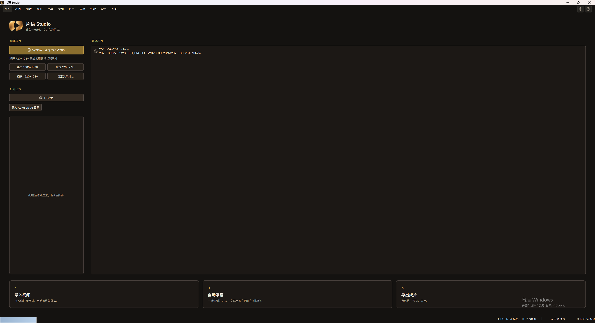

*欢迎页：新建项目 / 打开项目 / 拖入视频*

### 步骤 ① 导入

欢迎页点「新建项目」，或把视频拖进欢迎页；也可用 `Ctrl+I` / **文件 → 导入媒体**。

### 步骤 ② 重新识别

点 **② 重新识别**（或 **字幕 → 重新识别**），选语言。字幕出现在画布与时间线。

### 步骤 ③ 选风格

点 **③ 选风格**，点风格包预览；细调在右侧检查器。

### 步骤 ④ 导出

点 **④ 导出**（`Ctrl+E`）。工程用 `Ctrl+S` 存为 `.cutora`。

做到这里主线已跑通。

---

## 3. 主界面地图

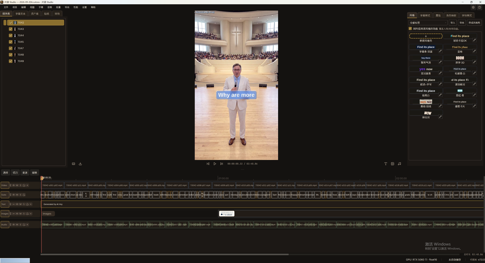

*主界面总览*

| 区域 | 名称 | 做什么 |
|------|------|--------|
| 顶 | 菜单栏 | 文件 … 帮助 |
| 顶 | 快捷步骤 | ①导入 · ②重新识别 · ③选风格 · ④导出 |
| 左 | 素材栏 | 媒体库 / 字幕文本 / 资产 / 贴纸 / 转场 |
| 中 | 预览 | 画布与字幕效果 |
| 右 | 检查器 | 风格、样式、属性、分屏、调色、关键帧 |
| 下 | 时间线 | 多轨与播放头 |

---

## 4. 顶栏菜单词典

需要时再查。每节配该菜单展开截图。

### 4.1 文件

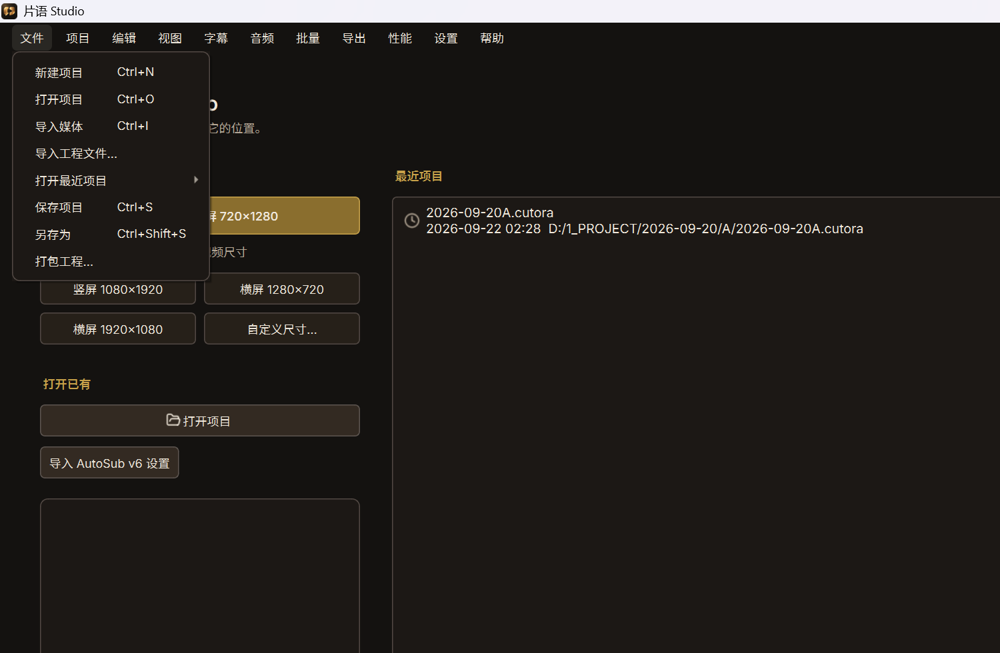

*菜单 · 文件*

| 菜单项 | 快捷键 | 作用 |
|--------|--------|------|
| **新建项目** | Ctrl+N | 新建空白工程，可选手竖屏 / 横屏 / 方形画布。 |
| **打开项目** | Ctrl+O | 打开 .cutora 工程（兼容旧版 .asproj）。 |
| **导入媒体** | Ctrl+I | 把视频加入媒体库与时间线。 |
| **导入工程文件…** | — | 把其它工程的视频和字幕合并进当前工程。 |
| **打开最近项目** | — | 子菜单列出近期工程。 |
| **保存项目** | Ctrl+S | 保存为 .cutora。 |
| **另存为** | Ctrl+Shift+S | 换路径另存。 |
| **打包工程…** | — | 工程与素材打成包，方便换机继续做。 |

### 4.2 项目

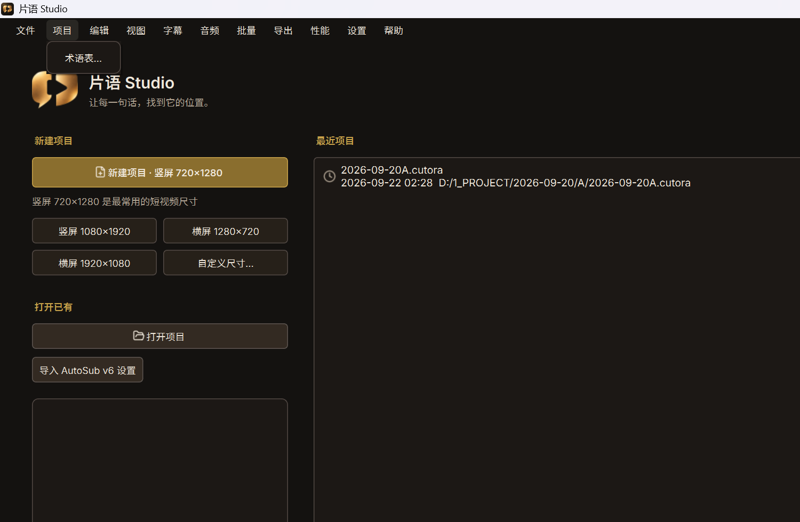

*菜单 · 项目*

| 菜单项 | 快捷键 | 作用 |
|--------|--------|------|
| **术语表…** | — | 维护专有名词，识别时更易写对品牌名、人名。 |

### 4.3 编辑

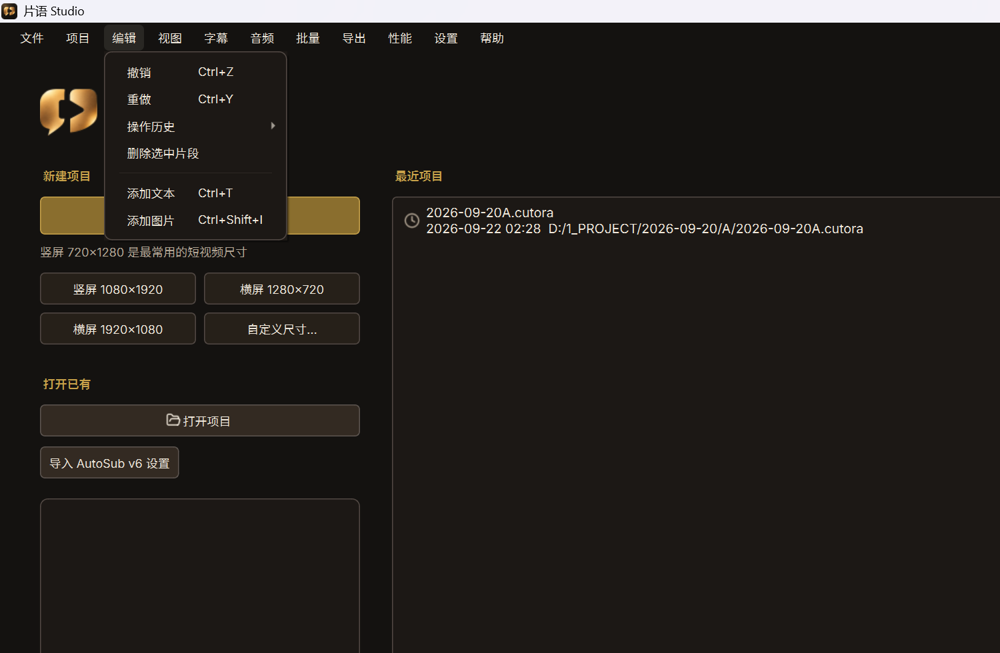

*菜单 · 编辑*

| 菜单项 | 快捷键 | 作用 |
|--------|--------|------|
| **撤销** | Ctrl+Z | 撤销上一步。 |
| **重做** | Ctrl+Y | 重做已撤销的操作。 |
| **操作历史** | — | 可跳转的历史步骤列表。 |
| **删除选中片段** | — | 删除时间线选中片段。 |
| **添加文本** | Ctrl+T | 添加文本层。 |
| **添加图片** | Ctrl+Shift+I | 添加图片层。 |

### 4.4 视图

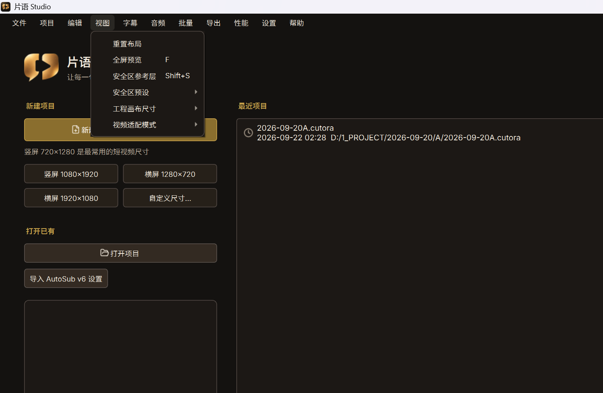

*菜单 · 视图*

| 菜单项 | 快捷键 | 作用 |
|--------|--------|------|
| **重置布局** | — | 停靠栏与预览恢复默认排布。 |
| **全屏预览** | F | 预览全屏；再按 F 退出。 |
| **安全区参考层** | — | 开关安全区参考线（平台参考值）。 |
| **安全区预设** | — | 选择不同平台安全区预设。 |
| **工程画布尺寸** | — | 竖屏 / 横屏 / 方形或自定义。 |
| **视频适配模式** | — | 适应 / 裁切 / 拉伸。 |

### 4.5 字幕

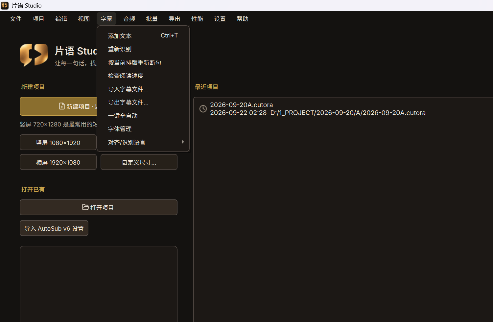

*菜单 · 字幕*

| 菜单项 | 快捷键 | 作用 |
|--------|--------|------|
| **添加文本** | Ctrl+T | 添加文本层。 |
| **重新识别** | — | 重新语音识别并对齐，生成字幕。 |
| **按当前排版重新断句** | — | 不重听写，只按当前样式重断句。 |
| **检查阅读速度** | — | 检查字幕是否过快（CPS）。 |
| **导入字幕文件…** | — | 导入外部字幕。 |
| **导出字幕文件…** | — | 导出当前字幕。 |
| **一键全自动** | — | 按当前设置自动跑识别等相关步骤。 |
| **字体管理** | — | 管理可用字体。 |
| **对齐/识别语言** | — | 选择识别与对齐语言。 |

### 4.6 音频

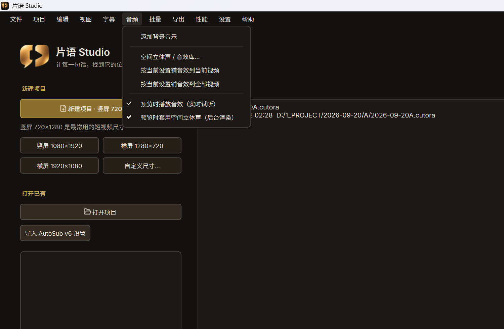

*菜单 · 音频*

| 菜单项 | 快捷键 | 作用 |
|--------|--------|------|
| **添加背景音乐** | — | 添加 BGM。 |
| **空间立体声 / 音效库...** | — | 打开空间声与音效库。 |
| **按当前设置铺音效到当前视频** | — | 音效设置应用到当前视频。 |
| **按当前设置铺音效到全部视频** | — | 应用到全部视频。 |
| **预览时播放音效（实时试听）** | — | 预览是否实时听音效。 |
| **预览时套用空间立体声（后台渲染）** | — | 预览是否后台渲染空间声。 |

### 4.7 批量

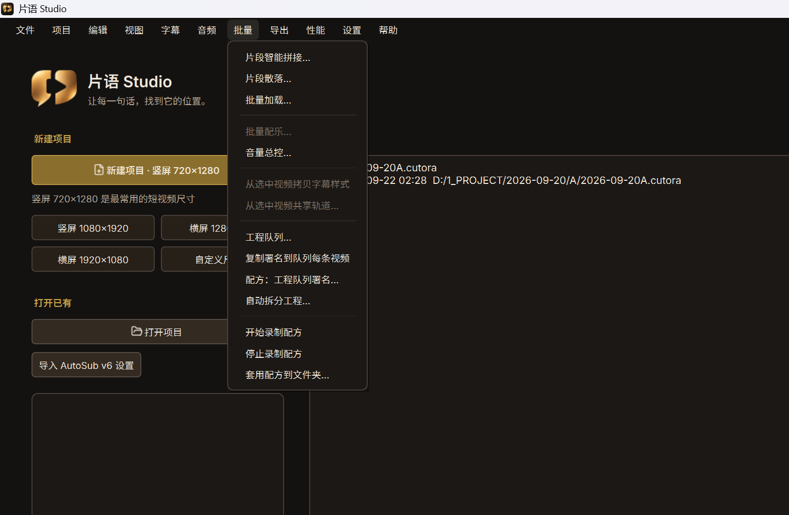

*菜单 · 批量*

| 菜单项 | 快捷键 | 作用 |
|--------|--------|------|
| **片段智能拼接…** | — | 多段口播按文案对齐拼接。 |
| **片段散落…** | — | 短 B-roll 撒到上层轨道。 |
| **批量加载…** | — | 一次加载多条素材。 |
| **批量配乐…** | — | 批量分配 BGM。 |
| **音量总控…** | — | 统一人声 / BGM 音量关系。 |
| **从选中视频拷贝字幕样式** | — | 拷贝字幕样式到其它视频。 |
| **从选中视频共享轨道…** | — | 共享轨道配置。 |
| **工程队列…** | — | 管理待处理工程队列。 |
| **复制署名到队列每条视频** | — | 署名复制到队列每条。 |
| **配方：工程队列署名…** | — | 用配方批处理队列署名。 |
| **自动拆分工程…** | — | 按规则拆成多个小工程。 |
| **开始录制配方** | — | 开始记录操作。 |
| **停止录制配方** | — | 结束录制。 |
| **套用配方到文件夹…** | — | 配方应用到文件夹内工程。 |

### 4.8 导出

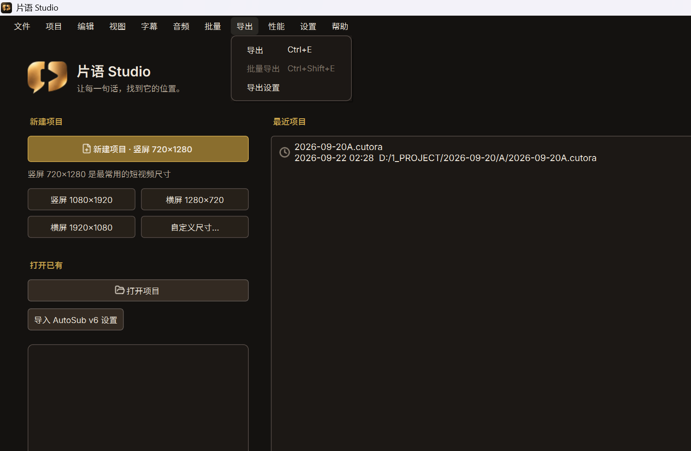

*菜单 · 导出*

| 菜单项 | 快捷键 | 作用 |
|--------|--------|------|
| **导出** | Ctrl+E | 导出当前成片。 |
| **批量导出** | Ctrl+Shift+E | 一次导出多条。 |
| **导出设置** | — | 分辨率、码率、格式等。 |

### 4.9 性能

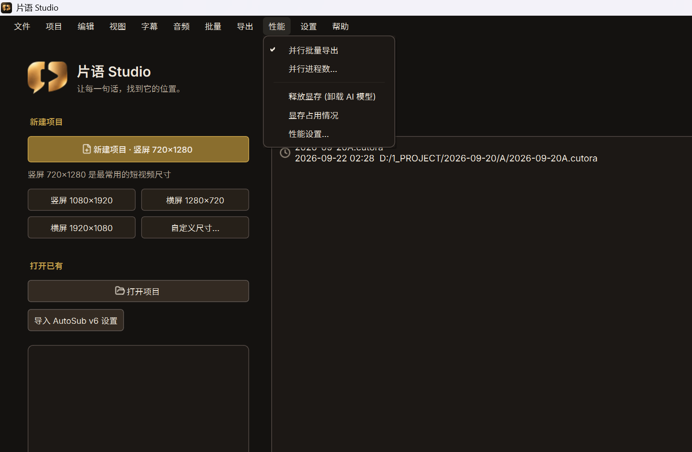

*菜单 · 性能*

| 菜单项 | 快捷键 | 作用 |
|--------|--------|------|
| **并行批量导出** | — | 是否多进程并行导出。 |
| **并行进程数...** | — | 设置并行进程数。 |
| **释放显存 (卸载 AI 模型)** | — | 卸载识别等模型，腾出显存。 |
| **显存占用情况** | — | 查看显存摘要。 |
| **性能设置…** | — | 打开设置中的性能页。 |

### 4.10 设置

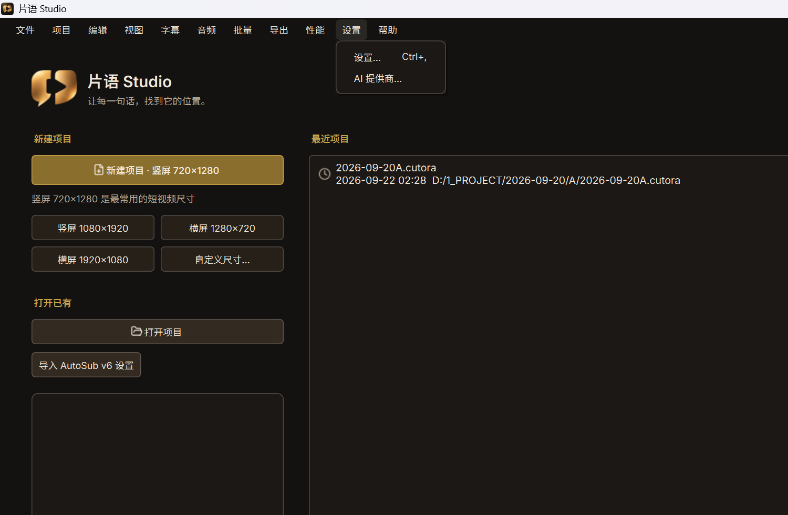

*菜单 · 设置*

| 菜单项 | 快捷键 | 作用 |
|--------|--------|------|
| **设置…** | Ctrl+, | 语言、路径、性能、外观等。 |
| **AI 提供商...** | — | 配置 AI / 识别相关提供方。 |

### 4.11 帮助

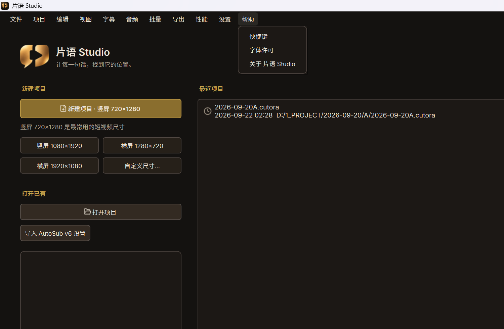

*菜单 · 帮助*

| 菜单项 | 快捷键 | 作用 |
|--------|--------|------|
| **快捷键** | — | 快捷键一览。 |
| **字体许可** | — | 捆绑字体许可说明。 |
| **关于 片语 Studio** | — | 版本与第三方授权入口。 |

---

## 5. 进阶生产能力（主线跑通后再看）

- **片段智能拼接**：批量 → 片段智能拼接…
- **片段散落**：批量 → 片段散落…（B-roll 建议落到 Video 2+）
- **分屏**：检查器 → 属性 → 分屏
- **转场**：左侧素材 → 转场
- **调色**：检查器 → 属性 → 调色
- **简易关键帧**：属性旁菱形按钮

---

## 6. 版权、许可与分发

| 项 | 内容 |
|----|------|
| 显示名称 | 片语 Studio |
| 工程名 | CUTORA |
| 版本 | 7.0.0 |
| 标语 | 让每一句话，找到它的位置。 |

### 分发范围

根目录 `INTERNAL_USE.txt` 写明：**内部使用，不对外分发**。

- 仅供可信内部使用者
- 不要发到公网或未授权外部人员
- 对外发布须另行完成法务与第三方许可门禁（见 `THIRD_PARTY.md`）

### 本软件许可

源码为 **GPL-3.0-or-later**。内部使用仍应遵守 GPL；若对外分发，须同时满足 GPL 与第三方再分发条件。

### 第三方与字体

- 清单：`THIRD_PARTY.md`
- 应用内：帮助 → 关于 片语 Studio → 第三方授权；帮助 → 字体许可
- 部分组件为专有或非商业许可：内部使用 ≠ 可对外整包再分发

---

## 7. 快捷键与故障速查

| 快捷键 | 作用 |
|--------|------|
| Ctrl+N / Ctrl+O | 新建 / 打开 |
| Ctrl+I | 导入媒体 |
| Ctrl+S | 保存 |
| Ctrl+Z / Ctrl+Y | 撤销 / 重做 |
| Ctrl+E / Ctrl+Shift+E | 导出 / 批量导出 |
| F | 全屏预览 |
| Ctrl+, | 设置 |

| 现象 | 可先试 |
|------|--------|
| 识别很慢 | 查 NVIDIA 驱动；性能 → 显存占用 |
| 显存紧张 | 性能 → 释放显存 |
| 布局弄乱 | 视图 → 重置布局 |

——

*截图来自本机实际窗口。若构建文案略有出入，以窗口为准。*
