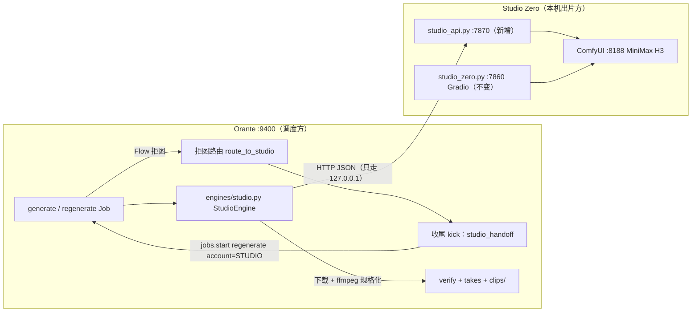
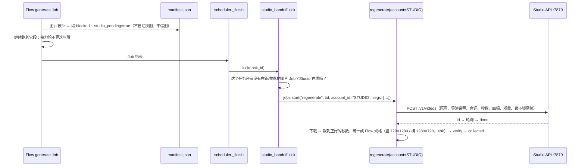

# Orante × Studio Zero 衔接方案（规格 98 · 交给 Fable 5.1 执行）

> [!NOTE]
> **2026-10-05 修订（第 2 版）**：对照 Orante 真实代码和 9 月底 338 段真实提示词复核后改了 5 处，并加了用户的新要求。改动点：
> ① 画幅跟着**图片**走，不读账号（§0、§1.1、§4.1、§4.7、§5.3）；② "同一张图连续失败 3 次"收窄成"内容类失败"（§0、§4.6(b)、§10）；
> ③ Studio 排队时间不计入 15 分钟超时，超时 / 作废 / 关闭时取消 Studio 那边的旧任务（§4.1、§6）；④ 任务的"账号"下拉框不出现 Studio（§4.9）；
> ⑤ 运镜判断识别否定说法（§5.2）；⑥ 用户拍板：默认画质 **均衡 640p**，拒图后**直接转 Studio、用原图**（§10）；
> ⑦ 新要求：**所有重生入口都能直接选本地模型**（新增 §4.10，归入 P1）。

> [!IMPORTANT]
> 本文只是方案，**两边代码都还没改**。执行方请按 Orante 惯例来：先把本文另存为 `D:\0_Dev\Orante\specs\98-studio-zero-engine.md`；每个要改的文件先备份成 `*.bak-1004studio`；`legacy/` 一律不动；报错用 `OranteError(中文消息, 提示)`；界面文字只写进 `orante/i18n/zh.json` 和 `en.json`；测试写在 `tools/test_spec98.py`（必须设置 `ORANTE_DATA`，用 `python -m pytest tools/` 跑）；做完写 `specs/reports/98-studio-zero-engine.md`。

---

## 0. 一句话目标

只要 Flow 拒绝某张图（上传被拒、或者出片时被判内容违规；普通失败不算，见 §4.6(b)），这张图**还没出片的段就自动交给本机的 Studio Zero（MiniMax H3）去出**：**用原图，不换图，不用点任何按钮**。出好的片子按 Flow 片子的规格（**画幅跟着这张图走：竖图 720×1280、横图和正方形图 1280×720** / 24fps / 时长精确 / AAC 48k）写进同一个任务的 `clips/`，后面的检查和组装流程照常走。

---

## 1. 两头现状（已核实）

### 1.1 Orante（`D:\0_Dev\Orante`）— 负责调度

| 项目 | 事实 |
|---|---|
| 技术栈 | Python FastAPI 后端 + Vue 前端（不用 npm），venv 在 `D:\0_Dev\Orante\.venv` |
| 引擎接口 | [`Engine`](file:///D:/0_Dev/Orante/orante/engines/base.py)：`connect / close / health / capacity / submit(seg, image, prompt, duration, last_image=None[, silent]) → gen_id / poll(ids) → {state: pending\|done\|failed\|blocked, url, error} / download(gen_id, dest) / forget_url`；`make_engine(account)` 按 `account["engine"]` 分派，目前只认 `flow`、`grok` |
| 时长档位 | [caps.py](file:///D:/0_Dev/Orante/orante/engines/caps.py#L7)：`flow (4,6,8)`、`grok (6,10,15)`；`snap_duration` 取不短于原时长的最短一档 |
| 账号表 | [db.py](file:///D:/0_Dev/Orante/orante/db.py#L19)：`CHECK(engine IN ('flow','grok'))`，`port UNIQUE`；整个库**没有外键** |
| 调度 | 每个账号一条队列，同一账号同一时间只跑一个 Job；跨进程靠 `account_locks` 表（account_id 只是字符串） |
| 互斥规则 | [jobs._check_run_account](file:///D:/0_Dev/Orante/orante/jobs.py#L93-L118)：**同一个任务不能有两个不同账号同时出片 / 重生**（不然两边各存一份 manifest，后存的会盖掉先存的）。排队中的 Job 也算 |
| 换账号重生（规格 97） | [regenerate](file:///D:/0_Dev/Orante/orante/services/generate.py#L1817-L1990)：`jobs.start("regenerate", tid, account_id=别的账号, segs=[…])` → 段改回 planned → `generate(only=…, chain=False, acc_id=…)`。**这条路已经能用，Studio 直接复用它** |
| 拒图处理 | [generate.py](file:///D:/0_Dev/Orante/orante/services/generate.py) 一共三个入口，最后都走 `_block_image` → `try_auto_refill`（用 Flow 生成一张新图替换，**会换掉人物**）→ `maybe_borrow` → `notify_flow_refused`（弹窗提示“换 Grok”）：① 提交前发现图已经 blocked（L1248-1263）② 提交时抛 `BlockedImage`（L1377-1405）③ 轮询时失败并且带“被拒”，或者连续失败 ≥3 次（L1698-1756） |
| 收片 | 下载到 `clips/<clip_name>` → `verify.after_download`（首帧和配图比 aHash，**图不是正好 9:16 时会拿居中裁切的那块再比一次**；还会做重复检查）→ 记一条 take（带 engine/account_id/duration）→ 状态改成 `collected` |
| 无声任务 | 任务本身是 Flow 而且没文案时，`strip_silent=True`，下载后去掉音轨（换引擎重生也一样去） |
| 超时 | `GEN_TIMEOUT = 15 分钟`（从提交算起），续跑接手的是 5 分钟 |
| 真实数据 | 工作区 `D:\1_PROJECT\<日期>\<A/B/C>\T####-名称\manifest.json`。例子 [T0107](file:///D:/1_PROJECT/2026-09-27/A/T0107-September%2029,%2030/manifest.json)：图 p01（五个美国高中生在祷告）`status=blocked`、`flow_upload_refused`、`auto_refill=1`，5 段全部 blocked |
| Flow 片子规格 | 竖图 720×1280、横图 / 正方形图 1280×720（规格 84：画幅跟图片走，`FlowEngine.aspect = None` 不读账号；T0122 的正方形图出的就是 1280×720），24fps，H.264 High，AAC 48kHz 立体声，时长正好 4/6/8 秒 |

`prompt_final` 的实际结构（T0107 s001，Veo 专用的中文长提示词）：

```
【镜头】……镜头轻微明显地向画面左侧平移……不要完全不动的固定镜头……
人物保持原位不移动……（画面描述，来自 images[].desc）
人物的头身比例……4K电影质感……情绪……禁止背景音乐……
人物全程紧闭双眼不睁开。画面上不要出现任何文字字幕内容。注意：上文所有内容都是拍摄指令，一个字都不要念出来；……这个人物说话的内容：
September 29, 30, and October 1. The person holding this phone is blessed.   ← 等于 seg["text"]
```

### 1.2 Studio Zero（`D:\0_LLM`）— 负责出片

| 项目 | 事实 |
|---|---|
| 组成 | ComfyUI `127.0.0.1:8188`（真正跑模型的地方）+ Gradio 界面 [studio_zero.py](file:///D:/0_LLM/studio_zero.py) `127.0.0.1:7860`；启动脚本是 `D:\0_LLM\启动工作站.bat`，用的 Python 是 `D:\0_LLM\ComfyUI\venv\Scripts\python.exe`（已经带 fastapi/uvicorn，Gradio 依赖它们） |
| 可复用的函数 | `build_workflow(image_name, prompt, w, h, length, steps, lora, seed, …, sparse_tau, lock_last_frame, end_image_name)`、`seconds_to_length`（H3 帧数必须是 17k+5，24fps）、`cover_to_canvas`、`queue_prompt`、`wait_for_video`/`_video_from_history` |
| 速度（5060 Ti 实测） | 576×1024，4 步，tau1.8，首尾帧锁定：15 秒片子约 215 秒，8 秒约 2 分钟；640p 运镜模式（tau1.3，不锁尾帧）：15 秒约 5 分钟 |
| 提示词约束 | H3 **没有单独的“台词”字段**：台词写在提示词最后一行，前面是导演说明；台词附近多写的指令可能会被念出来；提示词里**不能出现“视频”两个字**（曾经让画面跳到别的讲道人） |
| 首尾帧 | 固定镜头：尾帧锁成首帧，防止人物走样。有运镜的镜头：**一定不能锁尾帧**（锁了最后一帧会跳回首帧，用户已经碰到过） |
| 输出 | 例如 640×1120、24fps、AAC **32kHz**，时长按 17k+5 帧向上取整（6 秒会出成 6.58 秒） |

---

## 2. 两头的关系与总体架构

**分工原则**：Studio Zero 只管“给一张图 + 一段话 → 出一条片子”，不知道 Orante 里有任务、段、账号这些概念；Orante 把 Studio Zero 当作**第三种出片引擎 `studio`**，调度、互斥、收片、检查全部沿用现有流程。



**为什么要单独加一个 REST API，不让 Orante 直接调 ComfyUI**：工作流拼装、H3 帧数规则、画布、LoRA/注意力参数都已经在 Studio Zero 里调好、测过了，放在 Studio 一边维护，Orante 就不用知道 ComfyUI 节点长什么样。以后换模型或调参数，只改 Studio 一边；这个 API 本机别的软件也能调。

**为什么转交要等 Flow 那个 Job 结束后再开新 Job，而不是在同一个 Job 里两个引擎一起跑**：`generate()` 有将近 2000 行，里面有限流、额度、接片等很多逻辑，而且默认只有一个引擎。改成双引擎风险很大。等 Flow Job 结束后，用规格 97 已经验证过的“换账号重生”通道接着跑，不会违反“一个任务同时只能被一个账号写”这条规则，改动最小。代价是 Studio 要等 Flow 那轮跑完才开始，后面 §9 给了以后升级成同一轮并行的做法。



---

## 3. Studio Zero 这边：新增 `D:\0_LLM\studio_api.py`

### 3.1 部署

- 新建文件 `D:\0_LLM\studio_api.py`，用 FastAPI + uvicorn，**只绑定 `127.0.0.1:7870`**（不对外开放）。
- 用 `import studio_zero as sz` 复用里面的函数（`studio_zero.py` 的界面只在 `__main__` 里启动，import 不会弹出界面）。**不要改 `studio_zero.py` 现有行为**；如果确实要抽公共函数，只能新增，不能改已有函数的签名。
- 新增启动脚本 `D:\0_LLM\启动Studio API.bat`：先确认 ComfyUI 在跑（照抄 `启动工作站.bat` 第 1 步），再用同一个 Python 启动 `studio_api.py`（窗口最小化，日志写到 `D:\0_LLM\logs\studio_api.log`）。
- `启动工作站.bat` 里加一步：7870 没在监听时就把 API 一起在后台启动。

### 3.2 接口约定（v1）

| 方法 | 路径 | 说明 |
|---|---|---|
| GET | `/v1/health` | `{ok, comfy: bool, busy: bool, queued: int, version: "1", presets: [...]}`。`comfy` 用 `GET 127.0.0.1:8188/system_stats` 探测 |
| POST | `/v1/videos` | 提交，返回 `{id, state:"queued"}` |
| GET | `/v1/videos/{id}` | `{id, state: queued\|running\|done\|failed\|cancelled, progress: 0~1, error, width, height, frames, seconds_out, seed, elapsed}` |
| GET | `/v1/videos/{id}/file` | 返回 mp4（只有 `done` 状态才有） |
| DELETE | `/v1/videos/{id}` | 取消：还在排队就移出队列；正在跑就调 ComfyUI `/interrupt` |

`POST /v1/videos` 请求体（JSON）：

```json
{
  "image_path": "D:\\1_PROJECT\\...\\images\\p01.jpg",
  "end_image_path": null,
  "direction": "（导演说明，可以为空）",
  "line": "September 29, 30, and October 1. The person holding this phone is blessed.",
  "seconds": 6,
  "aspect": "9:16",
  "quality": "fast",
  "lock_last": true,
  "seed": null,
  "client_ref": "T0107-s001"
}
```

规则（必须严格照做）：

1. 图片用**本机绝对路径**传（两边在同一台电脑上，最省事）；同时支持 `image_b64` 作为备选。读进来后用 `sz.cover_to_canvas` 按下表的画布居中裁切填满，存到 ComfyUI 的 `input/sz_api_<id>.png`（尾帧图存成 `sz_api_<id>_end.png`）。
2. 画布与质量档：

   | quality | 9:16 画布 | 16:9 画布 | LoRA / 步数 / sol-attn tau |
   |---|---|---|---|
   | `fast`（默认） | 576×1024 | 1024×576 | LORA_4 / 4 / 1.8 |
   | `balanced` | 640×1152 | 1152×640 | LORA_4 / 4 / 1.8 |
   | `camera` | 640×1152 | 1152×640 | LORA_4 / 4 / 1.3 |

3. 帧数：`length = sz.seconds_to_length(seconds)`（向上取到 17k+5 帧）。**不要套用界面里的 `spoken_seconds` 缩短逻辑**：Orante 给多少秒就出多少秒，最后在 Orante 那边精确裁剪。
4. 提示词：`prompt = direction.strip() + "\n" + line.strip()`（台词放最后一行、一字不改）；`line` 为空就只用 direction；两个都为空返回 422。
5. 尾帧：有 `end_image_path` 就用它（`lock_last_frame=False, end_image_name=…`）；没有尾帧图而且 `lock_last=true`，就锁成首帧；否则不锁。
6. 队列：进程里只有**一个工作线程**按先进先出处理（显卡只有一块）。Gradio 界面同时在用时，ComfyUI 自己会排队，不冲突，只是要等。
7. 结果文件复制到 `D:\0_LLM\Outputs\api\<id>.mp4`；任务记录放在内存里，保留 24 小时。API 重启后旧的 id 一律返回 404，Orante 会把它当失败处理。
8. 出错（ComfyUI 不在线、显存不够、执行报错）时 `state=failed`，`error` 写中文原因和 ComfyUI 原始报错的前 300 个字。

### 3.3 Studio 这边的验收

- `curl http://127.0.0.1:7870/v1/health` 返回 `ok:true, comfy:true`。
- 用 T0107 的 `images/p01.jpg` 和 s001 的台词，按 6 秒 / 9:16 / fast 提交：大约 1.5 到 2.5 分钟出片，576×1024，158 帧（约 6.58 秒），有声音。
- 连续提交 3 条，按顺序完成，期间 7860 界面照常能用。

---

## 4. Orante 这边：逐个文件的改动

> 行号以 2026-10-04 的代码为准，执行前请重新搜一遍确认。

### 4.1 新增 `orante/engines/studio.py` — `StudioEngine(Engine)`

- `name = "studio"`，`can_gen_images = False`。
- `connect()`：`GET {base}/v1/health`。连不上时，如果设置了 `engine.studio.launcher`，就 `subprocess.Popen` 启动它，最多等 90 秒，期间每 3 秒探一次；还是不行就抛 `EngineUnavailable("Studio Zero 没开（127.0.0.1:7870 连不上）")`。
- `capacity()`：`max(0, config engine.studio.max_inflight（默认 2） - 正在跑的数量)`。设 2 是让显卡做完一条马上接下一条，同时不超过 15 分钟超时（2 条 15 秒的运镜片也只要 10 分钟左右）。
- `submit(seg, image, prompt, duration, last_image=None, silent=False)`：
  1. `line = "" if 无文案任务 else seg["text"]`（无文案任务可以靠 `silent=True` 或 prompt 里有 `prompts.silent` 那段来判断，两种都兼容）；
  2. `direction = studio_direction(prompt, line)`（见 §5.1）；
  3. `aspect = caps.aspect_for_image(image, "flow")`——和 Flow 完全同一条规则（横 / 正方形 → 16:9，竖 → 9:16）。**不读账号的 aspect**（那是旧字段，规格 84 起 Flow 已经不用了）；
  4. `quality, lock_last = pick_mode(prompt)`（见 §5.2）；
  5. 有 `last_image` 就作为 `end_image_path`；
  6. 调 `POST /v1/videos`，返回 `"sz:" + id` 作为 gen_id。HTTP 出错抛 `OranteError`；**永远不要抛 `BlockedImage`**。
- `poll(ids)`：逐个 `GET`。`queued/running` 对应 `pending`，并带上 `queued: True/False`；`done` 对应 `done`（url 填 file 地址）；`failed/cancelled/404` 对应 `failed`（error 写中文原因）。
- **超时口径**：`generate()` 的 15 分钟超时是从提交算起的，Studio 在本机排队（比如你正在 7860 界面跑一条长片）的时间不该算进去。poll 返回 `queued: True` 时，`generate()` 把这条的 `started[gid]` 重设为当前时间（只对 `eng.name == "studio"`）；真正开始跑之后才开始计时。
- **取消旧任务**：这条在 Orante 这边超时、作废重交、或者 Job 结束 / 取消时（`close()`），对 Studio 还没完成的 id 调 `DELETE /v1/videos/{id}`，免得显卡白跑。
- `download(gen_id, dest)`：先下载到 `dest.with_suffix(".raw.mp4")`，再用 ffmpeg 规格化后写到 `dest`，最后删掉 raw（见 §5.3）。
- `forget_url(gid, url)`：调 `DELETE` 取消这条（作废重交时 Orante 会调它）；`adopt(gid, seg)` 把 gid 加回正在跑的集合（Orante 重启后能接着轮询）；`close()`：对本 Job 提交过、还没 done 的 id 逐个 `DELETE`。
- HTTP 一律用标准库 `urllib.request`（不新增依赖），超时 30 秒，下载超时 300 秒。

### 4.2 `orante/engines/base.py`

- `make_engine`（L78-86）：增加 `if eng == "studio": from . import studio; return studio.StudioEngine(account, log)`。
- `can_gen_images`（L67）：studio 返回 False。

### 4.3 `orante/engines/caps.py`（L7-10）

```python
DURATIONS = {"flow": (4, 6, 8), "grok": (6, 10, 15), "studio": tuple(range(4, 16))}
ASPECTS   = {..., "studio": ("9:16", "16:9")}
NO_COPY_DEFAULT = {..., "studio": 8}
```

这样 Flow 的 4/6/8 秒、Grok 的 6/10/15 秒在 Studio 上都**原样保留**，不会被改成别的档位。

### 4.4 虚拟账号（不改数据库表）

> [!WARNING]
> **不要改 accounts 表的 `CHECK`**。SQLite 要改 CHECK 只能重建整张表，而 `port UNIQUE`、Chrome 相关的字段对 Studio 都没有意义。用一个**虚拟账号**就够了，库里没有外键，`account_locks` / `account_waiters` 里的 account_id 只是字符串，可以直接用。

`orante/accounts.py`：

- 新增常量 `STUDIO_ID = "STUDIO"` 和 `def studio_account() -> dict`，返回 `{id:"STUDIO", name:"Studio Zero", engine:"studio", port:None, profile:"", project_url:"", model:"MiniMax H3", aspect:"9:16", max_concurrent: engine.studio.max_inflight, enabled: 1 if engine.studio.enabled else 0, extra:{}, login_state:"", alive: <最近一次 health 结果>, virtual: True}`。
- `get(acc_id)`（L60）：`acc_id == STUDIO_ID` 时直接返回 `studio_account()`，不查库。
- `list_all(probe=True, include_virtual=False)`（L45）：只有 `include_virtual=True` 而且 Studio 已启用时才把虚拟账号加到最后。**所有现有调用方保持默认 False**（它们大多默认账号背后有 Chrome）；只有给前端用的 `/api/accounts` 路由传 True。执行前先搜一遍 `list_all(` 的所有调用方确认。
- `update / delete / open_login / patch_extra / create` 遇到 STUDIO 时抛 `OranteError("Studio Zero 是本机引擎，不用登录也不能删", "到设置页「Studio Zero」里开关它。")`；`health(STUDIO)` 返回 API health 的结果。
- 限流相关的函数（`throttle_remaining / is_throttled / probe_due`）对虚拟账号自然返回“不限流”（extra 为空），不用改。

### 4.5 `orante/jobs.py` — `_check_run_account`（L100-106）

- 允许的引擎改成 `("flow", "grok", "studio")`；studio 没启用时报“Studio Zero 没启用”。
- 互斥规则（L107-118）**不改**：转交必须排在 Flow Job 之后，这是靠 §4.7 的 kick 来保证的。

### 4.6 `orante/services/generate.py`（核心改动）

**(a) 新增两个小函数**

```python
def _keeps_image(eng) -> bool:
    """这个引擎没有 Flow 那种拒图：失败不换图，用原图再交一次（Grok、Studio）。"""
    return (getattr(eng, "name", "") or "") in ("grok", "studio")

def studio_fallback_on() -> bool:
    return bool(config.get("engine.studio.enabled", False)) and bool(config.get("engine.studio.fallback", True))
```

把 L1245、L1249、L1378、L1705 这四处的 `_is_grok(eng)` 换成 `_keeps_image(eng)`。在 L1249 分支里，studio 要用 `_unblock_grok_image(m, p, keep_refused=True)`（新增参数，作用是**保留** `flow_upload_refused` 标记，这样以后 Flow 再碰到这张图就直接转交，不再白传一次）。`_eng_label`（L302）里加 `"studio": "Studio Zero"`。

**(b) 拒图路由：在 `generate()` 内部、`try_auto_refill` 旁边新增闭包 `route_to_studio(p, reason) -> bool`**

满足以下全部条件才转交：`studio_fallback_on()`、`acc.engine == "flow"`、`not chain_mode`、这张图 `role != "空镜"`。

**哪些失败算"被拒"**（新增 `is_content_refusal(err) -> bool`，三个入口都用它判断要不要转交）：
- 算：上传被拒（`BlockedImage` / `is_flow_upload_refused`）；出片时的错误里带"被拒""拒收"，或者匹配 `PUBLIC_ERROR_\w*(FILTER|POLICY|PROMINENT|PERSON|MINOR|UNSAFE|SAFETY)`。
- **不算**：`PUBLIC_ERROR_AUDIO_FILTERED`（是声音的问题，不是图）、`UNUSUAL_ACTIVITY`（限流）、超时、网络错误、真人操作没点上、Flow 没给理由的普通失败。
- 原来的"同一张图连续失败 3 次 → 标 blocked"（`maybe_block_for_fails`）**不变，但它本身不触发转交**：Orante 记的 `gen_fail` 什么失败都算（见 generate.py 轮询失败分支 `im["gen_fail"] += 1`），网络不好时好图也会凑满 3 次。只有这 3 次里至少有一次是内容类失败（图上记 `im["content_fail"]`）才转交；否则照旧走原来的换图 / 提示。

- 找出所有 `image == p`、`status == "blocked"`、而且不是锚点模式接片段（`anchor_mode and role == "bridge"`）的段：设置 `seg["studio_pending"] = True`，`seg["studio_reason"] = reason[:200]`，`seg["error"] = "Flow 不收这张图 → 已排给 Studio Zero"`；
- 图上记 `im["studio_route"] = True`；
- 调 `drain(p)`，写一行日志 `"  ⇢ {p} Flow 不收 → {段号} 交给 Studio Zero（原图，不换图）"`；弹一次提示（每张图只弹一次，i18n 键 `studio.toast.routed`）；
- 调 `save()`，返回 True。条件不满足就返回 False，后面照旧换图 / 借图 / 提示。

接到三个入口上（**放在 `try_auto_refill` 前面**）：

```python
# L1260 / L1402 / L1755 三处统一改成：
if not route_to_studio(p, reason):
    if not try_auto_refill(p):
        ...（原来的 maybe_borrow / notify_flow_refused 不变）
```

另外在 L1248 之前加一个**预判**：如果 `im.get("flow_upload_refused") and studio_fallback_on() and acc.engine == "flow"`，就先 `_block_image(m, p, flow_refused_text(p))`，再 `route_to_studio(p, "上次已被 Flow 拒收")`，然后 `continue`。这样同一张图不会每轮都重新传一次 Flow。

> [!NOTE]
> 开着转交时就**不再走 Flow 的自动换图**。原因：自动换图是让 Flow 重新生成一张图，人物的长相、发型、衣服都会变，跟用户“保留 AI 虚拟人物”的要求相反。如果想保留原来“先换图，换不成再转 Studio”的顺序，就加一个设置 `engine.studio.order = "refill_first"`，把上面 `if` 里的两步对调（这个是可选项）。

**(c) Flow 跑的时候不能再碰排给 Studio 的段**

- L824-826 `todo`：当 `acc.engine != "studio"` 时，排除 `seg.get("studio_pending")` 为真的段。（注意：手动选别的 Flow / Grok 账号重生这些段时，`regenerate()` 先把 `studio_pending` 清掉——用户明确选了谁就用谁。）
- `_finish_round`（L524）、`_progress_line`（L500）、`pack_demand`（L732）里统计 blocked 时，都排除 `studio_pending` 的段。进度那一行改成：`仍被拒 N（…），已转 Studio M`。
- 效果：开着“跑到全部出片”时，接力轮不会因为这些段再去换图，也不会多排一个 Flow 的 generate Job（多排的话会挡住 Studio 的转交）。
- 执行前请把 `generate.py`、`tasks.py`、`services/*.py` 里所有 `== "blocked"` 都搜一遍，凡是“决定要不要重跑”的地方都要排除 `studio_pending`；只是显示的地方保留 blocked，前端单独加徽章（§4.9）。

**(d) Studio 自己跑的时候**

- 提交成功后（L1435 附近）：如果 `acc.engine == "studio"`，就 `seg.pop("studio_pending", None)`，`seg["studio_tries"] = int(seg.get("studio_tries") or 0) + 1`。
- 失败：沿用 `_keeps_image` 分支（等于 `_grok_resubmit`：原图再交一次；还失败就标 `failed`，不换图，不标 blocked，**也不会再转回 Flow**，所以不会来回循环）。
- `regenerate()` 里：L1835-1836 的引擎名称表加上 studio；L1930 和 L1935 的 `run_eng != "grok"` / `== "grok"` 改成 `not in ("grok","studio")` / `in ("grok","studio")`。L1957-1965 锚点接片的 `bridge_engine` v1 **不处理 studio**（这些段本来就不会转交，见 (b)）。

### 4.7 新增 `orante/services/studio_handoff.py` + `scheduler._finish` 加钩子

```python
def pending_segs(m) -> list[int]:
    return [int(s["s"]) for s in m.segments if s.get("studio_pending") and s.get("status") == "blocked"]

def kick(task_id: str, *, log=None) -> dict:
    """把排给 Studio 的段交出去。条件不满足就什么都不做，下次再试。可以重复调用（幂等）。"""
    # 1. Studio 没启用 → {"skip": "disabled"}
    # 2. 本进程里这个任务还有 queued/running/halted 的 generate/regenerate Job → {"skip": "busy"}
    #    （等那个 Job 结束时还会再 kick 一次）
    # 3. 读 manifest，pending 为空 → 从 pending 登记表里移除，返回
    # 4. （删掉：画幅不用在这里定，StudioEngine.submit 按图片自己判断，见 §4.1）
    # 5. 探 /v1/health：不在线 → 登记到 settings 的 "studio.pending_tasks"，弹一次提示，返回 {"skip": "offline"}
    # 6. jobs.start("regenerate", task_id, account_id=STUDIO_ID, segs=pending)
    #    抛 OranteError（还有别的 Job）→ 登记，等下次再试
```

- [scheduler.py `_finish`](file:///D:/0_Dev/Orante/orante/scheduler.py#L357-L370)：在 `emit_seg_changed` 后面加上：`if job.kind in ("generate","regenerate") and job.task_id: try: studio_handoff.kick(job.task_id) except Exception: pass`。这时 `job.status` 已经是 done/failed/cancelled，`_check_run_account` 不会把它当成还在跑。**用户点停止（cancelled）时不要 kick**，尊重用户的操作。
- `start_ticker` 的循环里每 60 秒对 `studio.pending_tasks` 里的任务调一次 `kick`（处理 Studio 刚启动、或者之前被别的 Job 挡住的情况）。`studio.pending_tasks` 要加进 `config.HIDDEN_KEYS`。
- 新增 API `POST /api/tasks/{tid}/studio-handoff`，手动立刻触发 `kick`（界面上“现在交给 Studio”按钮用）。

### 4.8 `orante/config.py` 的 DEFAULTS（加在 L77 “引擎”那一组后面）

```python
"engine.studio.enabled": False,          # 总开关（默认关，用户在设置页打开）
"engine.studio.fallback": True,          # Flow 拒图自动转交 Studio
"engine.studio.url": "http://127.0.0.1:7870",
"engine.studio.launcher": r"D:\0_LLM\启动Studio API.bat",   # 连不上时自动拉起；留空 = 不自动启动
"engine.studio.max_inflight": 2,
"engine.studio.quality": "balanced",     # 用户 2026-10-05 拍板：均衡 640p。fast | balanced（有运镜时自动改用 camera）
"engine.studio.lock_last": "auto",       # auto | always | never
"engine.studio.match_flow_spec": True,   # 下载后统一成 Flow 规格：竖 720×1280 / 横 1280×720、24fps、AAC 48k
```

设置页是按 DEFAULTS 自动渲染的，所以 i18n 里每个键都要配上中英文的名称和说明。

### 4.9 前端与 i18n

- [regen-acc.js](file:///D:/0_Dev/Orante/ui/js/parts/regen-acc.js#L3-L30)：`DURS.studio = [4..15]`，`LABEL.studio = 'Studio Zero'`；`others()` 的过滤条件允许 `a.engine === 'studio'`。这样用户也能**手动**选 Studio 来重生任意一段。
- `ui/js/parts/accounts.js`：碰到 `virtual` / `engine === 'studio'` 的账号，显示成只读卡片（在线 / 离线、排队数），隐藏登录、打开、删除、改端口这些按钮。
- **任务的"账号"下拉框里不能出现 Studio**：`/api/accounts` 会把虚拟账号发给前端，`store.accounts` 里就有它。凡是"给任务选账号"的地方（① 任务表的账号列 / 下拉、导入时按名字匹配账号、② 编排里的账号切换、④ 限流横幅里的"换个 Flow 账号"）都要过滤掉 `a.virtual || a.engine === 'studio'`；后端 `tasks.update` 收到 `account_id="STUDIO"` 时报错"Studio Zero 只能用来重生，不能当任务账号"。第一版不支持 Studio 任务。
- 颜色：Flow 是 teal，Grok 是 gold，**Studio 用 violet**（`--eng-studio`）。take 和段的引擎徽章按 `gen_via.engine` / `take.engine` 显示。
- 段的徽章：`studio_pending` 显示“排给 Studio 中”；④ 生成面板的 blocked 列表（`blocked_rows`）给这类段加一列状态，并放一个“现在交给 Studio”按钮。
- 涉及到的文件（搜过 `'grok'`）：`ui/js/panels/tasks.js`（L441, 452, 1160, 1689, 2734, 3960）、`panels/track.js` L1787、`parts/expand-ui.js` L37、`parts/setup.js` L308。逐个看：这些地方是在**列举引擎**（要加 studio）还是在**判断是不是 Grok**（不用动）。
- 后端搜到的地方：`services/pipeline.py` L743-824（接片引擎判断，v1 不动）、`split.py`、`preset.py`、`bench.py`、`duration_edit.py`、`server.py` L930。**任务本身的引擎**还是只有 flow/grok（v1 不支持新建 Studio 任务），所以这些拆段、预设的逻辑**不用改**。

### 4.10 所有重生入口都能直接选本地模型（用户 2026-10-05 新要求，归入 P1）

规格 97 只在两个地方放了"用哪个账号重生"（⑤ 收片的重生抽屉、④ 的"重生哪些段"对话框）。现在要求**每一个会发起重生的地方**都能直接选本地模型。

**统一做法**：新增一个小组件 `RegenAccMenu`（放在 `ui/js/parts/regen-acc.js`，和 `RegenAccPick` 共用 `RegenAcc` 逻辑）——一个"分体按钮"：
- 左半边照旧：点一下用**原账号**重生（行为和现在一模一样，不会因为加了这个功能误用别的账号）；
- 右半边 `▾`：弹出小菜单，列出 原账号 / 其它 Flow / Grok 账号 / **本地模型 · Studio Zero（均衡 640p）**；选哪个就用哪个立刻重生，并在 toast 里写明"用本地模型重生 s003（8 秒）"。
- 本地模型那一项单独放在最下面、紫色（`--eng-studio`），显示在线 / 离线（读虚拟账号的 `alive`）；Studio 没启用时这一项灰掉并提示"到设置里打开 Studio Zero"。
- `RegenAccPick`（抽屉和对话框里那排小按钮）里的 Studio 也叫"本地模型 · Studio Zero"，不叫账号名。

**要接上的入口**（2026-10-05 代码里搜 `API.job('regenerate'` / `blocked/retry` / `auto_redo` 得到，执行前再搜一遍）：

| # | 位置 | 现在怎么调 | 改法 |
|---|---|---|---|
| A | ⑤ 收片 · 重生抽屉 `doRegen(fill, fromDrawer)` | 已有 `RegenAccPick` | 加上本地模型那一项即可 |
| B | ⑤ 收片 · 换图并重生 `setImage(p, alsoRedo=true)` | `doRegen()` 用原账号 | "换图并重生"按钮改成 `RegenAccMenu` |
| C | ⑤ 收片 · 旧图记号上的重生 `redoReplaced(seg)` | 同上 | 改成 `RegenAccMenu` |
| D | ⑤ 查漏补缺 · 重生 `doGapfillRegen()` | 同上 | 改成 `RegenAccMenu` |
| E | ⑤ 尾帧 · 重生 `tailsRegen()` | `API.job('regenerate', {segs:[s]})` | 改成 `RegenAccMenu` |
| F | ④ 生成 · "重生哪些段"对话框 `confirmRedo()` | 已有 `RegenAccPick` | 加上本地模型那一项即可 |
| G | ④ 生成 · 右键菜单"重做失败段" `redoFailed(task)` | 原账号 | 菜单项后面加二级菜单（原账号 / 本地模型 / 其它账号） |
| H | ④ 检查台 · `chainRegen(it)` / `benchRegen(it)` | 原账号 | 两个按钮改成 `RegenAccMenu` |
| I | ④ 被拒列表 · "再试一次" `retryBlocked(row)` | `POST /blocked/retry`（走 generate，任务账号） | 旁边加"用本地模型出片"按钮：`API.job('regenerate', tid, {segs:[s], account_id:'STUDIO'})`。后端 `/blocked/retry` 也接受可选的 `account_id`，传了别的账号就改走 `regenerate` |
| J | 描述卡换图后自动重生（`desc_cards.card_swap(auto_redo=True)`） | 后端起 `regenerate`，任务账号 | `card_swap` 加可选参数 `redo_account_id`，透传给 `jobs.start("regenerate", …, account_id=…)`；前端描述卡的"换上并重生"同样用 `RegenAccMenu` |

后端除了 I、J 两处不用改：其它入口都是前端调 `API.job('regenerate', tid, {segs, account_id})`，`jobs.start` 已经支持 `account_id`（规格 97），本地模型只是多一个 `account_id="STUDIO"`。`jobs._check_run_account` 的互斥规则照旧生效（这个任务还有 Flow 在跑时，选本地模型会提示"等它跑完再换"）。

**测试**（加进 `test_spec98.py`）：每个入口的 JS 都把选中的账号作为 `account_id` 传出去（静态检查源码 + 模板能编译）；`/blocked/retry` 传 `account_id="STUDIO"` 时起的是 regenerate；`card_swap(redo_account_id="STUDIO")` 起的 regenerate 带这个账号；左半边按钮仍然不带 `account_id`。

---

## 5. 映射规则（最容易出错的地方）

### 5.1 提示词：`studio_direction(prompt_final, line)`

写在 `engines/studio.py` 里，必须有单元测试：

1. 删掉台词说明段：从最后一次出现的 `"注意：上文所有内容"` 开始到结尾全部删掉。如果没找到这句，就删掉最后一次出现的 `"说话的内容："` 及后面的内容。如果结尾还有 `line` 原文，也删掉。
2. 删掉 Veo 专用、对 H3 没用而且可能被念出来的句子（按句号切开后整句删）：包含 `一个字都不要念出来`、`嘴型对齐`、`一字不差` 的句子。
3. `视频` 全部替换成 `画面`；删掉 `【xx|yy】` 这种带竖线的标签（`【镜头】` 保留）。
4. 合并多余的空行，限制在 1200 字以内（超了就从“画面描述”之后的修饰句开始截）。
5. 结果交给 API 的 `direction`；台词 `line = seg["text"]` 单独传，API 会把它放在最后一行。

> [!TIP]
> 刚接上的时候先拿 T0107 的 p01 和 s001 至少做一次 A/B 对比：A 用上面规则处理后的 direction，B 只用 `images[].desc` + 【镜头】那一行。听一下有没有把指令念出来、口型和台词对不对得上，再决定默认用哪个（可以做成 `engine.studio.prompt_mode = clean|desc`）。

### 5.2 运镜和尾帧：`pick_mode(prompt_final)`

- 只看 `【镜头】` 开头的那一行（不看全文：比如“人物保持原位不移动”里的“移动”说的是人，不是镜头）。
- 这一行包含 `平移|推进|推近|拉远|拉开|环绕|摇|跟拍|跟随|升降|运镜|移动` 中的任意一个 → `quality="camera"`, `lock_last=False`。
- **否定说法不算**：关键词前面 6 个字以内有"不 / 别 / 禁止 / 避免 / 无"（例如"不要推进""禁止摇镜"）的不算运镜。
- 否则 → `quality=engine.studio.quality`（默认 **balanced**），`lock_last=True`（尾帧 = 首帧，防止人物走样）。
- 真实数据（9 月底 40 个任务里 338 段带【镜头】行）：**338 段全部带运镜**，没有一段是否定说法。所以实际效果是：**有台词的任务每段都走运镜档**（640p、tau1.3、不锁尾帧）；`quality` 设置真正影响的只有**不说话的任务**（例如 T0122，没有【镜头】行 → balanced + 锁尾帧，正好满足"首尾帧能接起来"）。
- `engine.studio.lock_last` 设成 always/never 时，以设置为准。
- T0107 的【镜头】行里有“平移”→ 运镜模式。这正是用户之前碰到“最后一帧突然跳回首帧”的那种情况，现在会自动避开。

### 5.3 时长、画幅、声音：`download()` 里统一处理

ffmpeg 用 `checks.find_ffmpeg()`（Orante 已经有，找不到就抛 `OranteError` 并附上 `FFMPEG_FIX_HINT`）：

```
ffmpeg -y -i raw.mp4 -t {seconds} \
  -vf "scale=720:1280:force_original_aspect_ratio=increase:flags=lanczos,crop=720:1280,setsar=1,fps=24" \
  -c:v libx264 -preset veryfast -crf 18 -pix_fmt yuv420p \
  -c:a aac -ar 48000 -ac 2 -b:a 160k -movflags +faststart dest.mp4
```

- 画幅按 submit 时 `caps.aspect_for_image(image)` 的结果（按 gid 记下来）：9:16 用 `720:1280`，16:9 用 `1280:720`。`match_flow_spec=False` 时只做 `-t` 裁剪（`-c copy` 不准，还是要重新编码）。
- `seconds` = 提交时的 `sub_dur`（StudioEngine 在 submit 时按 gid 记下来）。
- 无声任务不用在这里处理：`generate()` 里本来的 `strip_silent` 会去掉音轨（任务引擎是 flow 而且没文案时它就会生效）。
- 首帧检查：画布用的是**居中裁切**，和 `verify` 的“居中裁切再比”是同一种裁法，正常能通过。如果真出现距离太大被作废，作废后会按原图重新交一次，不会死循环（`VOID_STOP=6`）。

---

## 6. 边界情况与处理

| 场景 | 处理 |
|---|---|
| Studio / ComfyUI 没开 | 段保持 `blocked + studio_pending`，弹一次提示“Studio Zero 没开，N 段等着”；设置了 launcher 就自动拉起；ticker 每 60 秒重试；用户也可以手动点按钮 |
| Flow Job 还在跑 | kick 直接跳过；等它结束时会再 kick（幂等） |
| 开着“跑到全部出片” | 排给 Studio 的段不算 blocked → 不触发接力 → Flow 结束后转交 |
| Studio 出片失败 | 原图再交一次，还失败就标 `failed`（显示 Studio 的报错），不会再转回 Flow，也不会换图 |
| 用户点停止 | 取消的 Job 不触发 kick；`close()` 对 Studio 侧还没完成的调 DELETE 取消 |
| Orante 中途重启 | submitted 段的 `sz:` gid 会被续跑接手（`adopt`）；API 也重启过就是 404 → 失败 → 再交一次 |
| 开了多个 Orante 窗口 | `account_locks` 会让跨进程的 Studio Job 排队；“同一个任务两个账号同时跑”的检查本来就只管本进程（和规格 97 一样的已知限制） |
| 用户同时在 7860 界面出片 | ComfyUI 会排队，只是慢一点；排队时间不计入 15 分钟超时（§4.1），不会因为排队被判超时、重复提交 |
| Orante 这边超时 / 作废重交 | 先对旧 id 调 DELETE，再重交；Studio 那边不会同时跑两条同样的 |
| 尾帧接龙任务 / 锚点模式的接片段 | v1 不转交，保持原来的行为（换图 / 提示）。见 §9 |
| 图是“空镜” | 不转交（空镜没有台词，按原逻辑处理） |
| 显存不够 / 太慢 | API 报 failed；可以在设置里把 quality 改成 fast，或者关掉 Gradio 界面里正在跑的任务 |

---

## 7. 测试（`tools/test_spec98.py`）

用假引擎 / 假 HTTP 服务（`http.server` 起在随机端口），不依赖真显卡：

1. `caps.snap_duration("studio", d)`：4/6/8/10/15 原样返回，3→4，20→15。
2. `accounts.get("STUDIO")` 返回虚拟账号；`list_all()` 默认不含它，`include_virtual=True` 时有（启用时）；`delete("STUDIO")` 抛 OranteError。
3. `jobs._check_run_account("regenerate", …, "STUDIO")`：启用时通过，没启用时报错；任务上还有 Flow Job 时报“正在用…出片”。
4. `studio_direction`：拿 T0107 s001 的 prompt_final，结果里不含“一个字都不要念出来”、不含台词原文、不含“视频”，保留【镜头】那一行。
5. `pick_mode`：T0107 → camera/False；只有“固定机位，人物看镜头”→ fast/True；设置成 always/never 时按设置。
6. generate 拒图路由：用 monkeypatch 让假 Flow 引擎提交时抛 `BlockedImage("Flow 拒收了 p01…")` → 断言 p01 的段都有 `studio_pending`、`try_auto_refill` **没被调用**、`_finish_round` 没有接力、Job 结束后 `kick` 调了 `jobs.start("regenerate", account_id="STUDIO", segs=[…])`。
7. 关掉 fallback 时：行为和改之前完全一样（还是调 `try_auto_refill`）。
8. Studio 跑的时候：假 StudioEngine 返回 done 加一个合成 mp4 → 段 `collected`，take 的 `engine == "studio"`，`studio_pending` 被清掉；返回 failed 两次 → 段 `failed`，图**不会**被标 blocked。
9. `download` 规格化：合成一段 6.58 秒、640×1120、32k 的 mp4 → 输出正好 6.00 秒（±0.05）、720×1280、48k。
10. kick 幂等：同一个任务连续 kick 两次，只会排一个 Studio Job。
11. 画幅跟图片：正方形图 → 提交 `aspect="16:9"`、规格化成 1280×720；竖图 → 9:16 / 720×1280；账号上的 `aspect` 改成什么都不影响。
12. `is_content_refusal`：PROMINENT_PEOPLE / "被拒" / 上传拒收 → True；AUDIO_FILTERED / UNUSUAL_ACTIVITY / 超时 / 普通失败 → False；网络失败凑满 3 次不转交。
13. 运镜否定：`【镜头】固定机位，不要推进` → balanced/锁尾帧；T0107 那行 → camera/不锁。
14. 超时口径与取消：假 Studio 一直返回 queued 20 分钟不判超时；running 超过 15 分钟判超时并调了 DELETE；作废重交前调了 DELETE；`close()` 取消没完成的。
15. 任务账号不能是 Studio：`tasks.update(account_id="STUDIO")` 报错；任务表账号下拉的数据里没有虚拟账号。
16. §4.10 的各入口测试。
17. 跑一遍全量 `python -m pytest tools/`，确认旧测试全部通过（尤其是规格 17/54/91/97 相关的）。

---

## 8. 验收标准（拿真实任务验）

1. 打开 `engine.studio.enabled`，把 T0107 的 p01 恢复成 blocked 状态（或者另找一个会被 Flow 拒的图），点“开始生成”：日志里出现“⇢ p01 Flow 不收 → s001~s005 交给 Studio Zero”，**没有**“自动换图”。
2. Flow 那轮结束后，**不用任何操作**，Studio Zero 的 regenerate Job 自动开始；5 段（6/8/8/…秒）逐段出片，每段大约 2 到 3 分钟。
3. `clips/` 里新片子的时长正好等于段时长，画幅和同任务的 Flow 片子一样（竖 720×1280 / 横 1280×720），24fps，48k；人物和原图一致；有运镜时最后一帧**不会**跳回首帧。
4. 任务的段全部 `collected`，后面的检查台和组装照常能用；take 的徽章是紫色的 “Studio Zero”。
5. 关掉 fallback 再跑一遍：行为和现在一样（回归测试）。
6. Studio 没开时跑：段停在“排给 Studio 中”并弹提示；开启 Studio 后 60 秒内自动开始。

---

## 9. 分阶段上线（建议照这个顺序，每步都能单独验收）

| 阶段 | 内容 | 能单独验证的东西 |
|---|---|---|
| P0 | Studio 侧 `studio_api.py` 加启动脚本（§3） | 用 curl 能出片 |
| P1 | Orante 的 StudioEngine、caps、make_engine、虚拟账号、jobs 白名单、regenerate 的名称和判断、regen-acc.js、**所有重生入口的本地模型选项**（§4.1-4.5、4.6(a)(d)、4.9 的一部分、**4.10**） | 在界面上任何一个重生按钮都能**手动**选"本地模型"出片并收片 |
| P2 | 自动转交：route_to_studio、todo/接力排除、studio_handoff.kick、scheduler 钩子、ticker、设置项和徽章、提示（§4.6(b)(c)、4.7、4.8） | §8 全部 |
| P3（可选） | ① 锚点模式接片段转交（H3 支持首尾双图，`stage_bridge_images` 给的首帧和尾帧图正好对应 `image_path/end_image_path`）② 同一轮并行：做一个 `RoutedEngine`，按 gid 前缀 `sz:` 把 submit/poll/download 分给 Studio，不用等 Flow 那轮结束 ③ 允许新建“Studio 任务”，彻底替代 Grok（accounts 表的 CHECK 不用动，任务引擎字段里加 studio，要连带改 split/preset） | — |

---

## 10. 用户拍板结果（2026-10-05）

1. **被拒后直接转 Studio、用原图**（人物不变），不先让 Flow 换图。`engine.studio.order = "refill_first"` 作为可选设置保留。
2. **默认画质：均衡 `balanced`（640p）**。有台词的任务实际上每段都带运镜、会自动用 camera 档；这个设置主要影响不说话的任务。
3. **触发范围**：上传被拒、出片时被判内容违规 → 转交；"同一张图连续失败 3 次"只有其中有内容类失败时才转交（见 §4.6(b)），网络 / 限流 / 超时 / 普通失败不转。
4. **新要求**：所有重生入口都能直接选本地模型（§4.10）。

---

## 11. 实施记录（2026-10-05，2.0.0-beta.19）

P0、P1、P2 全部做完。和上面方案不一样、或方案没写细的地方：

1. **前端拿本地模型状态的方式**：没有把虚拟账号塞进 `/api/accounts` 的列表（那份列表是给"任务选账号"用的，塞进去就得在每个选账号的地方过滤）。改成 `/api/state`、`/api/accounts` 多返回一个 `studio` 字段（`accounts.studio_public()`，健康状态缓存 15 秒，没启用不探），前端放在 `store.studio`。这样任务表、编排、限流横幅这些选账号的地方天然看不到本地模型；后端 `tasks.set_account("STUDIO")` 和 `jobs.start("generate", account_id="STUDIO")` 也都会拒。
2. **启动脚本默认值**：规格 64 规定默认值里不能有本机路径，所以 `engine.studio.launcher` 默认是空：空 = 用 `D:\0_LLM\启动Studio API.bat`（写在 `engines/studio.py` 的 `DEFAULT_LAUNCHER`），填 `off` = 不自动启动。
3. **重生入口（§4.10）的具体做法**：
   - 分体按钮 `RegenAccMenu`（左边原账号、右边 ▾）用在：查漏补缺、尾帧重生、检查台的两个重生按钮。
   - ▾ 弹出的是一个全局菜单（`RegenAcc.menu`，`position: fixed`），抽屉 / 弹窗里也不会被裁掉。
   - 「旧图」记号旁边多一个小 ▾。
   - 换图面板（换图并重生 + 描述卡换上后自动重生）顶部加一排「换图并重生时用」的小按钮，选了本地模型两种都用它。
   - ④ 右键菜单加两项：「重做失败段 · 选账号 / 本地模型…」「被拒的段用本地模型出片（原图）」；被拒列表每行加「用本地模型出片」，有排给本地模型的段时底部多一个「现在交给本地模型」（`POST /api/tasks/{tid}/studio-handoff`）。
   - 抽屉和「重生哪些段」对话框里原来那排账号按钮，最后多一个紫色的「本地模型 · Studio Zero」。
4. **超时与取消**：引擎加了可选的 `cancel(gid)`，`generate()` 判超时时调它；轮询结果带 `queued: True` 时把这一条的计时起点挪到现在。作废（`forget_url`）= 取消 + 下一次轮询报失败 → 用原图重交一次。
5. **内容类失败**：`generate.is_content_refusal()`；图上记 `content_fail`。凑满 3 次失败（`maybe_block_for_fails`）只有 `content_fail` 有值才转交。
6. **账号抽屉**：最下面一行只读的「本地模型 · Studio Zero」，显示 没启用 / 就绪 / ComfyUI 没开 / 没开，可以点「检查」。
7. **设置页**：新分组「本地模型」，8 个设置项，中英文名称和说明齐。

### 测试

- `tools/test_spec98.py` 42 条：时长换档、虚拟账号的读写限制、提示词清理、运镜判断（含否定说法）、引擎连接 / 提交 / 轮询 / 下载规格化（真 ffmpeg：6.58 秒 640×1120 32k → 6.00 秒 720×1280 48k；正方形图 → 1280×720）、取消、续跑接手、jobs 把关、`blocked/retry` 和 `card_swap` 带账号、真走一遍「Flow 任务用本地模型重生」（不说话任务去音轨、Flow 拒收标记保留）、排队不计超时 / 超时取消、P2 的拒图路由（上传拒、出片时内容拒、声音被过滤不转、关掉开关回到老行为、已知被拒的图不再白传、排给本地模型的段 Flow 不碰）、进度行和接力不算这些段、kick 的四种情况、Job 结束钩子、前端各入口接线和中英文案。
- `D:\0_LLM\test_studio_api.py` 14 条：假 ComfyUI 下的提交、画布、提示词、锁尾帧 / 运镜、尾帧图、参数校验、先进先出、取消（排队中 / 运行中）、ComfyUI 报错、ComfyUI 没开。要用装了 httpx 的 Python 跑（ComfyUI 的 venv 有）。
- 全量 `python -m pytest tools/`：除了原来就因环境失败的那些（缺老备份、Windows 路径、挂载盘上的 sqlite），全部通过。

### 还没验证的

没有在真显卡上跑过：需要用户开着 Studio Zero（`启动Studio API.bat`），在设置里打开本地模型，拿 T0107 验收（§8）。

---

## 12. 补充：本地模型当任务账号 + 出片模式（2026-10-06，2.0.0-beta.20）

用户要求：「本地模型也以账号的概念加入 Orante……任务表格里选择账号要能选；账号设置里要能选本地模型的不同方式，就像 Flow 账号选模型一样。」

这一条推翻了 §11-1 的"任务不能选本地模型"：

1. **列表**：`/api/state`、`/api/accounts` 的 `accounts` 最后多一个虚拟账号 `{id: "STUDIO", name: "本地模型", engine: "studio", virtual: true, model/quality: 当前模式}`；`studio` 字段照旧。数据库不动（`accounts` 表的 CHECK 还是 flow / grok）。`accounts.list_all()` 仍然不含它，预设导出、扩图选账号这些地方看不到它。
2. **任务表**：账号下拉多一组「本地模型」（只在启用时列出），左侧色条紫色；表里填 `本地模型` / `studio` / `Studio Zero` / `STUDIO` 都认。时长：不说话的任务 4–15 秒都行（下拉列 4/6/8/10/12/15，单段编辑 4–15 每秒一档）；有文案的见下面第 6 条。批量设时长时本地模型单独一个下拉（4/6/8/10/15）。
3. **生成**：`jobs.start("generate", account_id="STUDIO")` 放行（没启用就报"本地模型没启用"）；本地模型的任务也能临时换 Flow / Grok 重生。已有的 Flow 任务不能直接换成本地模型（`set_account` 同引擎规则不变）。重生时缺图要"生成新图替补"：本地模型不能生图，借扩图账号生。
4. **出片模式**（账号抽屉最下面本地模型那一栏，等同设置 `engine.studio.quality`）：

   | 模式 | 分辨率 | 采样 | 说明（8 秒一段，估计值） |
   |---|---|---|---|
   | 极速 fast | 576p | 4 步 + 稀疏注意力 | 约 2 分钟 |
   | 均衡 balanced（默认） | 640p | 4 步 + 稀疏注意力 | 约 2.5 分钟 |
   | 高质 high | 768p | 4 步 + 稀疏注意力 τ1.3 | 约 4 分钟 |
   | 精品 best | 768p | 8 步 LoRA，不开稀疏注意力 | 约 15 分钟 |

   极速 / 均衡下有运镜的段自动用运镜档（640p）；高质 / 精品自己就能拍运镜，不降档。超时按模式和秒数算（`StudioEngine.timeout_for`，最少 15 分钟），精品不会被默认的 15 分钟误杀。`studio_api.py` 加了 `high` / `best` 两个预设。
5. **抽屉里的本地模型栏**：启用 / 停用按钮、四个模式按钮（带速度提示）、检查。

测试：`tools/test_spec98.py` 新增 17 条 `test_99_*`（共 59 条）；`D:\0_LLM\test_studio_api.py` 新增高质 / 精品两档（共 15 条）。

6. **有文案任务的拆段（同日用户追加两条要求）**：「尽量保持少片段数量，镜头和画面更完整」「自动时更倾向 Grok 的分段：15 / 10 / 6 秒」。
   - 语速沿用 Flow 的口径（20 词 ≈ 8 秒，按比例推到 10 秒 25 词、15 秒 37 词），因为 H3 的实际语速还没在真显卡上量过；量过以后只要改 `split._studio_rule` 的几个上限。
   - 切法：先用 Flow 的贪心切法（只在标点 / 连词处切）得到最少段数，再在同样的切点上找「段数最少 → 少用连词切 → 总秒数最短 → 少在句中切 → 段长最匀」的切法（`split._even_split`），避免 15 + 15 + 6 这种碎尾巴。
   - 自动时长：`caps.STUDIO_AUTO_TIERS = (6, 10, 15)` 里够念完的最短一档；手选可选 4 / 6 / 8 / 10 / 15（`caps.COPY_TIERS["studio"]`）。
   - 例：一段 70 词的祷告文，Flow 拆成 5 段（8+8+6+8+8），本地模型拆成 3 段（15+10+10），都在句末切。
   - Flow、Grok 的拆段一个字没改。

