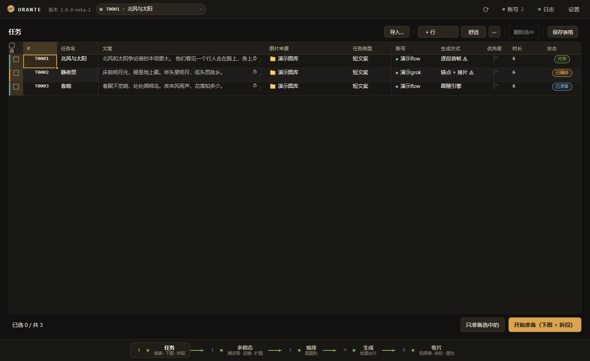
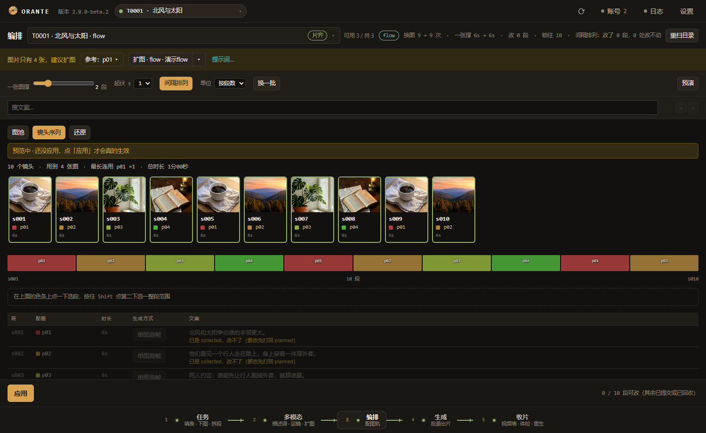
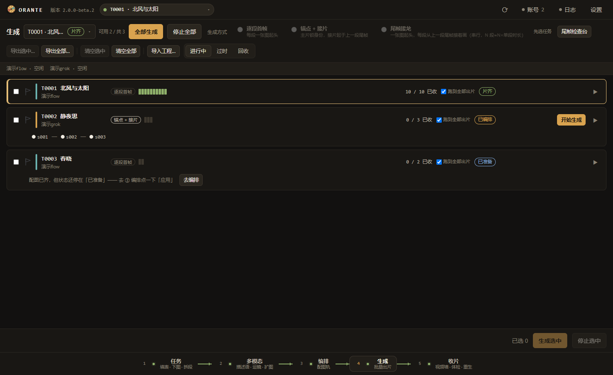

# Orante 2.0 使用说明

把素材变成视频。五个面板按顺序走：任务 → 多模态 → 编排 → 生成 → 收片。
文案可以留空：没有文案时按「一图一段」走简单任务（准备后自动排好配图，②③ 可跳过），描述语就是整段提示词。

---

## 1. 开始之前

只要这三条：

1. **Windows 10 或 11**
2. **Python 3.10 或更高**（安装时勾上 **Add to PATH**）
3. **Google Chrome**（本机已经装的那个就行）

**不需要**再下载 Playwright 自带的浏览器，也不会在第一次启动时拉 300 MB 的 Chromium。Orante 只是把本机 Chrome 拉起来，用调试端口接上去。

请把 zip **解压到纯英文路径**，比如 `D:\Orante`。路径里有中文，`.venv` 和 bat 都可能出岔子。

如果解压时杀毒软件报毒、或者文件直接消失了，先看第 9 节。

---

## 2. 第一次启动

1. 双击 `Orante2.bat`。
2. 第一次会自己建 `.venv` 并联网装依赖，大约两三分钟，只有这一次。
3. 窗口起来后会弹出向导，四步：
   1. **环境自检**（Python / Chrome / 端口 / 工作区 / 依赖），不过的项后面有一句人话怎么办。
   2. **工作区**：成片输出目录，默认 `Orante\workspace`。生成好的视频、图片、manifest 都会按 `日期\版本\任务` 放在这里。
   3. **账号**：加 Flow 或 Grok 账号 →「打开浏览器登录」→ 在弹出的 Chrome 里登一次 →「我登好了，检测一下」。Flow 还要填项目地址（在 Flow 里新建项目，把地址栏那一串贴过来）。至少 1 个账号就绪才能下一步。
   4. **多模态 Key**（可跳过）：Gemini API Key，去 [aistudio.google.com](https://aistudio.google.com) 免费申请。不填的话，②多模态 的自动描述语用不了，只能自己手写。

换过机器、手里有一份 `.orpreset` 预设文件的，向导第一步选「我有一份预设文件」即可，不必再填。

第一次跑完，桌面和开始菜单上就会出现带图标的 **Orante**，以后从那里启动，没有黑窗口。想钉到任务栏：先正常启动，右键任务栏上的 Orante 图标 → 固定到任务栏。快捷方式不小心删了，双击 `tools\创建快捷方式.bat` 可以重建。如果这个脚本提示 `Not installed yet`，说明还没装好依赖，请先双击 `Orante2.bat` 跑一次。

设置抽屉里随时可以点「重新运行向导」。

---

## 3. 五个面板各干什么

### ① 任务

建任务、贴文案（可留空）、选图、选账号。一行一个任务。准备好了点「准备」（下图 + 拆段），这一步做完才能往后走。

- **有文案**：按文案拆段，类型列显示长/短等；后面还要走②描述语、③编排。
- **不填文案**：类型列显示 `—`（提示「没有文案，一图一段」）。准备后会按主体图一图一段自动拆好，并自动排进配图轨，状态直接到「已编排」。节点栏上②多模态 / ③编排会标「可跳过」。
- 若一批旧任务想把文案挪进每张图的描述语：在任务表选中行 → 右键「把文案改成描述语…」→ 确认。只会处理你勾选并确认的任务；已有成片的会跳过，**不会**自动扫全库。

### ② 多模态

给每张图写描述语（人物是谁、在做什么、现场什么样）。填了 Gemini Key 可以自动写，也可以自己改。描述语带在软件里，设置 → 提示词里能看到、能改。

**没有文案的任务**：描述语就是全部提示词，出片前每张主体图都必须有描述语；缺的话④生成会拦住，并提示「描述语就是全部提示词」。开关里的「静音提示」只在这种无文案路径生效（画面不说话、嘴唇闭合那句）。

### ③ 编排

把图排到每一段上，生成配图轨。可以微调、钉死某张图、补空镜。

- **没有文案**：准备时已经自动排好，面板顶部有灰条说明「这个任务只有一种配图方式，已经自动排好了。不用在这里做什么。」。一般不用再动；节点会标「可跳过」。
- **有文案**（哪怕只有一张主体图）：和以前一样要自己编排。图不够时仍会看到黄色提示（例如「图片只有 N 张，建议扩图」），不会因为单图就自动跳过。

### ④ 生成

提交给 Flow 或 Grok 出片。看进度、失败重试、额度提示都在这里。

- 配图轨显示过期、但每一段都已经有图时，可以点「直接用现在的配图生成」（对所有任务都适用）。
- 没有文案又缺描述语时会拦截，需先回②补齐。

### ⑤ 收片

视频墙：看片、体检、重生某一段。过完这一关，成片在工作区对应任务目录里。

---

## 3.5 简单任务：不填文案

适合「只有图、没有口播稿」的批量短片：一图一段，描述语当全部提示词。

**怎么走**

1. ① 任务：文案列留空，选好图和账号，点「准备」。
2. 准备结束后状态到「已编排」——配图已自动按主体图排好。
3. ② 多模态：给每张主体图写好描述语（可自动可手改）。这一步对无文案任务**不能省**。
4. ③ 编排：通常可跳过；顶栏灰条只是说明已经排好。
5. ④ 生成 → ⑤ 收片：照常。

**和「有文案 + 只有一张图」的区别**

有文案的任务——哪怕主体图只有一张——**不会**自动跳过编排，黄条扩图建议也还在。
只有「文案为空」才算简单任务。

**把旧文案改成描述语**

任务表多选 → 右键「把文案改成描述语…」→ 确认。文案会清空并写入每张主体图的描述语，再按一图一段重拆。已有成片的任务会跳过。

---

## 3.6 模板套装：一键换风格

顶栏右上角 **● 套装名 ▾** 显示你当前在哪一套里工作。一个套装打包：提示词、扩图覆盖库、换图卡片、生成参数、账号选用（不含登录态）。

**正确用法**：先「+ 新建套装…」并切换进去，再改提示词 / 卡片；不要先改默认套装再想着打包。

- **切换**：面板里点另一张卡的「切换」。可开设置项「切换套装时自动保存当前改动」。正在生成时也可以切；多个窗口可以各自用不同套装。同一账号仍然不会同时跑两个生成，换一个账号即可并行。
- **新建**：内容可从当前套装 / 别的套装 / 出厂默认复制。
- **⋯ 菜单**：重命名、改色、复制、另存、导出 `.orpreset`、删除（出厂套装不能删，可恢复出厂内容）。
- **和「设置 → 预设」的区别**：预设加密包是整机备份（可含登录态）；套装是日常换风格的工作区。

## 3.7 多开窗口

可同时开多个 Orante 窗口；同一账号同一时刻仍只能跑一个生成。普通图标聚焦已有窗口；需要新窗口用「Orante（新窗口）」快捷方式或顶栏「＋ 新窗口」。

## 4. 加 / 换账号

顶栏「账号」打开抽屉。＋添加 Flow 或 Grok，取个自己认得的名字。Flow 填项目地址，点「登录 / 打开」，在弹出的 Chrome 里登一次。以后这个账号就用这一份登录态，不用每次重登。

换账号：同一个抽屉里改任务用的账号，或再加一个。

端口不用填，软件自己分配。

---

## 5. 改描述语

设置 → 提示词。六块（描述语 / 运镜 / 收尾 / 问题句 / 扩图 / 补位）都能改。改坏了可以单块恢复默认。向导不会重置它们。

---

## 6. 导出预设备份

日常换风格请用顶栏「模板套装」（见 3.6）。这里的预设是整机加密备份。

设置 → 预设 →「导出预设…」。账号、Key、提示词、各种参数打成一个加密的 `.orpreset`。换机后向导里选「我有一份预设文件」导回来。这个文件请当成密码一样保管。

---

## 7. 出问题怎么办

| 现象 | 怎么办 |
|---|---|
| 窗口空白 / 起不来 | 双击 `tools\13-Orante-Debug.bat`，把 `data\logs\orante-debug.txt` 发来 |
| 找不到 Chrome | 设置环境变量 `ORANTE_CHROME` 为 `chrome.exe` 的完整路径 |
| 端口被占 | 设置里改 `ui.port`（默认 9400），或关掉已经开着的 Orante |
| 向导说依赖没装齐 | 关掉，再双击一次 `Orante2.bat`，它会自己装 |

---

## 8. 额度（一句话）

**默认只用免费、不扣额度的模型。** 要用会扣额度的，去设置里把 `flow.allow_paid` 打开，后果自负。

---

## 9. 杀毒软件报毒 / 文件被删

这个包里**没有任何可执行程序**，全是纯文本：`.py`、`.js`、`.json`、`.bat`、`.md` 和几张 `.png`。
本包不含任何 `.exe`；快捷方式是在你自己机器上生成的，不是传过来的。
你可以用记事本打开任意一个看，里面是什么一目了然。

即便如此，少数杀毒软件仍可能拦 `Orante2.bat`，因为它做了两件「看起来可疑」的事：建一个 Python 虚拟环境，然后联网 `pip install` 依赖。这是**误报**（false positive），不是病毒。

**装完之后还有两样会被报，这两样是 pip 自己装出来的，改不掉：**

| 文件 | 它为什么在那儿 | 为什么被盯上 |
|---|---|---|
| `.venv\Scripts\python.exe`、`pythonw.exe` | 建虚拟环境时 Windows 会**复制**一份 Python 解释器过去 | 你的用户目录里多了个「没见过的」程序文件 |
| `.venv\Lib\site-packages\playwright\driver\node.exe` | playwright 自带的驱动 | 同上，而且它会开子进程、连本地端口 |

这两个都是官方发布的正规程序（python.org 和 Microsoft 的 playwright），只是被复制到了你的用户目录、没有「信誉记录」，启发式引擎就爱管闲事。

顺带澄清一句常被误会的事：**Orante 从不下载任何浏览器**，它连的是你自己电脑上已经装好的 Chrome（调试端口）。代码里没有一处下载浏览器的调用。

怎么办：

1. **先别急着「恢复」。** 打开杀毒软件的隔离区 / 病毒查杀记录，看它报的是**哪个文件、什么名字**，截图发给我。名字里带 `!ml`、`Heur`、`AdvML`、`Gen:Variant`、`suspicious`、`susgen` 这些字样的，基本都是启发式误报。
2. 确认是误报后，把解压目录（比如 `D:\Orante`）加进杀毒软件的**信任区 / 排除目录**，再重新解压一次。**先加排除，再解压安装**，顺序反了装到一半又会被咬。
   - Windows 安全中心：病毒和威胁防护 → 管理设置 → 排除项 → 添加文件夹
   - 360 / 火绒 / 腾讯电脑管家：在「信任区」里添加这个文件夹
3. 如果杀的是整个压缩包、连解压都不让，让发包的人换个方式传（网盘直链、或者改成 `.zip` 以外的后缀让你手动改回来）。

**不要**为此关掉杀毒软件。加一个目录排除就够了。

如果你不确定，可以把被报的文件传到 [virustotal.com](https://www.virustotal.com) 看看：70 多个引擎里只有零星几个报、而且报的是上面那些启发式名字，就是误报；大面积报毒才需要停下来找发包的人。
