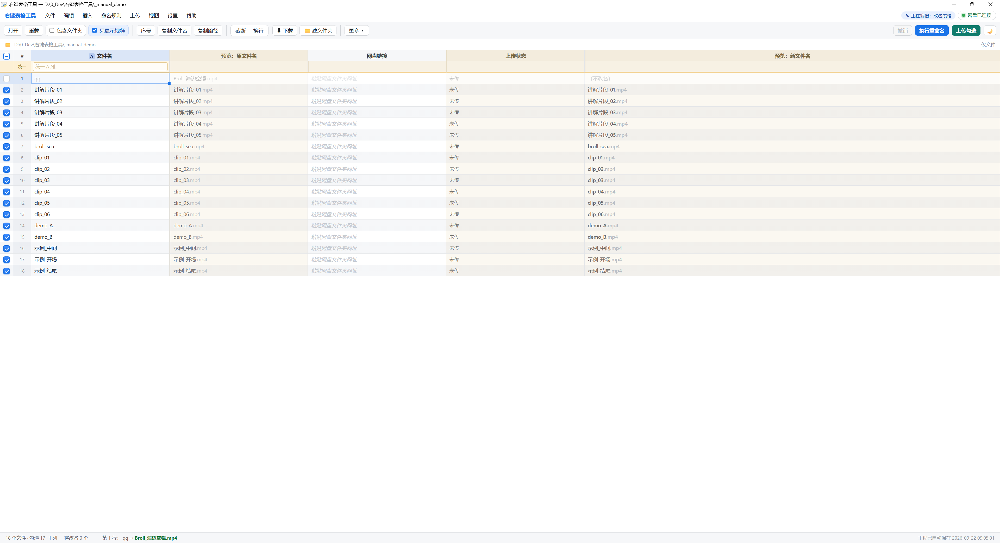
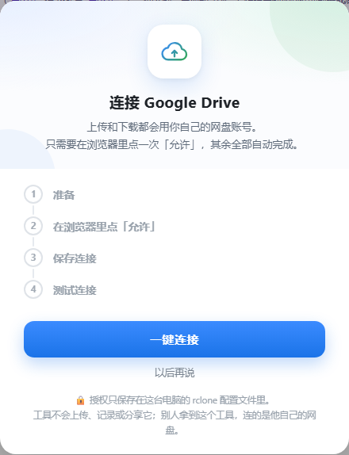
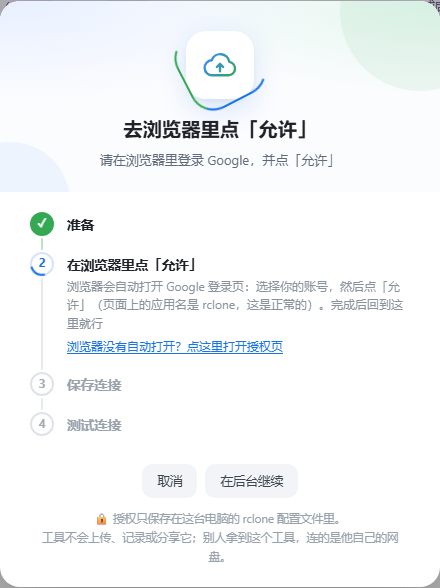
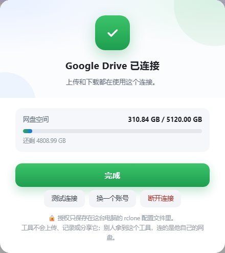
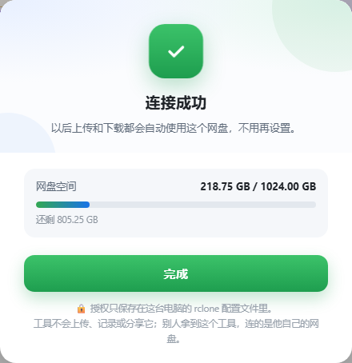
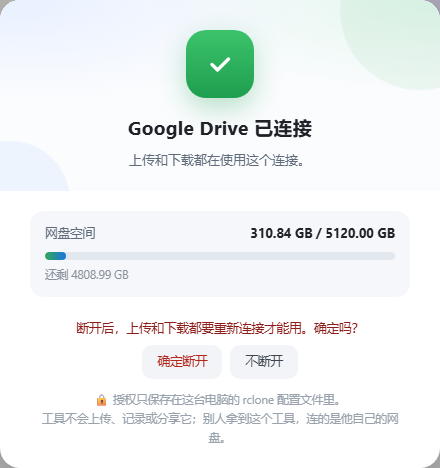
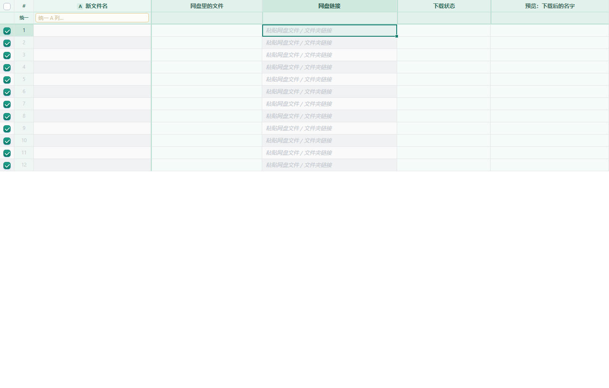
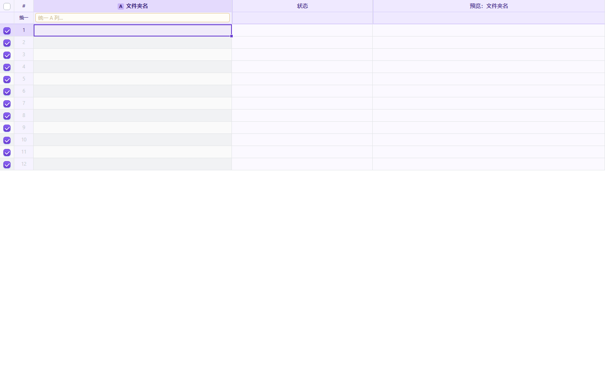

# 右键表格工具 · 使用说明

在文件夹空白处点右键，用表格批量重命名视频、粘贴网盘链接并上传。
改名会自动保存工程文件，文件名改错了可以一键还原。

上传、从网盘下载之前，需要先在工具里**连接你自己的 Google 账号**（一次性授权，见下文）。

---

## 目录

1. [安装](#安装给别人用也是这一步)
2. [主界面](#主界面)
3. [日常用法（改名 / 上传）](#日常用法改名--上传)
4. [连接 Google 账号（授权）](#连接-google-账号授权)
5. [网盘下载](#网盘下载)
6. [批量新建文件夹](#批量新建文件夹)
7. [卸载](#卸载)

---

## 安装（给别人用也是这一步）

1. 电脑需要 **Python 3.10 或更高**（https://www.python.org/downloads/ ，勾选 *Add python.exe to PATH*）
2. 把整个「右键表格工具」文件夹拷给对方（不要拆开）
3. 双击 **安装.bat**
4. 打开任意文件夹，在空白处点右键 → **右键表格工具**

不需要管理员权限。程序装在 `%LOCALAPPDATA%\RightClickTableTool`。

---

## 主界面

右键打开后，中间是改名表格：左边各列从左到右拼成新文件名，右边是原名 / 新名预览，以及网盘链接、上传状态。

顶部常见按钮：

| 位置 | 作用 |
|------|------|
| **打开 / 重载** | 换文件夹，或重新扫描当前目录 |
| **包含文件夹** | 子文件夹也进表（上传仍然只传文件） |
| **⬇ 下载** | 打开 / 收起网盘下载面板（`Ctrl+Shift+D`） |
| **📁 建文件夹** | 打开 / 收起批量建文件夹面板（`Ctrl+Shift+N`） |
| 右上角 **连接网盘 / 网盘已连接** | 连接、查看或更换 Google 账号 |

菜单里 **设置 → Google Drive 网盘连接** 和右上角按钮是同一件事。

---

## 日常用法（改名 / 上传）

- **勾选**：只有勾选的行会改名 / 填序号 / 上传。列顶复选框全选；按住拖可以连续勾选。
- **改名**：左边编辑列从左到右拼成新文件名。`Ctrl+Enter` 执行。
- **长文件名**：打开时列宽是固定的，超出部分截断。悬停看全文，双击进入编辑。
  - 工具栏 **截断 / 换行**：对选中单元格切换
  - **全部截断 / 全部换行**：一键整张表
  - 拖列边缘可以拉宽
- **网盘链接**：在该行「网盘链接」列填入（或粘贴）要传到的文件夹网址。上传只认本表这一行的文件和链接。
  - 直接从 Google Sheet 复制带超链接的单元格粘贴过来，工具会自动解析出网址。
- **上传**：勾选并填了链接后点「上传勾选」。对应关系和结果写在「上传状态」列及工程文件里。用本机已配置的 rclone `gdrive` 远程。
- **工程文件**：每次改名自动写隐藏文件 `.renamer_project.json`。可导出 / 导入；视频挪位置后指定新文件夹即可还原原名。
- **复制**：`Ctrl+Shift+C` 文件名，`Ctrl+Shift+P` 完整路径。
- **换文件夹**：去资源管理器打开目标文件夹，再切回本窗口，顶部蓝条一点即可跳转。

> 还没连接 Google 账号就点上传时，会自动弹出连接窗口；连好后再点「继续上传」即可。

---

## 批量添加 / 修改文件后缀名

别人上传到网盘的文件有时候没带后缀，下载下来就是光秃秃的 `a022`，一个个手改很麻烦。
**命名规则 → 🏷 批量设置扩展名…**（视图菜单里也有，显示当前模式）。

这个功能**只改后缀，文件名部分一个字都不动**。三种模式：

| 模式 | 效果 |
| --- | --- |
| **沿用原来的扩展名** | 默认。`a022.mp4` 改名后还是 `.mp4`，本来没后缀的还是没有 |
| **统一用这个后缀** | 填 `.mp4`（不填点也行，会自动补）。勾上「只补给本来没有后缀的文件」就只补缺，不动已有后缀的；取消勾选则全部换成这个后缀 |
| **去掉扩展名** | 新文件名里不带任何后缀 |

弹窗底部实时显示「勾选的 N 个文件里，M 个的后缀会变」，并列出前几条对照，确认无误再点「应用」。
应用后先看「预览：新文件名」列，没问题再点「执行重命名」。

**下载表里也能用**：在下载面板设成「统一用 .mp4」，下载下来的文件直接就带后缀，不用事后再改一遍。

**作用于哪张表**：弹窗顶部有「作用于：✎ 改名表 / ⬇ 下载表」，各显示勾选了几个文件，点哪个就改哪张表，两张表的设置互不影响。默认选你正在编辑的那张；如果那张一个勾选都没有、另一张有，会自动帮你选另一张。

**已经下载好的文件**：在下载表里应用后，如果有勾选的行已经下载到磁盘、名字还没后缀，会再问一句「已下载的文件也补上后缀？」，点确认就直接在下载文件夹里把它们改好（只改后缀；新名字已被别的文件占用时整批不改，不会覆盖）。

**只显示视频**：没有后缀的文件认不出类型，现在不会再被这个开关藏起来。

> 改名表和下载表各自记各自的设置，都会存进工程文件，下次打开还在。

---

## 连接 Google 账号（授权）

上传、网盘下载都要用你自己的 Google Drive。授权是**一次性**的：在浏览器里登录并点「允许」，其余由工具自动完成。

### 从哪里打开

- 点菜单栏右上角的 **「连接网盘」**（已连接时显示 **「网盘已连接」**）
- 或：**设置 → Google Drive 网盘连接**
- 也可以在点「上传」或「下载」时，若尚未连接，会自动弹出

### 第一次连接

弹出窗口标题类似 **「连接 Google Drive」**，说明只需在浏览器点一次「允许」。

下方有四步预览：

1. **准备** — 检查这台电脑上的 rclone  
2. **在浏览器里点「允许」** — 自动打开 Google 登录页，选账号后点「允许」（页面上的应用名是 **rclone**，这是正常的）  
3. **保存连接** — 自动写好 `gdrive` 配置，不用你填任何东西  
4. **测试连接** — 读一次网盘空间，确认真的能用  

点 **「一键连接」** 开始；也可以 **「以后再说」**。

### 在浏览器里授权

点「一键连接」后，工具会进入「正在连接… / 去浏览器里点「允许」」状态，并自动打开 Google 登录页。

- 选择你的 Google 账号  
- 在权限页点 **「允许」**（应用名显示为 rclone）  
- 完成后回到本工具窗口即可  

若浏览器没有自动打开，可点窗口里的 **「浏览器没有自动打开？点这里打开授权页」**。  
连接过程中可以 **取消**，或选 **在后台继续**（连上后会提示）。

### 连接成功 / 已连接

成功后会提示 **「连接成功」**，并显示网盘空间；之后上传和下载都会自动用这个连接。

再次点右上角 **「网盘已连接」**，可看到当前连接状态，例如：

- **测试连接** — 再读一次网盘，确认还能用  
- **换一个账号** — 断开后重新走一遍授权（可选同一个账号）  
- **断开连接** — 清除本机上的连接；之后上传/下载需重新授权  

### 断开连接

点「断开连接」后会再确认一次（断开后上传和下载都要重新连接才能用）。确认后回到「一键连接」界面。

### 授权保存在哪里（安全说明）

窗口底部会提示：

> 授权只保存在这台电脑的 rclone 配置文件里。  
> 工具不会上传、记录或分享它；别人拿到这个工具，连的是他自己的网盘。

把工具发给同事时，对方需要用**自己的** Google 账号再连一次，不会继承你的授权。

### 找不到 rclone 时

若提示还差 rclone 小组件：请重新双击工具文件夹里的 **安装.bat**，装完再打开连接窗口点「一键连接」。

---

## 网盘下载

点工具条 **「⬇ 下载」**（或 `Ctrl+Shift+D`）展开下载表，可拖中间分隔条调高度。

要点：

- 下载表和上面的改名表是**同一套表格操作**（插入/删除行列、填充编号、命名规则、撤销重做等）。菜单栏会标明当前正在编辑哪张表。
- 把网盘链接贴到 **「网盘链接」** 列：文件链接、文件夹链接都行；可从 Google Sheet 整列复制。文件夹会展开成里面的每个文件。
- 左边各列拼成 **下载后的名字**；一行全空则用网盘原名。
- 点 **「开始下载」**（下载表里也可 `Ctrl+Enter`）。本地重名自动加 `(2)(3)`，失败自动重试；每批写一份下载日志。
- 下载同样走本机 rclone 的 `gdrive`，所以私有文件夹也能下。未连接时会先弹出授权窗口。

---

## 批量新建文件夹

点工具条 **「📁 建文件夹」**（或 `Ctrl+Shift+N`，或 文件 → 批量新建文件夹）。与「网盘下载」共用窗口下半部分，可用左上角标签切换。

要点：

- **每一行 = 一个文件夹。** 左边列拼成文件夹名，右边实时预览。
- 「建在」默认当前文件夹，点路径可换位置。
- 点 **创建文件夹**（或 `Ctrl+Enter`）。已存在的会跳过；非法名字会提前标出。
- **撤销刚才的创建** 只删仍然为空的文件夹。每次创建会记入「新建文件夹日志.txt」。

---

## 卸载

双击 **卸载.bat**。只删程序和右键菜单，不动你的视频和工程文件。

---

## 快捷键速查

| 快捷键 | 作用 |
|--------|------|
| `Ctrl+Enter` | 执行当前表的改名 / 下载 / 建文件夹 |
| `Ctrl+Shift+D` | 打开或收起网盘下载 |
| `Ctrl+Shift+N` | 打开或收起建文件夹 |
| `Ctrl+Shift+C` | 复制文件名 |
| `Ctrl+Shift+P` | 复制完整路径 |

---

*界面截图来自本机实际运行窗口（含授权弹窗）。若你使用的版本按钮文案略有出入，以窗口里显示的为准。*
